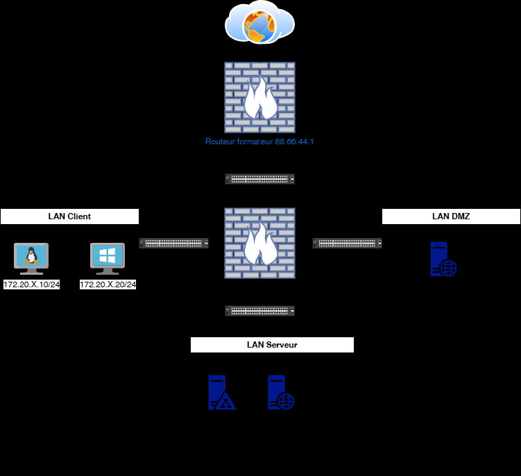
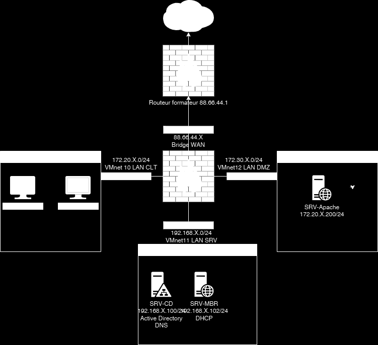

# Énoncé — TP4 — Services hébergés dans une DMZ


Services hébergés dans
une DMZ
TD

 Avant de démarrer ce TP, il convient d’avoir fait le TP2.

            Durée estimée

              1 heures

Énoncé

Objectifs:

Gestion de la DMZ.





Texte visible sur la capture :

```text
Routeur formafeur 88.66.44.1
VMnet 10 LAN CLT
VMnet12 LAN DMZ
VMnet11 LAN SRV
```

Installation du serveur WEB
Récupérer le bunble SRV-Apache.ova

       Le mot de passe de root est P@ssw0rd

        Attribuer lui, l’adresse IP ainsi que sa passerelle définis sur le schema.
        Connectez-le sur le VMnet 12.
        Modifier les fichiers /etc/hosts et /etc/resolv.conf avec les informations de votre
infrastructure.

       Faites son enregistrement DNS sur votre serveur SRV-CD

Sur le SRV-DC

       Exécuter le script D:/scripts/Script-TP3-AddDnsZone.ps1 et entrer la nouvelle adresse
IP du SRV-Apache
       Tester l’URL https://extra.votrenom.eni

Sur du routeur Pfsense

       Faites un alias URLs pour extra.votrenom.eni

Et ensuite une redirection NAT depuis le WAN pour accèder on site WEB A voir si fessable
       Attention aux règles de pare-feu

Depuis votre machine hôte

       Tester l’accès au serveur WEB avec l’ip de votre WAN

Client Windows

       Tester l’accès au serveur WEB avec le FQDN

Solution
Une solution est proposée pour ce TP sous la forme d'un PDF commenté, disponible dans les
ressources à télécharger.
