# Correction — TP5 — SÉCURISER LE SURF INTERNET


Le domaine bloqué dans l’ACL de la correction est un nom de fournisseur qu’on ne publie pas. Il est remplacé par « un domaine imposé par la correction (exemple : site-interdit.example) » et masqué sur les captures.


SÉCURISER LE SURF INTERNET
TD5 Module 1

 Avant de démarrer ce TP, d’avoir réalisé les TP précédents. Il convient aux CEL d’avoir
 regardé sur la bibliothèque  les vidéos « pfSense - La sécurité avec un pare-feu open
 source” Filtrage Web et Portail captif.

            Durée estimée

              4 heures

Énoncé

Objectifs:

Ce exercice pratique vous permettra de mettre en place un proxy avec filtrage web et
un portail captif sur pfSense, offrant ainsi un contrôle avancé sur le trafic Internet de votre
réseau..

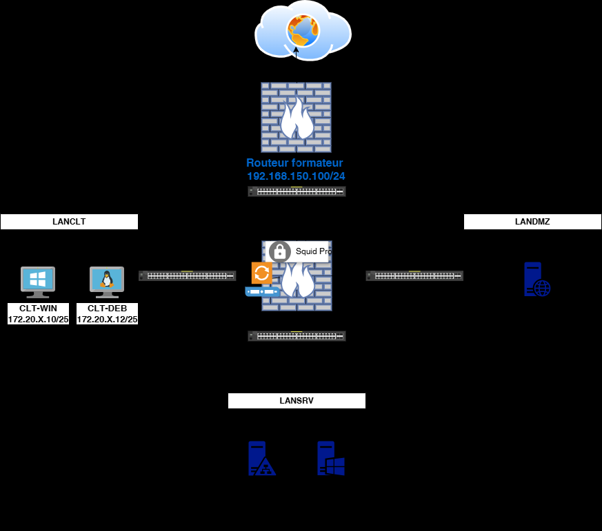

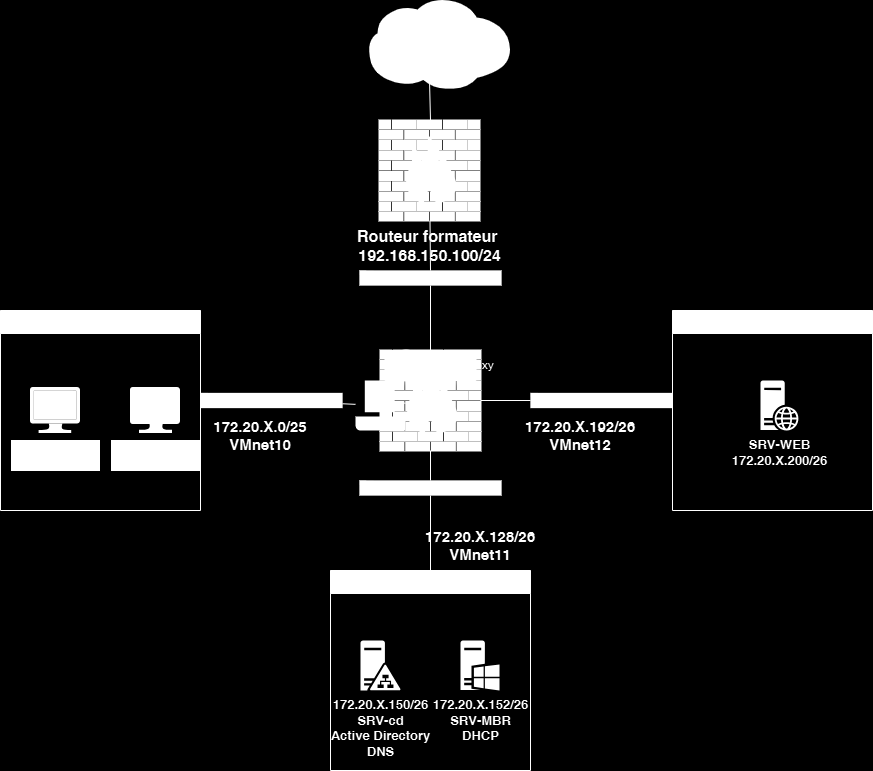

Texte visible sur la capture :

```text
192.168.150.100/24
VMnet10
VMnet12
VMnet11
```

Paramétrage du squid Pfsense
1: Configuration de Squid
         Connectez-vous à l'interface web de pfSense.
         Allez dans Services > Squid Proxy Server
         Onglet "General" :
                  Cochez "Enable Squid Proxy"
                  Sélectionnez l'interface LANCLIENT
                  Port : 3128

        Onglet "Local Cache" :
                 Hard Disk Cache Size : 1024 (ou plus selon vos besoins)
                 Cliquez sur "Save" pour chaque onglet

        Acls Onglet "ACLs" :
                Autoriser votre réseau client et interdire le domaine site-interdit.example

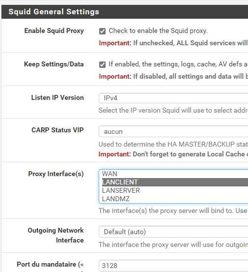

Texte visible sur la capture :

```text
Squid General Settings
Enable Squid Proxy
Check to enable the Squid proxy.
Important: If unchecked, ALL Squid services wi
Select the IP version Squid will use to select addr
```

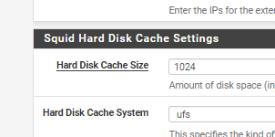

Attention aux règles de pare-feu.
Télécharger le certificat CA-TP5 et l’installer sur vos clients

Ajouter le proxy de votre PFsense sur les postes clients

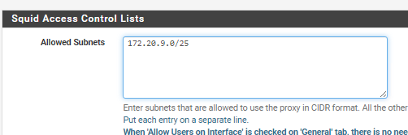

Texte visible sur la capture :

```text
Squid A
Allowed Subnets  [372.20.9.0/25
```

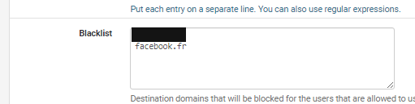

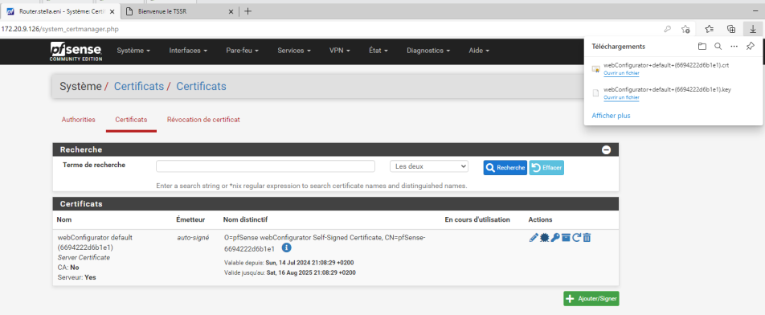

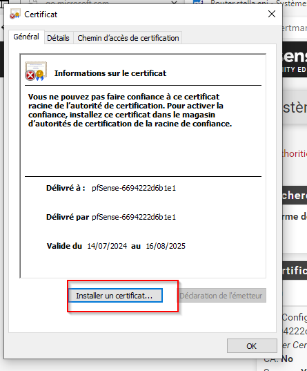

2: Configuration de SquidGuard
         Allez dans Services > Proxy Filter
         Onglet "General settings" :
                  Cochez "Enable"

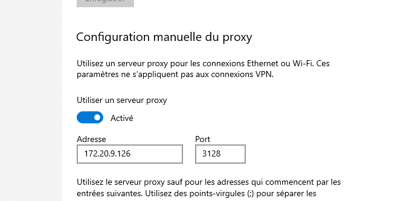

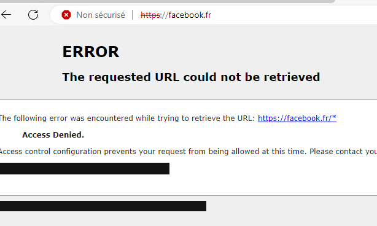

Blacklist : Sélectionnez une liste noire
        Onglet "Common ACL" :
                 Créez une règle pour bloquer les sites pour adultes, gaming,astrology
        Faites votre propre blaklist nommer: MyfirstBlackList

        Ajouter les domaines de votre choix

3: Testez la configuration depuis:
votre client Windows, essayez d'accéder à un site web normal et à un site bloqué

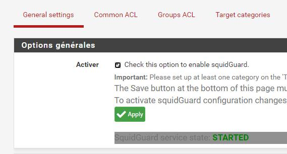

Texte visible sur la capture :

```text
Check this option to enable squidGuard
To activate squidGuard configuration changes
```

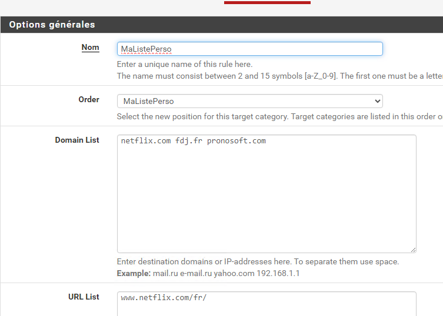

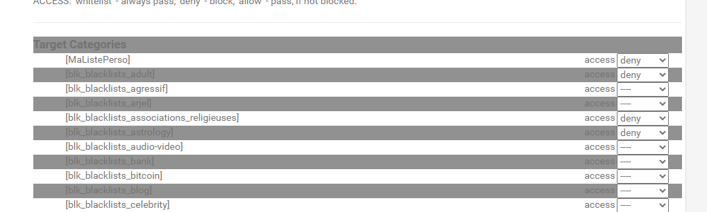

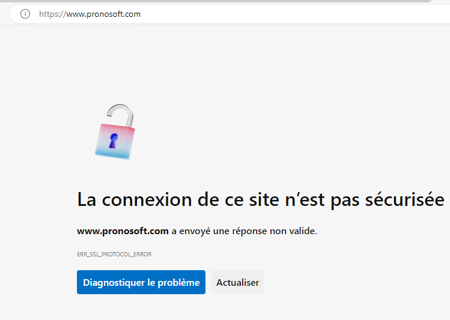

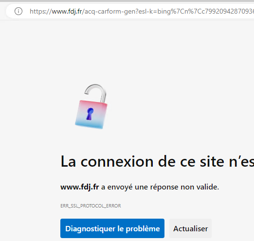

Vérifiez les logs dans Status > Proxy Filter

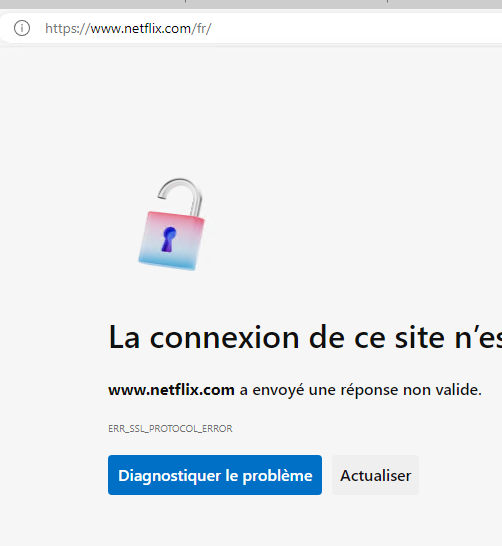

Bonus
Configuration d'un portail captif.
Désactiver squid proxy et mettre en place le portail captive pour vos clients
Faites une procédure et la remettre à votre formateur

Solution
Une solution est proposée pour ce TP sous la forme d'un PDF commenté.

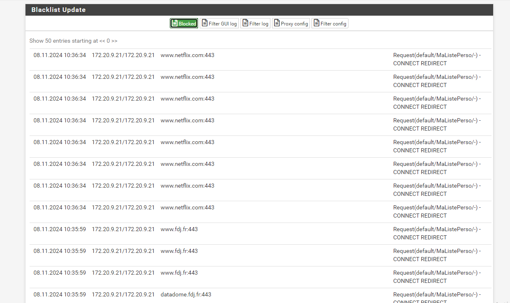

Note : l’énoncé active un proxy transparent sur l’interface LAN, avec un cache de 100. Cette correction utilise l’interface LANCLIENT, un cache de 1024, et n’active pas le mode transparent.
