# Correction — TP6 — La gestion des certificats autosignés


La gestion des certificats
autosignés
TD6 Module 2

 Avant de démarrer ce TP, d’être arrivé au moins au TP4 .

             Durée estimée

               4 heures

Énoncé

Objectifs:

Vous comprendrez le fonctionnement des serveurs web sous Apache et IIS et mettrez en
place des certificats autosignés pour active le HTTPS. La mise en place de certificats
autosignés sur Apache, IIS et pfSense a pour objectif de sécuriser les communications en
chiffrant le trafic entre clients et serveurs.

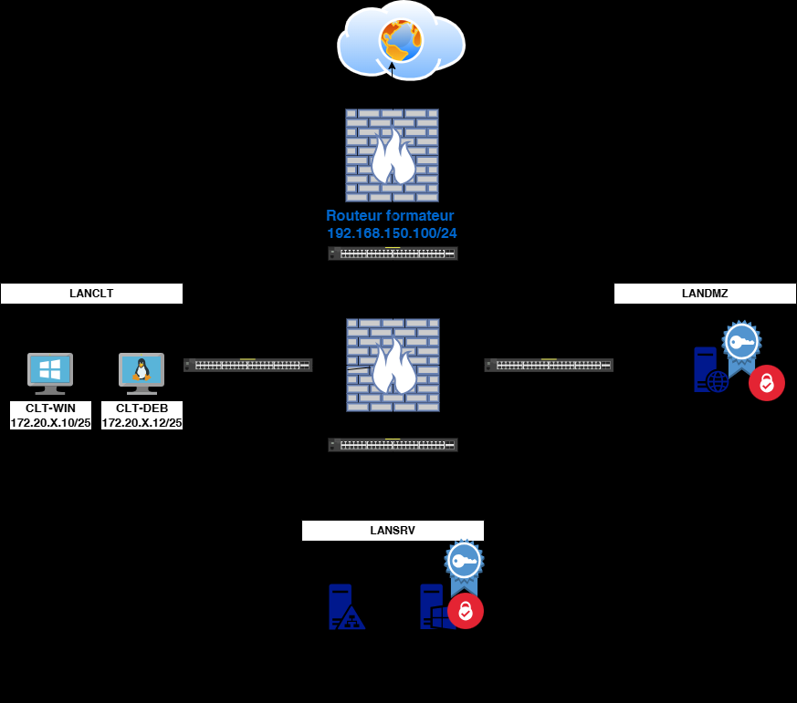

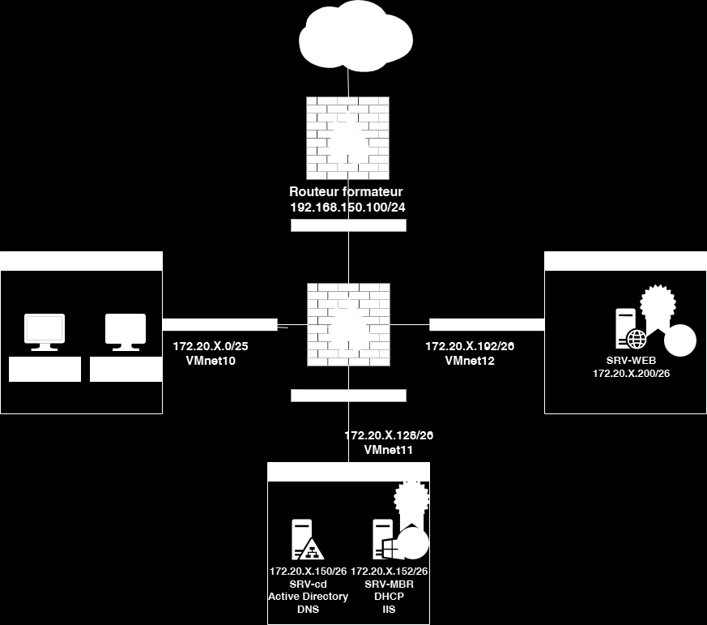

Texte visible sur la capture :

```text
192.168.150.100/24
VMnet10 VMnet12
VMnet11
```

Sur SRV-MBR

Ajout de règles

   •

   •
   •
   •
   •
   •   Ajouter une deuxième IP 172.20.X.153/26 sur l’interface Ethernet0

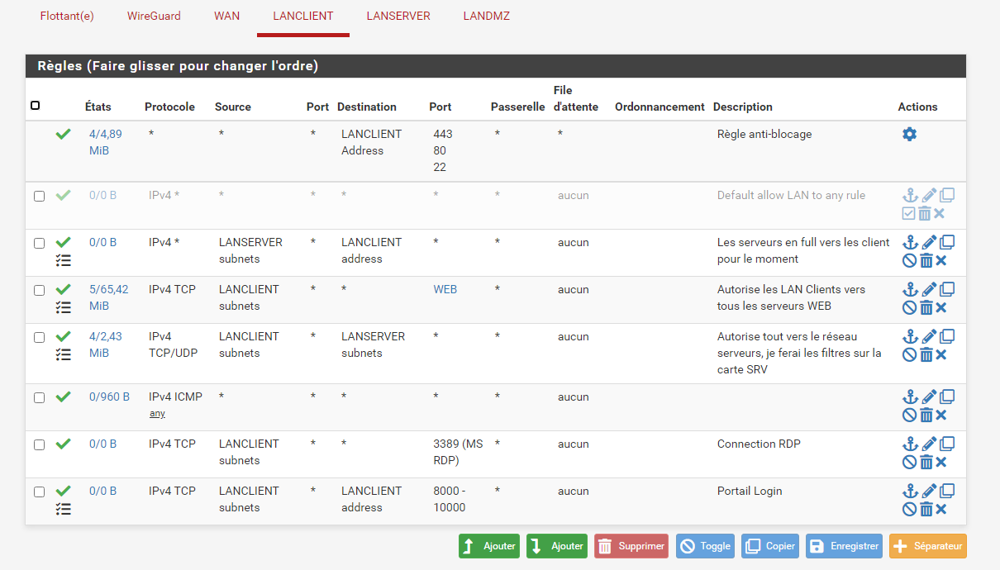

Texte visible sur la capture :

```text
WireGuard
Port Passerelle d'attente Ordonnancement Descri Actions
```

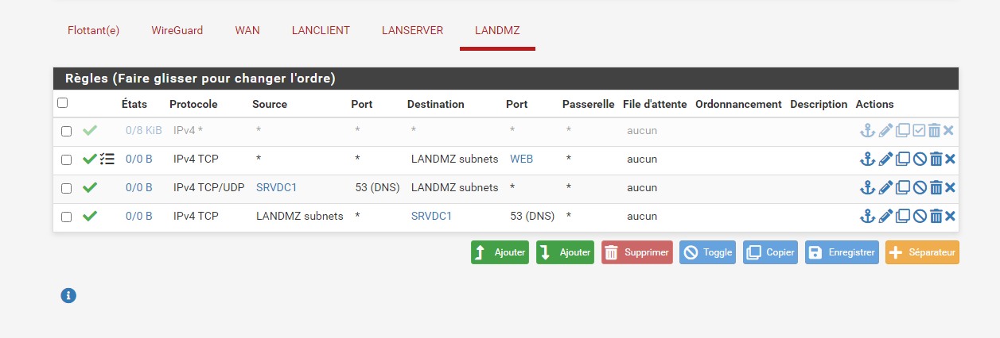

Texte visible sur la capture :

```text
Flottant(e) WireGuard WAN LANCLIENT LANSERVER LANDMZ
oO Etats Protocole Source Port Destination Port Passerelle d'attente Ordonnancement Description Actions
```

•

   •   Installer le rôle IIS

   •   Configurer et publier 2 sites nommés:
             www.votrenom.eni:80

               intranet.votrenom.eni sur l’IP172.20.X.153

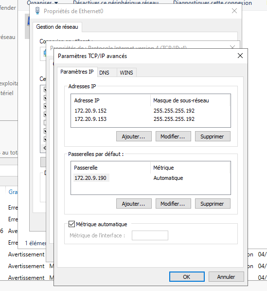

Texte visible sur la capture :

```text
1.208.152 255.255.255.192
_| 1.208.183 255.255.255.192
au tot Passerelles par défaut
q Passerelle Métrique
```

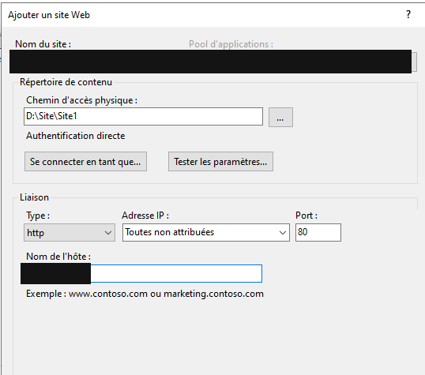

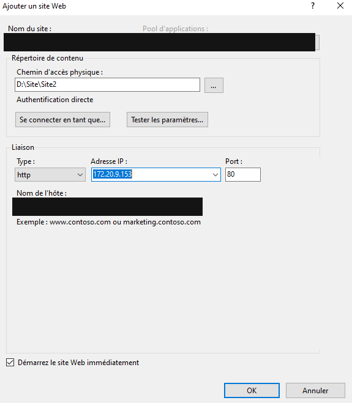

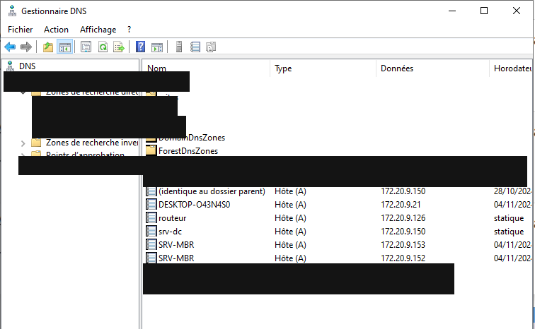

•   Tester l’accès aux différents sites à partir des postes clients

   •   Créer un certificat autosigné pour vos 2 sites

   •   Puis modifier les sites avec le certificat

   •

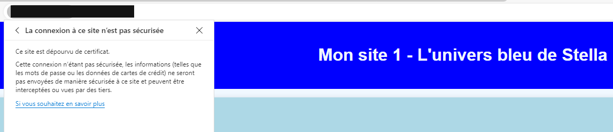

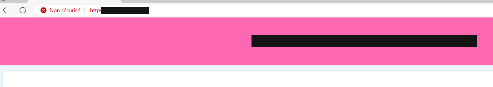

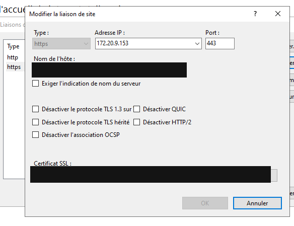

•

   •   Tester le bon fonctionnement depuis les clients

   •

Sur SRV-WEB
   •   Ajouter une IP à l'interface ens33 : 172.20.X.202/26

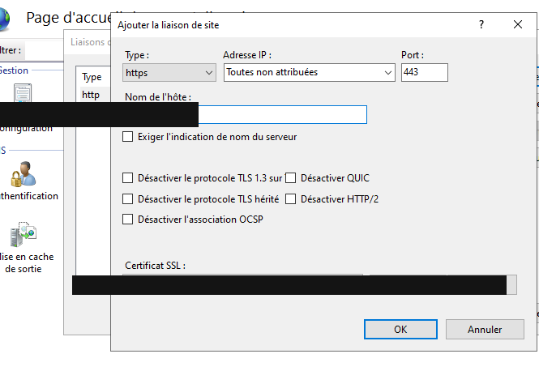

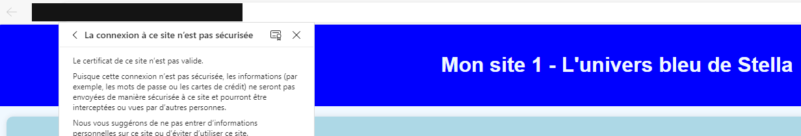

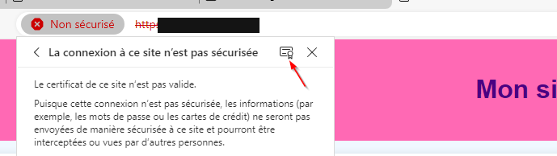

•

   •   Installer le navigateur lynx

   •   Configurer et publier 2 sites WEB nommés :
       intra.votrenom.eni sur n'importe quelle IP
       internet.votrenom.eni sur l'IP 172.20.X.202

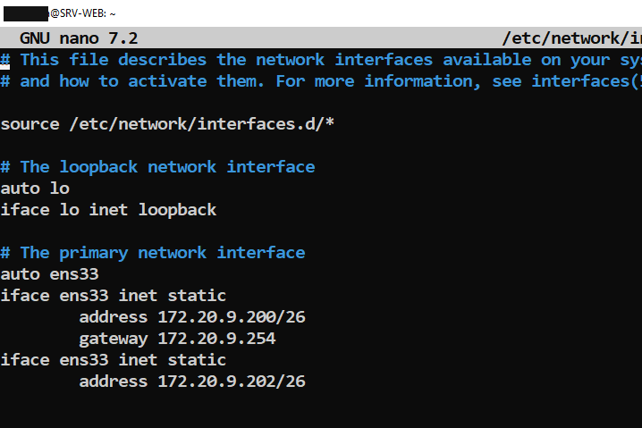

Texte visible sur la capture :

```text
GNU nano 7.2 /etc/network,
source /etc/network/interfaces.d/*
address 172.20.9.200/26
gateway 172.20.9.254
address 172.20.9.202/26
```

•   Tester l'accès aux différents sites à partir de SRV-WEB avec la commande lynx et
       depuis les postes clients dans les navigateurs.

   •   Créer des certificats auto-signés pour vos 2 sites

   •

   •

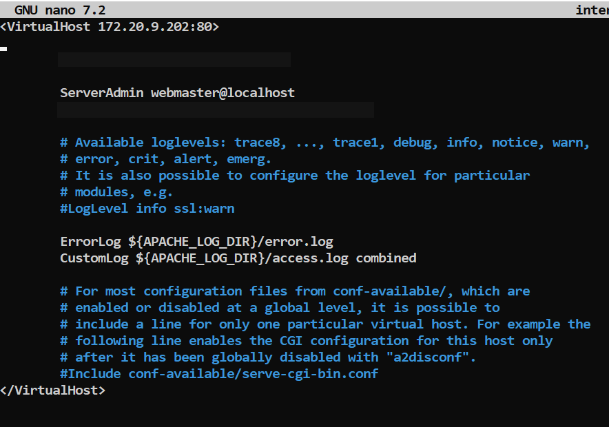


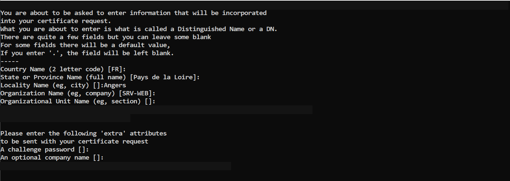

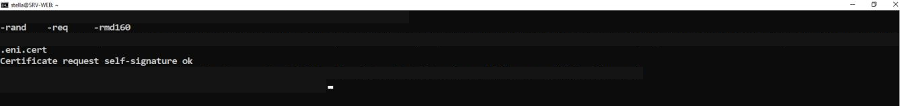

•
   •
   •   Cd ..
   •
   •   Puis modifier les fichiers de configuration des sites avec les certificats

   •   Tester le bon fonctionnement depuis les clients

   •

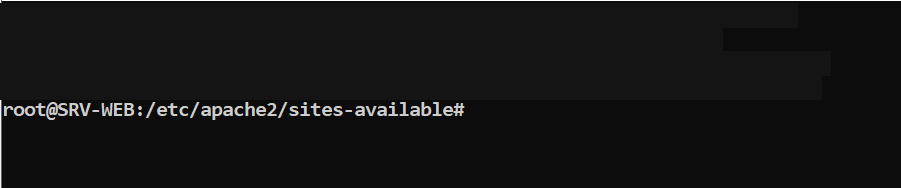

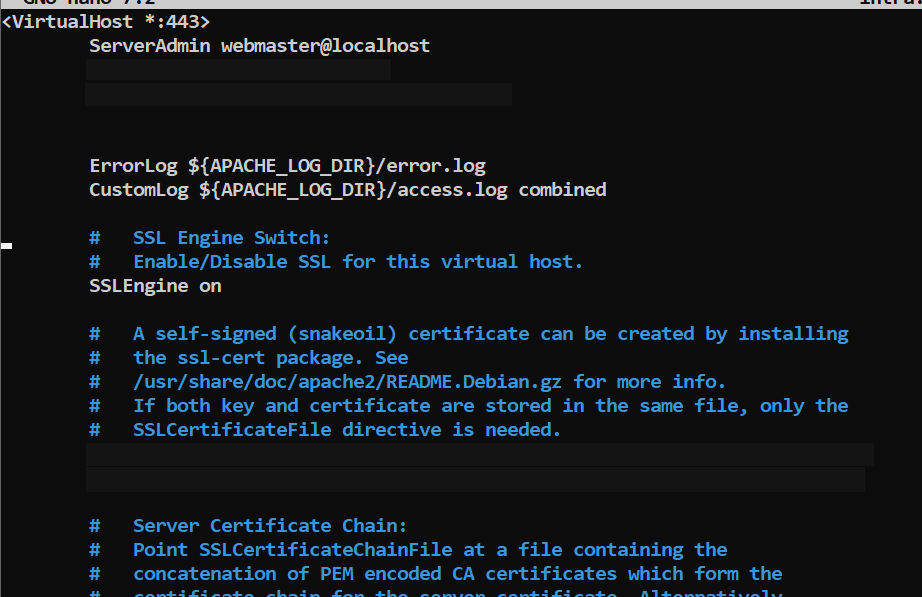

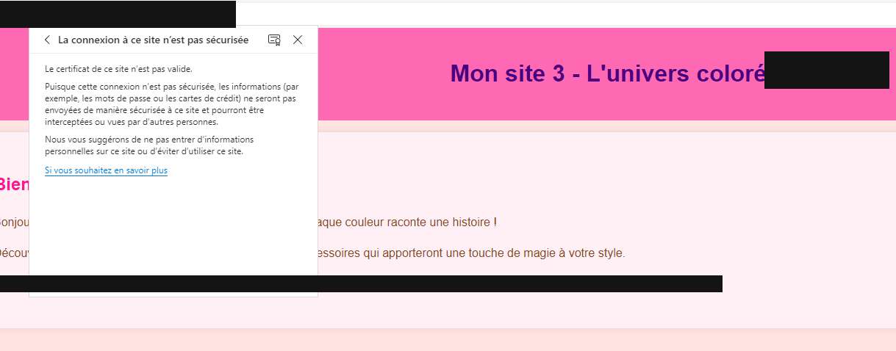

•

Sur le routeur PFsense
   •   Faites en sorte de vous connecter en https avec le certificate adequate en utilisant
       le FQDN routeur.votrenom.eni.

   •

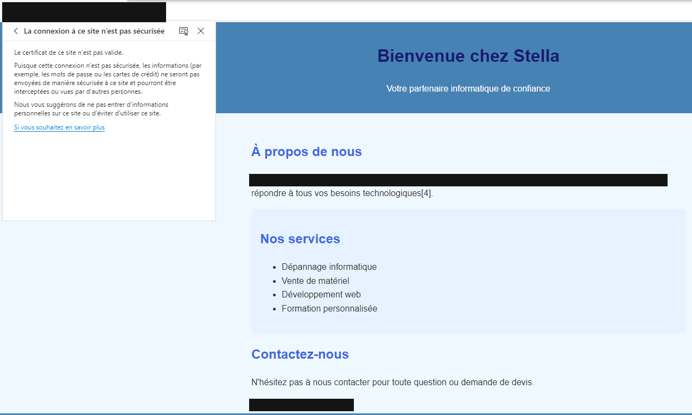

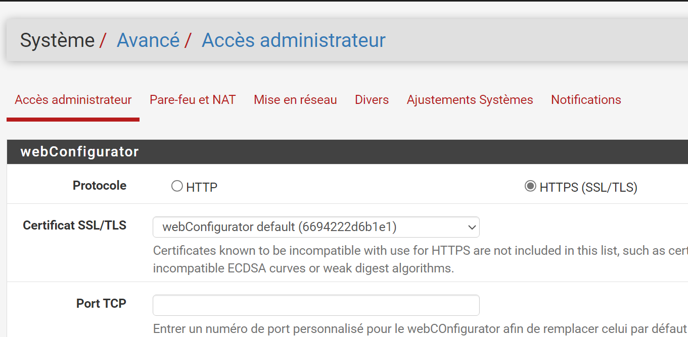

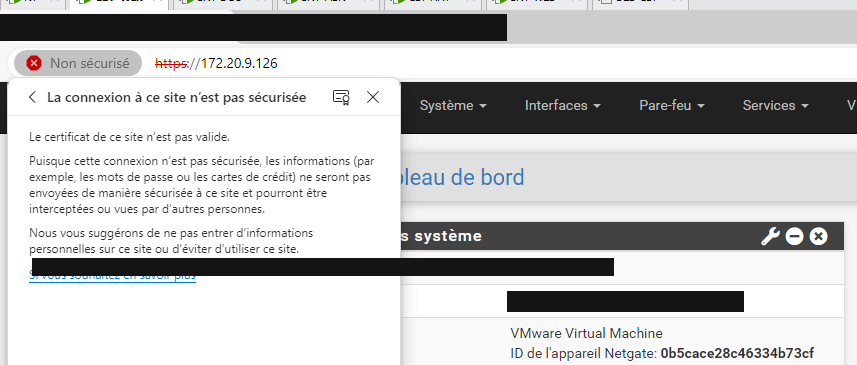

Solution
Une solution est proposée pour ce TP sous la forme d'un PDF commenté.
