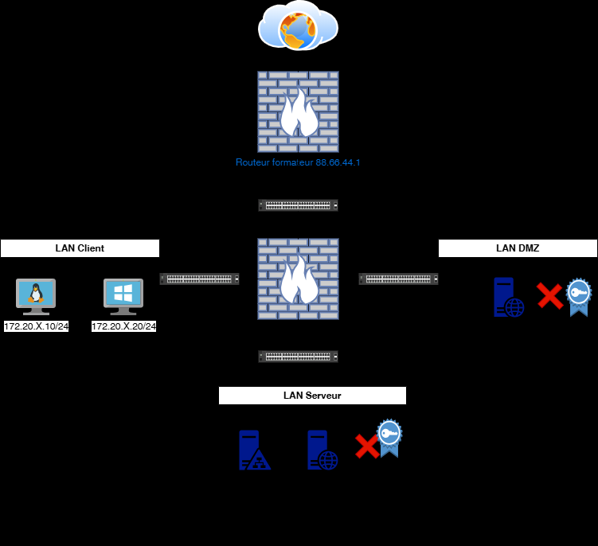
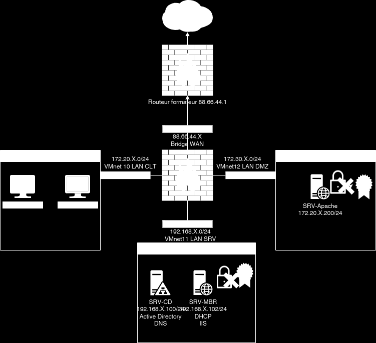

# Énoncé — TP6 — La gestion des certificats autosignés


La gestion des certificats
autosignés
TD5

 Avant de démarrer ce TP, .

            Durée estimée

              4 heures

Énoncé

Objectifs:

Mise en place de certificats autosignés





Texte visible sur la capture :

```text
Routeur formafeur 88.66.44.1
VMnet 10 LAN CLT
VMnet12 LAN DMZ
VMnet11 LAN SRV
```

Sur SRV-MBR
Installer le rôle IIS et créer un certificat autosigné

Faire un enristrement DNS vers intranet.votredomaine.eni

Sur SRV-MBR
Installer le Apache2 et créer un certificat autosigné

Faire un enristrement DNS vers extranet.votredomaine.eni

Sur le routeur PFsense
Activer le https avec le certificat autosigné existant

Faire un enristrement DNS vers routeur.votredomaine.eni

Solution
Une solution est proposée pour ce TP sous la forme d'un PDF commenté, disponible dans les
ressources à télécharger.
