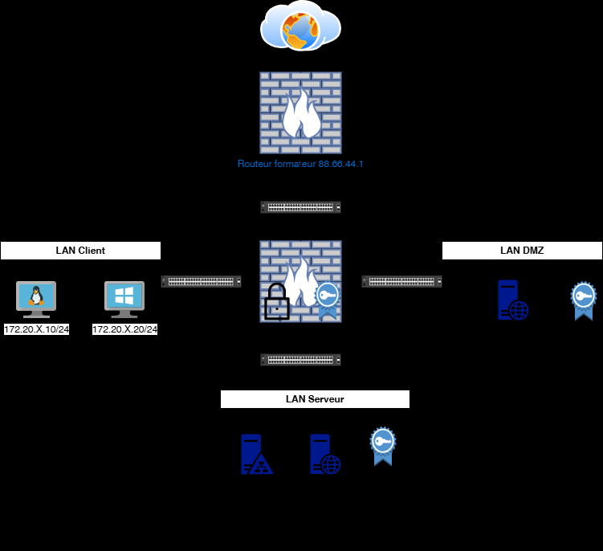
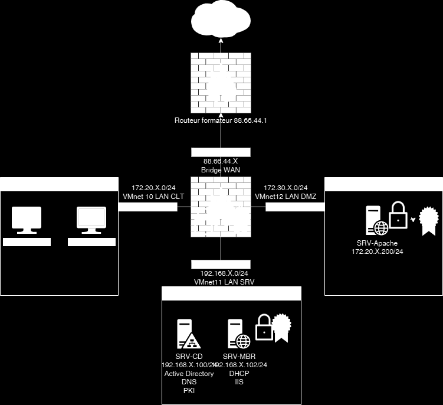

# Énoncé — TP7 — Certificat émanant d'une Private-KI ADCS


Certificat émanant d'une
Private-KI ADCS                                           TD5

 Avant de démarrer ce TP, .

            Durée estimée

              4 heures

Énoncé

Objectifs:

Mise en place





Texte visible sur la capture :

```text
Routeur formafeur 88.66.44.1
VMnet 10 LAN CLT
VMnet12 LAN DMZ
VMnet11 LAN SRV
```

Sur SRV-CD
Exécuter le script D:/InstallationPKI.ps1

Sur SRV-MBR
Utiliser la clé privée du SRV-CD pour sécuriser votre URL intranet.votredomaine.eni

Sur SRV-WEB
Utiliser la clé privée du SRV-CD pour sécuriser votre URL extranet.votredomaine.eni

Sur le routeur PFsense
Utiliser la clé privée de votre formateur http://88.66.44.1 pour sécuriser votre URL
routeur.votredomaine.eni, votre formateur vous indiquera les identifiants.

Solution
Une solution est proposée pour ce TP sous la forme d'un PDF commenté, disponible dans les
ressources à télécharger.
