# Correction — TP8 — Connecter les collaborateurs pour le télétravail

Connecter les
collaborateurs pour le
télétravail
 TD8 du Module 2

 Avant de démarrer ce TP. Il faut avoir fait les précédents

            Durée estimée

              4 heures

Énoncé

Objectifs:

Cette mis en pratique, vous permettra de sécuriser efficacement les connexions à
distance pour le télétravail en utilisant OpenVPN et WireGard sur pfSense. Vous
comprendrez le fonctionnement des VPN.

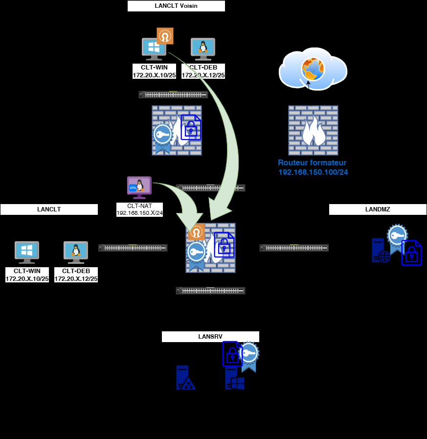

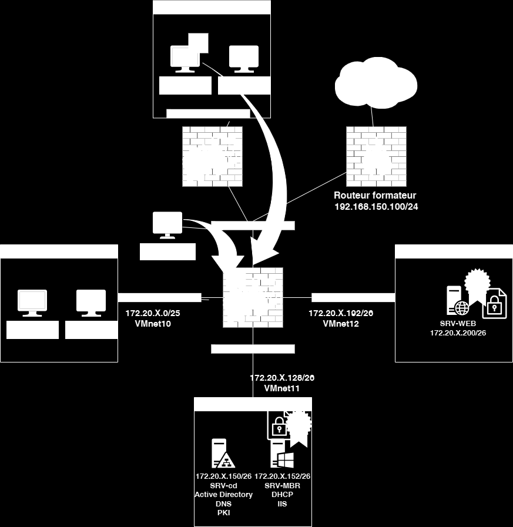

Openvpn
Sur le poste Client Windows:

   •   En binôme, assurez-vous que depuis vos clients windows, vous pouvez ping vos
       adresses WAN.
   •   Pour les CEL, sortez votre client Windows sur le reseau bridge et lui attribuer l’@IP de
       CLT-NAT qu’il faudra éteindre.

Sur le poste « PFsense » :
Si vous n’avez plus l’authentification LDAP d’un TP précédent alors:
    • Ajouter et paramétrer une autorité de certification
    • Création d’un certificat serveur
    • Mettre en place l’authentification LDAP

   •
   •   Paramétrer OpenVPN server

   •

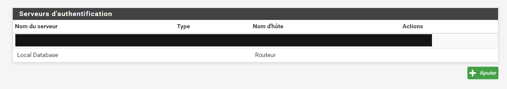

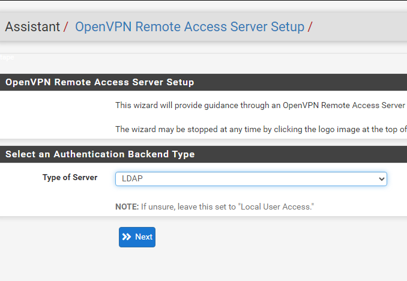

•

   •

   •

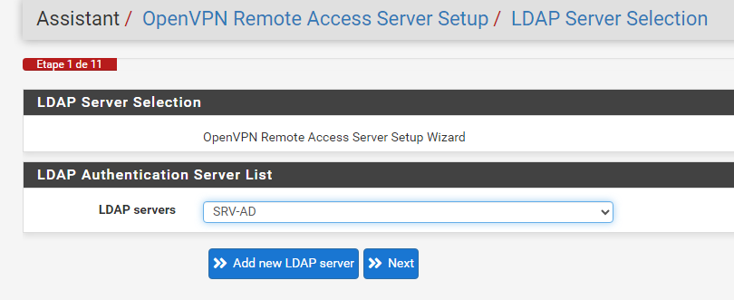

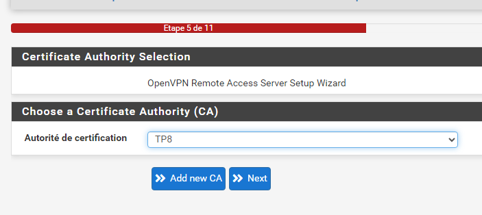

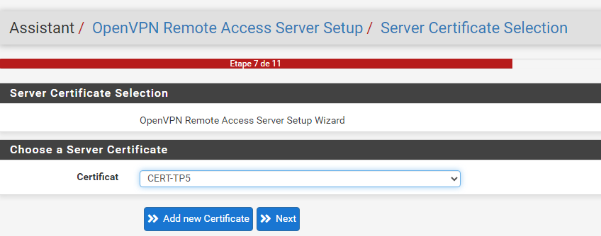

•
   •

   •

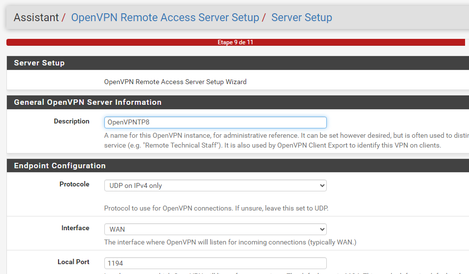

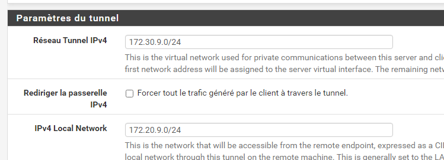

•

   •
   •   Paramétrer OpenVPN client

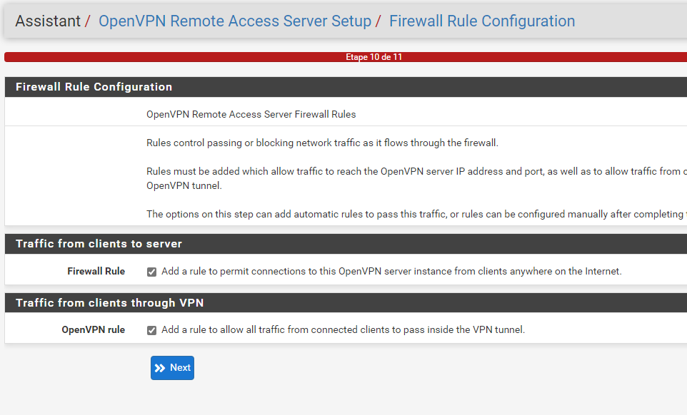

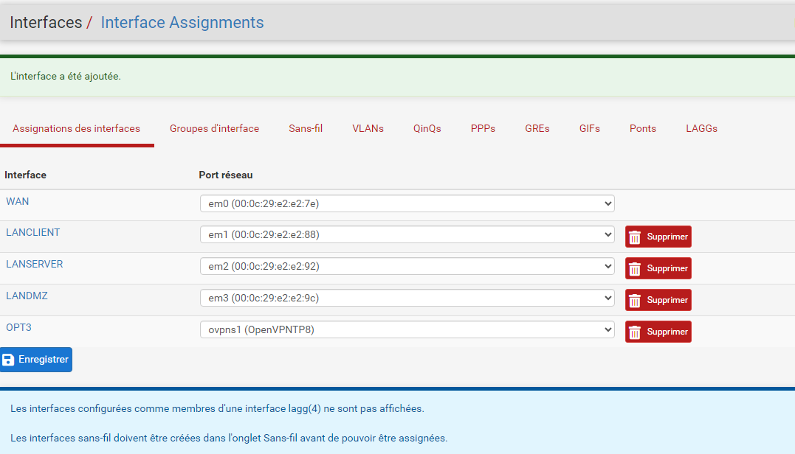

•
   •   Télécharger le fichier d’installation et de configuration client et l’envoyer à son
       binôme.

   •

Sur le poste Client Windows
    • Vous échangerez vos fichiers d’installation entre binôme et vous installerez ce
        fichier sur vos clients Windows.
    • Vous testerez la bonne connexion chacun votre tour.
    • Pour les CEL, vous installerez le fichier d’installation sur votre client Windows
        connecté sur le reseau WAN.

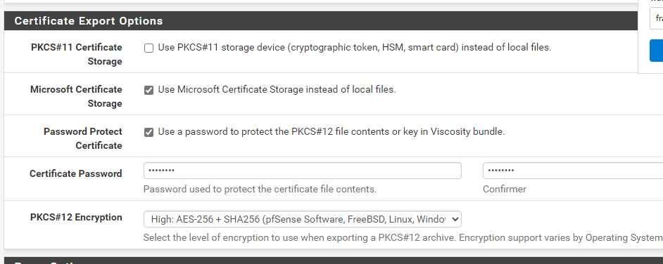

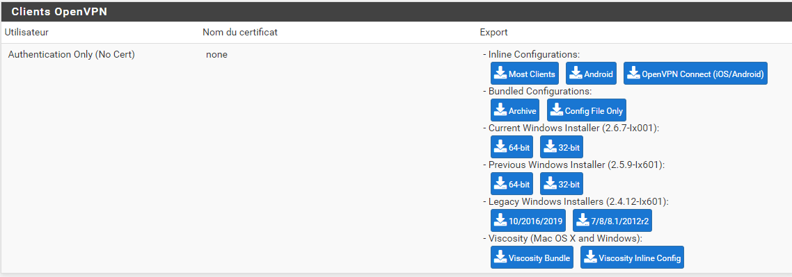

•

Wireguard
Sur le poste « PFsense » :
    • Paramétrer WireGuard et le peers pour CLT-NAT
Sur CLT-NAT
    • Renouveler les clés privée et publique.
    • Puis paramétrer le fichier de configuration pour l’adapter à votre nouvelle
        configuration.
    • Activer le routage
    • Activer WireGuard et essayez de vous connecter à votre serveur WEB en ssh.

Info sur les commandes wireguard
https://wireguard.how/client/debian/

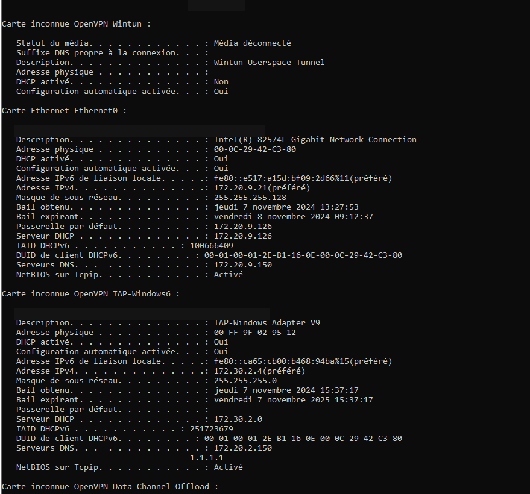

Solution
Une solution est proposée pour ce TP sous la forme d'un PDF commenté (correction reproduite ci-dessous).
