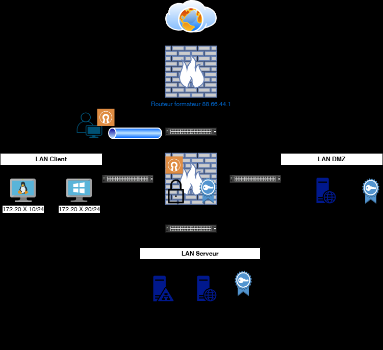
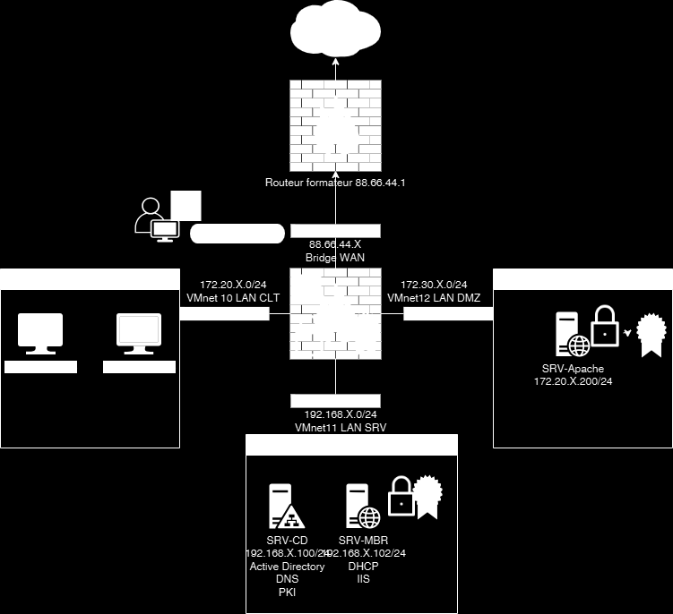

# Énoncé — TP8 — Connecter les collaborateurs pour le télétravail


Connecter les
collaborateurs pour le
télétravail
 TD8

 Avant de démarrer ce TP.

            Durée estimée

              4 heures

Énoncé

Objectifs:

Mise en place





Texte visible sur la capture :

```text
Routeur formafeur 88.66.44.1
VMnet 10 LAN CLT
VMnet11 LAN SRV
VMnet12 LAN DMZ
```

Sur SRV-CD
https://wireguard.how/client/debian/

Solution
Une solution est proposée pour ce TP sous la forme d'un PDF commenté, disponible dans les
ressources à télécharger.
