# Correction — TP9 — Connecter les collaborateurs site à site


Connecter les
collaborateurs site à site
 TD9 du Module 2

 Avant de démarrer ce TP, il faut au moins 2 routeurs pfSense et 2 réseaux LAN derrière
 chaque routeur.

            Durée estimée

             2-3 heures

Énoncé

Objectifs:

La mise en place de cet exercice, vous permettra de mettre en pratique la configuration
d'un VPN site à site avec pfSense, en utilisant le protocole IPsec. Vous acquerrierez une
compréhension approfondie du fonctionnement d'un VPN et des compétences pratiques
en matière de configuration et de dépannage des connexions VPN sécurisées entre sites
distants.

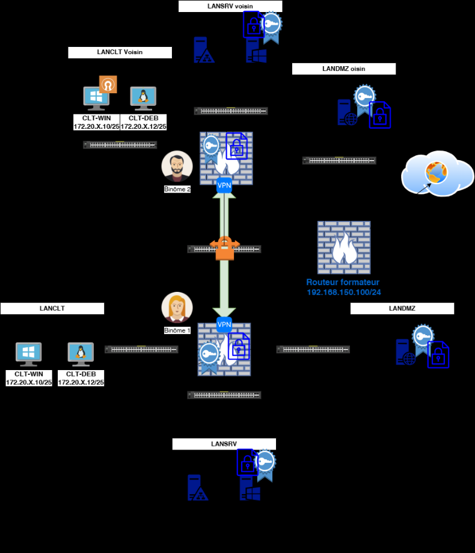

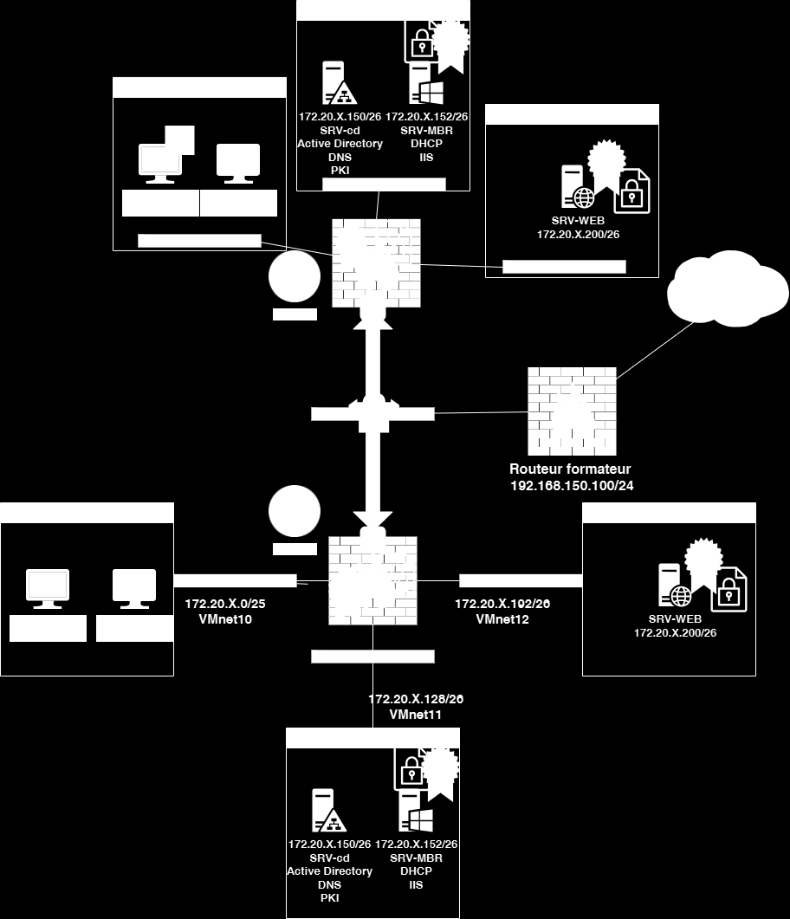

Texte visible sur la capture :

```text
VMnet10
VMnet11
192.168.150.100/24
VMnet12
```

En binôme sur vos routeurs pfSense:

   •   Configuration du tunnel IPsec

   •

   •
   •
       Création de la Phase 1 (IKE) sur les deux pfSense
       Configuration de la Phase 2 (ESP) sur les deux pfSense

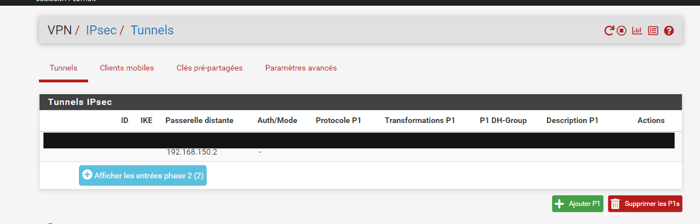

Texte visible sur la capture :

```text
VPN/ IPsec/ Tunnels
Tunnels IPsec
ID KE Passerelle distante Auth/Mode Protocole P1 Transformations P1 P1DH-Group Description P1 Actions
192.168.150.2 =
‘Afficher les entrées phase 2 (2)
```

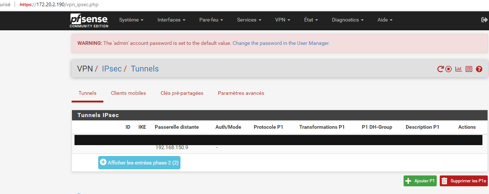

Texte visible sur la capture :

```text
urisé | Httes//172.20.2.190/vpn_ipsec.php
WARNING: The ‘admin’ account password is set to the default value. Change the password in the User Manager.
VPN/ IPsec/ Tunnels C® li
ID IKE Passerelle distante Auth/Mode Protocole P1 Transformations P1 P1 DH-Group Description P1 Actions
192.168.150.9 -
‘Afficher les entrées phase 2 (2)
```

Définition des réseaux locaux et distants
   •   Mise en place des règles de pare-feu pour le VPN

   •
   •

       Autorisation du trafic IPsec

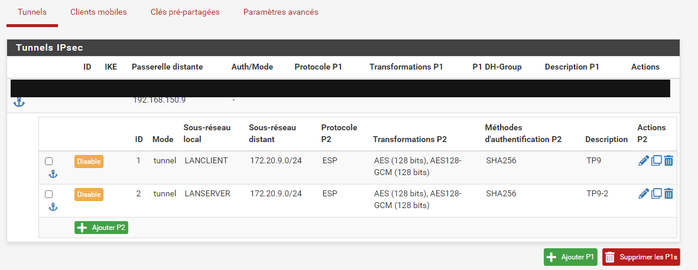

Texte visible sur la capture :

```text
Tunnels IPsec
ID IKE Passerelle distante Auth/Mode Protocole P1 Transformations P1 P1DH-Group Description P1 Actions
o | Disable | 1 tunnel LANCLIENT 172.20.9.0/24 ESP AES (128 bits), AES128- SHA256 TP9 vA
O | Disable | 2 tunnel LANSERVER 172.20.9.0/24 ESP AES (128 bits), AES128- SHA256 TP9-2 oe
```

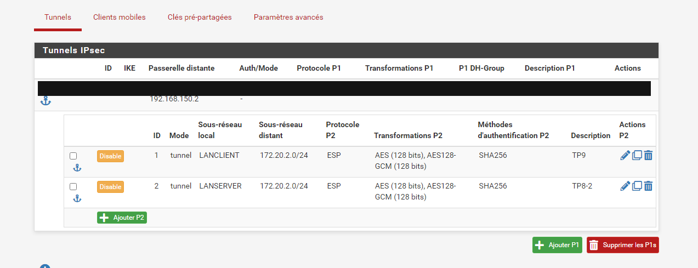

Texte visible sur la capture :

```text
Tunnels IPsec
Passerelle distante
172.20.2.0/24
```

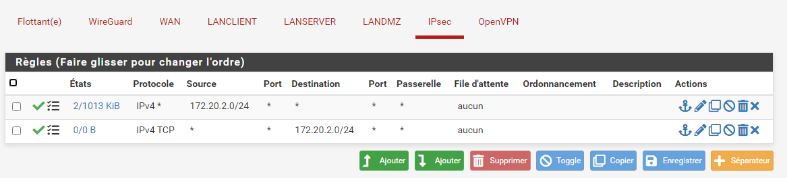

Texte visible sur la capture :

```text
LANSERVER LANDMZ IPsec OpenVPN
Flottant(e) WireGuard WAN LANCLIENT
Port Destination Port Passerelle File d'attente Ordonnancement Description Actions
* 172.20.2.0/24
```

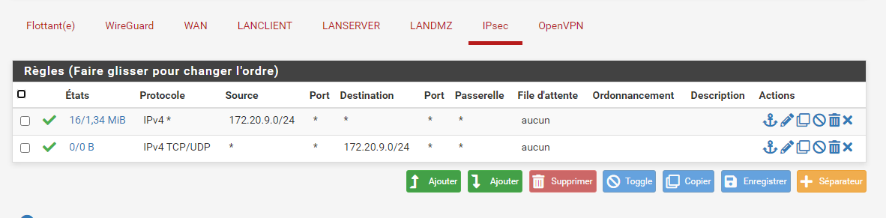

Texte visible sur la capture :

```text
Flottant(e) WireGuard WAN LANCLIENT LANSERVER LANDMZ IPsec OpenVPN
o Etats Protocole Source Port Destination Port Passerelle File d'attente Ordonnancement Description Actions
O W 16/134MiB  IPv4* 172.20.9.0/24 * * 5 8 aucun LSOOMX
```

Configuration des règles pour permettre le trafic entre les réseaux locaux

   •   Test et validation de la connexion VPN
   •
       Vérification de l'état du tunnel IPsec
       Test de connectivité entre les réseaux des deux sites

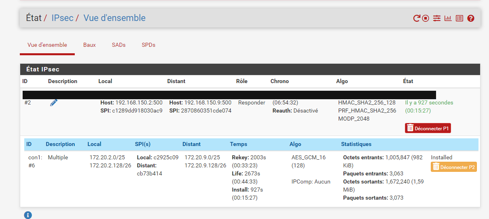

Texte visible sur la capture :

```text
État/ IPsec/ Vue d'ensemble
Etat IPsec
Host: 192.168.150.2:500 Host: 192.168.150.9:500 Responder (06:54:32) HMAC_SHA2_256-128 lly a 927 secondes
#6 172.20.2.128/26 Distant: 172.20.9.128/26 (00:33:23) (128) KiB)
```

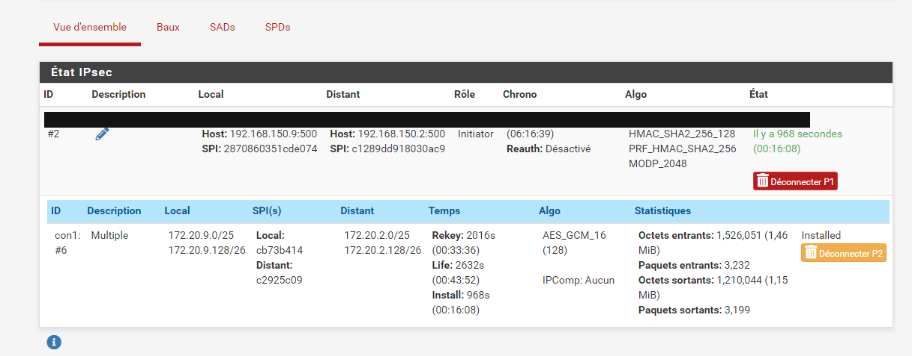

Texte visible sur la capture :

```text
tat IPsec
#2 = Host: 192.168.150.9:500 Host: 192.168.150.2:500 Initiator (06:16:39) HMAC_SHA2_256_128 lly a 968 secondes
#6 172.20.9.128/26 cb73b414 172.20.2.128/26 (00:33:36) (128) MiB)
```

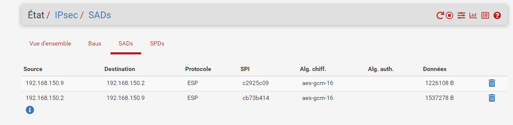

Texte visible sur la capture :

```text
État/ IPsec/ SADs
192.168.150.9 192.168.150.2 ESP
192.168.150.2 192.168.150.9 ESP
```

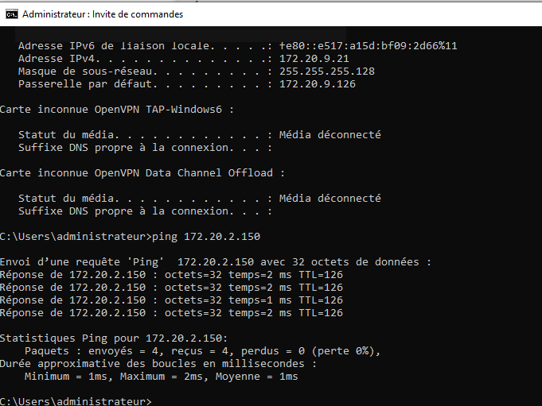

Texte visible sur la capture :

```text
Adresse IPv4. .. -: 172.20.9.21
Masque de sous-réseau. : 255.255.255.128
Passerelle par défaut. 172.20.9.126
Carte inconnue OpenVPN TAP-Windows6 :
Carte inconnue OpenVPN Data Channel Offload :
Users\administrateur>ping 172.20.2.150
Envoi d’une requête ‘Ping’ 172.20.2.15@ avec 32 octets de données :
Réponse de 172.20.2.15@ : octets=32 temps=2 ms TTL=126
Réponse de 172.20.2.150 : octets=32 temps=2 ms TTL=126
Réponse de 172.20.2.150 : octets=32 temps=1 ms TTL=126
Statistiques Ping pour 172.20.2.150:
```

Analyse des logs pour confirmer le bon fonctionnement

Solution
Une solution est proposée pour ce TP sous la forme d'un PDF commenté, disponible dans les
ressources à télécharger.

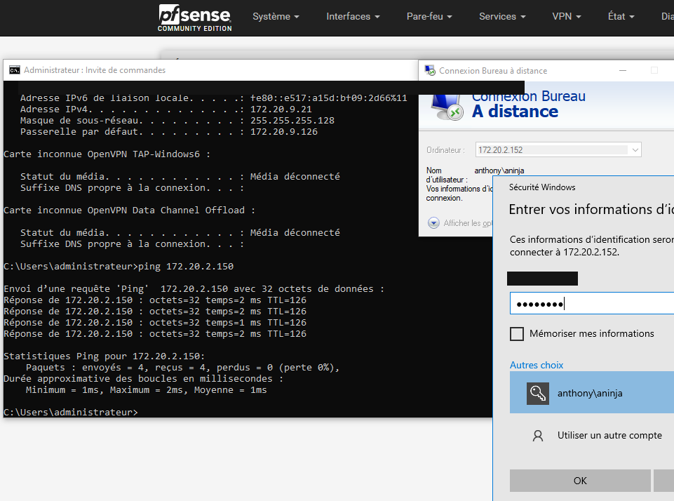

Texte visible sur la capture :

```text
Adresse IPv4. . . . . . . . . . . . . .: 172.20.9.21
Masque de sous-réseau. . . . . . . . . : 255.255.255.128
Passerelle par défaut. . . . . . . . . : 172.20.9.126
carte inconnue OpenVPN TAP-Windows6
carte inconnue OpenVPN Data Channel Offload
Ic: \Users\administrateur>ping 172.20.2.150
Réponse de 172.20.2.150 : octets=32 temps=2 ms
Réponse de 172.20.2.150 : octets=32 temps=1 ms
Réponse de 172.20.2.150 : octets=32 temps=2 ms TTL=126 information:
Statistiques Ping pour 172.20.2.150
```
