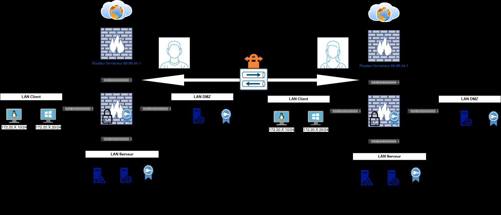
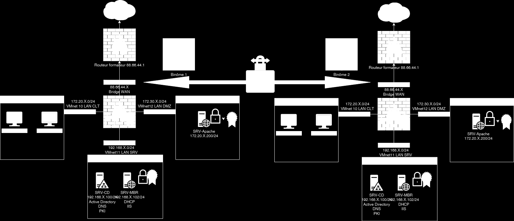

# Énoncé — TP9 — Connecter les collaborateurs site à site

Connecter les
collaborateurs site à site
 TD9

 Avant de démarrer ce TP, .

            Durée estimée

              4 heures

Énoncé

Objectifs:

Mise en place

Valeurs de la capture :

- Deux sites, Binôme 1 et Binôme 2, reliés par un tunnel
- Chaque site : routeur formateur 88.66.44.1, WAN 88.66.44.X en bridge
- LAN CLT : 172.20.X.0/24, VMnet10
- LAN DMZ : VMnet12, SRV-Apache 172.20.X.200/24
- LAN SRV : 192.168.X.0/24, VMnet11
- SRV-CD : Active Directory, DNS, PKI
- SRV-MBR : DHCP, IIS

Sur le routeur PFsense
En binôme pour salle

Mise en place d’un deuxième PFsense pour CEL

Solution
Une solution est proposée pour ce TP sous la forme d'un PDF commenté, disponible dans les ressources à télécharger (voir la page [Correction](corrections.md)).
