# Correction — TP 1 — Mise en place de l’infrastructure

Services transverses en environnement Microsoft (RDS/WDS)

Active Directory

TP 1 du Module 1 – Mise en place de l’infrastructure

Avant de démarrer ce TP, il convient d’avoir suivi les vidéos du module 1.

Durée estimée

2h00

Solution

Etape 1 : intégration des machines virtuelles

- Créer les 5 machines virtuelles suivantes :
Nom de la VM       Système d’exploitation              RAM      Réseau

INFRA       Windows Serveur 2019 Standard         1024 MB   Vmnet 10

RDS        Windows Serveur 2019 standard         1024 MB   Vmnet 10

DEPLOY       Windows Serveur 2019 standard         1024 MB   Vmnet 10

CLI10               Windows 10 Pro                1024 MB   Vmnet 10

CLINVX               Windows 10 Pro                1024 MB   Vmnet 10

Exemple de création de la VM INFRA à partir d’une base Workstation Windows Server 2019

- Récupérer la base sur le partage réseau « Distrib » et la décompresser.
- Importer la VM dans Workstation en double cliquant sur le fichier de configuration avec
l’extension « .vmx » de la VM.

Services transverses en environnement Microsoft (RDS/WDS)

- Paramétrer la VM en suivant le tableau récapitulatif pour la RAM et le Réseau.
- Sur le même principe, importer les VM RDS, DEPLOY, CLI10.
La machine virtuelle CLINVX n’aura aucun système d’exploitation d’installé, son type à

renseigner dans VMWare Workstation est « Windows 10 x64 ».

- CLINVX est à créer en utilisant le menu Création d’une nouvelle machine virtuelle.
Services transverses en environnement Microsoft (RDS/WDS)

Le reste du paramétrage est classique.

Résultat final de la configuration de la VM CLINVX :

Etape 2 : configuration réseau et nommage des postes

- Vérifier les noms d’hôtes des différentes machines, les modifier au besoin.
Services transverses en environnement Microsoft (RDS/WDS)

- Configurer l’adressage IP suivante sur les machines :
Nom de la VM           Adresse IP

INFRA             192.168.1.1 / 24

RDS              192.168.1.2 / 24

DEPLOY             192.168.1.3 / 24

CLI10              Client DHCP

- Aucune passerelle par défaut n’est à configurer. Renseigner l’adresse IP de INFRA
comme adresse de serveur DNS.

- Activer la règle de pare-feu permettant aux postes de répondre aux requêtes « ping
»

Services transverses en environnement Microsoft (RDS/WDS)

Services transverses en environnement Microsoft (RDS/WDS)

Services transverses en environnement Microsoft (RDS/WDS)

- S’assurer de la bonne communication entre les différentes machines virtuelles.
Depuis INFRA en ligne de commande, exécution de la commande PING vers RDS et

DEPLOY.

Services transverses en environnement Microsoft (RDS/WDS)

Etape 3 : installation et configuration des rôles

- Ajouter les rôles suivants au serveur INFRA : Services de domaine Active Directory,
DNS, DHCP

Services transverses en environnement Microsoft (RDS/WDS)

Services transverses en environnement Microsoft (RDS/WDS)

Terminer la configuration DHCP en validant toutes les questions.

- Promouvoir INFRA contrôleur de domaine d’un nouveau domaine dans une nouvelle
forêt. Le domaine sera nommé prénom.eni (ou prénom est à remplacer par votre

prénom).

Services transverses en environnement Microsoft (RDS/WDS)

À la suite de la validation des paramètres, le serveur va redémarrer.

- Configurer le service DHCP en lui ajoutant une plage pour votre réseau. Les adresses à
distribuer par ce service iront de 192.168.1.100 à 192.168.1.199. Le service devra fournir

l’adresse du serveur DNS et le suffixe DNS correspondant à votre domaine.

- Ouvrir la console de management DHCP.
- Autoriser le serveur à fonctionner dans l’environnement Active Directory.
Services transverses en environnement Microsoft (RDS/WDS)

- Créer la nouvelle étendue.
Services transverses en environnement Microsoft (RDS/WDS)

Pas d’exclusion à paramétrer.

Services transverses en environnement Microsoft (RDS/WDS)

Pas de passerelle à paramétrer.

- Activer l’étendue immédiatement.
Services transverses en environnement Microsoft (RDS/WDS)

Résumé du paramétrage.

- Vérifier que CLI10 obtient bien ses informations de configuration IP auprès du service
DHCP puis l’intégrer à votre domaine Active Directory.

Configuration réseau par défaut sur CLI10.

Configuration après une demande d’obtention d’une IP.

Services transverses en environnement Microsoft (RDS/WDS)

Vérification sur le serveur DHCP de la bonne attribution du poste.

- Intégrer les serveurs RDS, DEPLOY et CLI10 dans votre domaine Active Directory.
Exemple avec RDS.

Services transverses en environnement Microsoft (RDS/WDS)

Vérification de la bonne prise en compte de l’intégration de RDS dans le domaine AD sur

le contrôleur de domaine.

Services transverses en environnement Microsoft (RDS/WDS)

Réaliser les mêmes étapes d’intégration au domaine AD avec DEPLOY et CLI10.

Créer les utilisateurs et leurs groupes respectifs d’après les critères suivants et en respectant

les principes de nommage et d’organisation des objets dans l’Active Directory

Les cinq prénoms du document source sont remplacés par `prénom1` à `prénom5`, dans l’ordre du tableau. `VotrePrénom` est déjà le placeholder du compte administrateur.

Utilisateur          Service                    Privilège

prénom1           Direction                   Utilisateur

prénom2           Direction                   Utilisateur

prénom3         Pédagogique                   Utilisateur

prénom4          Pédagogique                   Utilisateur

prénom5          Informatique                  Utilisateur

VotrePrénom        Informatique                Administrateur

Création de l’arborescence des Unités d’Organisation (nommées UO ou OU).

Services transverses en environnement Microsoft (RDS/WDS)

Création des Utilisateurs.

Exemple de création de l’utilisateur frederic.

Services transverses en environnement Microsoft (RDS/WDS)

Création des groupes.

Exemple de création du groupe global GG_DIRECTION.

Services transverses en environnement Microsoft (RDS/WDS)

Attribution des membres au groupe GG_DIRECTION.

Etape 4 : snapshot de l’infrastructure

- Réaliser un Snapshot nommé « Atelier 1 OK » de toutes les machines virtuelles de votre
infrastructure.

- Eteindre et effectuer un snapshot sur toutes les VM.
Exemple avec INFRA.

Services transverses en environnement Microsoft (RDS/WDS)

Vérification du snapshot.

Services transverses en environnement Microsoft (RDS/WDS)

Les captures ci-dessous viennent de la correction imprimée. Ce sont des visuels externes du laboratoire. Les valeurs secrètes lues sur les images ont été écartées.

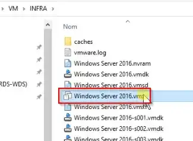

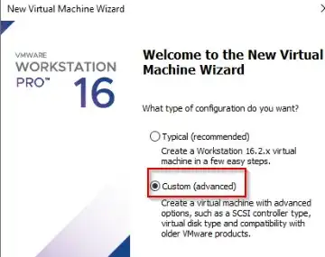

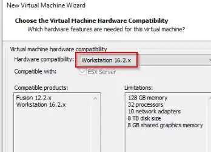

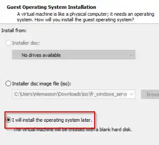

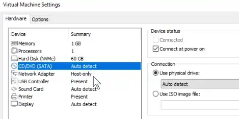

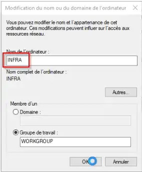

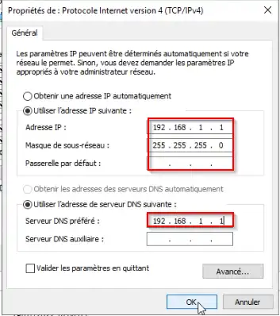

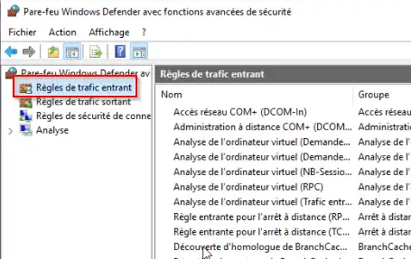

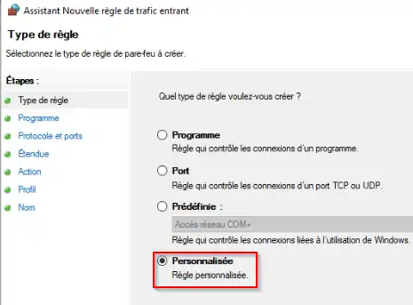

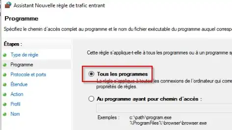

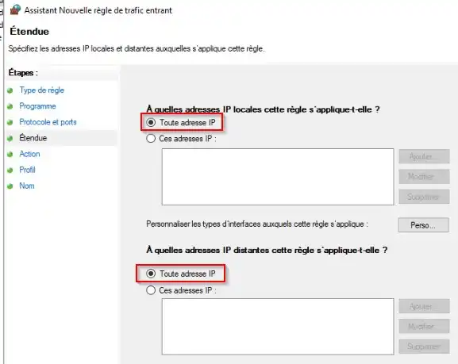

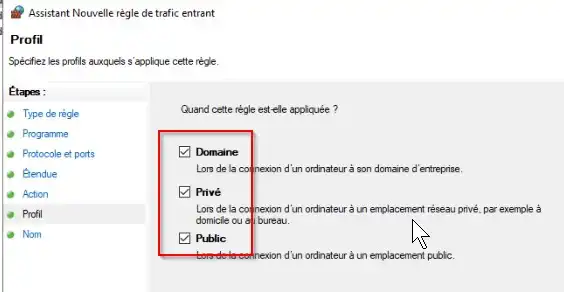

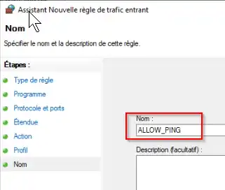

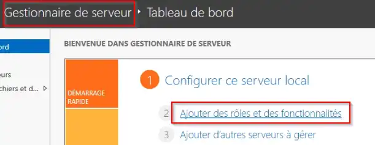

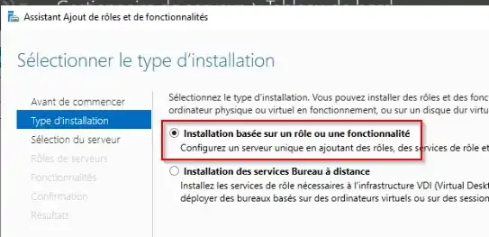

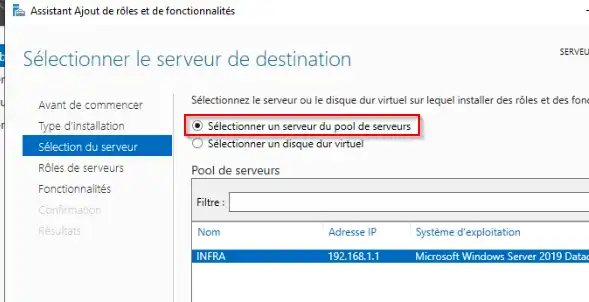

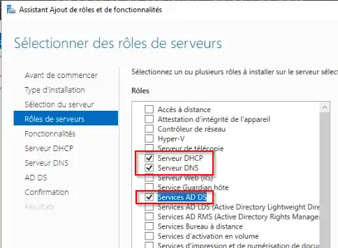

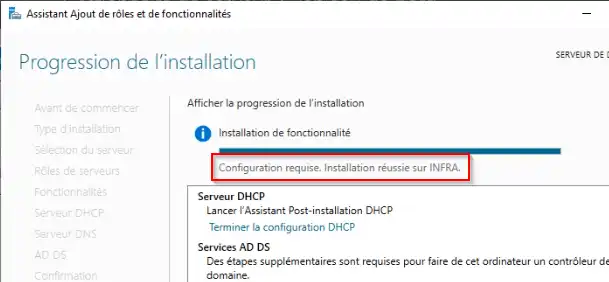

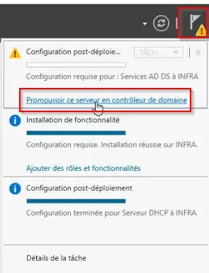

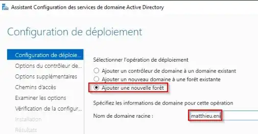

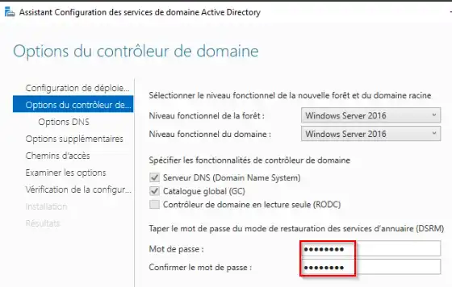

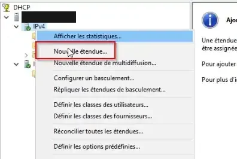

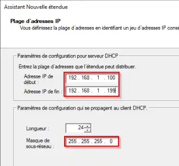

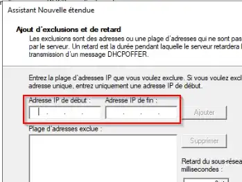

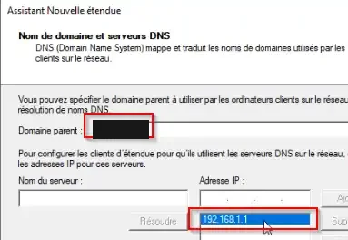

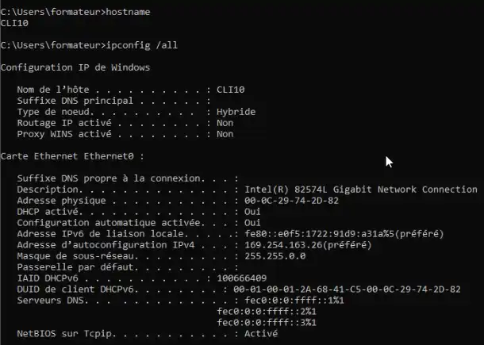

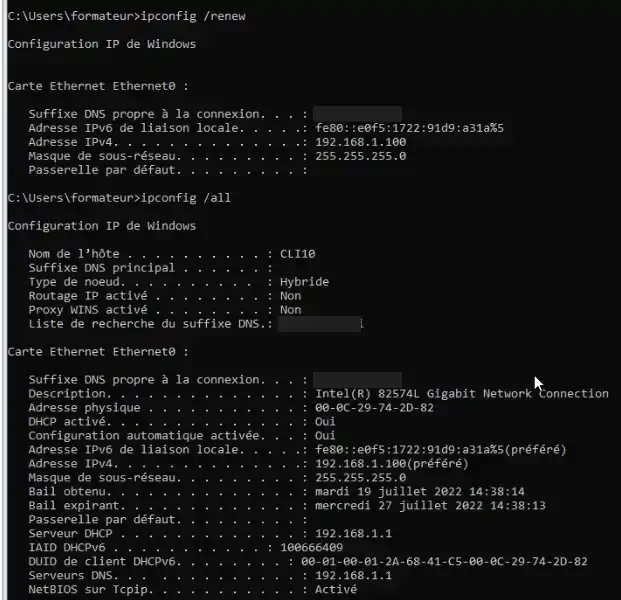

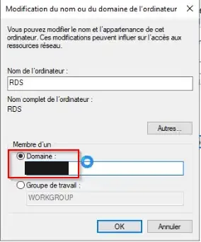
