# Correction — TP 2 — Bureaux distants

Services transverses en environnement Microsoft (RDS/WDS)

Mise en œuvre d’un

bureau à distance

TP 2 du Module 2 – Remote Desktop Services (RDS) – Bureaux distants

Avant de démarrer ce TP, il convient d’avoir suivi les vidéos des modules 1 et 2 et d’avoir

réalisé le TP 1 du Module 1.

Durée estimée

2h00

Solution

Etape 1 : Installation et configuration du service RDS

- Installer le rôle des services bureau à distance sur RDS
- Dans le « gestionnaire de serveur », installer le rôle.
Services transverses en environnement Microsoft (RDS/WDS)

- Ajouter les services de rôle nécessaires à la mise en œuvre du service.
- Sélectionner les 4 services de rôle obligatoires.
- Valider le reste des paramètres par défaut.
- Redémarrer le serveur.
Services transverses en environnement Microsoft (RDS/WDS)

- Effectuer la configuration du service :
- Type de déploiement : Standard
- Scénario de déploiement : Déploiement de bureaux basés sur une session
- Toujours depuis le gestionnaire de serveur, ajout d’un rôle.
Services transverses en environnement Microsoft (RDS/WDS)

- Tous les services de rôle nécessaires au fonctionnement du service seront hébergés
par le serveur RDS.

Déploiement du Broker.

Déploiement du Web Access.

Déploiement du Session Host.

Services transverses en environnement Microsoft (RDS/WDS)

Débuter le déploiement.

Progression de l’installation.

Services transverses en environnement Microsoft (RDS/WDS)

Installation du gestionnaire de licences RDS.

Services transverses en environnement Microsoft (RDS/WDS)

Progression de l’installation.

Etat des lieux des services de rôles installés.

- Créer une collection avec les paramètres de configuration par défaut :
- Ne pas activer les disques de profil utilisateur
Services transverses en environnement Microsoft (RDS/WDS)

Services transverses en environnement Microsoft (RDS/WDS)

- Laisser le paramétrage par défaut pour le choix du groupe d’utilisateurs.
- Désactiver le disque de profil utilisateur.
- Vérifier dans le Gestionnaire de serveur les paramétrages effectués
- Vue d’ensemble / Serveurs / Collections
Services transverses en environnement Microsoft (RDS/WDS)

Vérification de la création de la collection.

Etape 2 : Test du service Bureau à distance

- Depuis CLI10, tester l’ouverture d’une session distante sur RDS avec un des comptes
utilisateur de l’Active Directory (laisser la session ouverte) :

- En cas de dysfonctionnement, vérifier les paramètres de la collection
- Sur CLI10, lancer le client « Bureau à distance ».
Services transverses en environnement Microsoft (RDS/WDS)

Connexion avec le compte d’prénom1.

- Entrer le mot de passe lié au compte d’prénom1.
prénom1 est maintenant connectée à son bureau distant exécuté depuis CLI10 sur RDS.

Services transverses en environnement Microsoft (RDS/WDS)

Connexion aux bureaux de prénom5 et prénom3 en plus de celui d’prénom1.

Services transverses en environnement Microsoft (RDS/WDS)

- Modifier la configuration des services RDS afin que seuls les membres des services
Direction et Pédagogique puissent se connecter en bureau à distance sur RDS :

- Tester avec les comptes prénom3 et prénom5 (laisser les sessions ouvertes)
- Modifier les paramètres de la collection.
- Autoriser le groupe Direction et Pédagogique à se connecter.
Services transverses en environnement Microsoft (RDS/WDS)

- Supprimer « Utilisateurs du domaine », option qui n’est plus à garder.
Résultat des groupes positionnés sur la collection.

Test de connexion avec prénom5 qui n’est plus autorisé à se connecter.

Services transverses en environnement Microsoft (RDS/WDS)

Un message de refus de connexion est renvoyé.

- Modifier la configuration des services RDS afin que les lecteurs locaux du client ne
puissent pas être utilisés via la connexion distante :

- Tester avec les comptes prénom1 et prénom4 (laisser les sessions ouvertes).
Test sans mise en place de la restriction.

Services transverses en environnement Microsoft (RDS/WDS)

On établit une nouvelle connexion en RDP.

On visualise dans l’explorateur de fichiers les lecteurs du serveur sur lesquels est exécutée la

session (en rouge = lecteurs du RDS) et les lecteurs du client depuis lesquels est initiée la

session (en vert = lecteurs du CLI10).

Cela pose des problèmes de sécurité car il est tout à fait possible avec cette configuration

de copier des fichiers du serveur RDS (lecteurs en rouge) vers le client en local (lecteurs en

Services transverses en environnement Microsoft (RDS/WDS)

vert).

L’administrateur ne souhaitant pas autoriser les transferts de fichiers, l’option doit être

supprimée.

- Il faut modifier les propriétés de la collection.
- On décoche l’option « Lecteurs ».
Malgré le paramétrage côté client positionné sur montage des Lecteurs locaux.

Services transverses en environnement Microsoft (RDS/WDS)

Il n’est plus possible d’afficher les lecteurs dans l’explorateur de fichiers.

- Tester les fonctionnalités de gestion des connexions :
- Déconnexion / Envoyer un message / Cliché instantané / Fermer la session
→ Fonction Déconnexion

Services transverses en environnement Microsoft (RDS/WDS)

La session de l’utilisateur est déconnectée.

→ Fonction Envoyer un message

Le technicien rédige son message à destination de l’utilisateur.

Services transverses en environnement Microsoft (RDS/WDS)

Le message apparaît dans la session de l’utilisateur.

→ Fonction Cliché instantané

Première possibilité d’afficher seulement la session sans pouvoir interagir :

Services transverses en environnement Microsoft (RDS/WDS)

L’utilisateur devra accepter la prise en main à distance.

Le technicien est maintenant en mesure de voir la session de l’utilisateur.

Services transverses en environnement Microsoft (RDS/WDS)

Seconde possibilité en prenant la main à distance avec interaction (souris + clavier) dans

la session de l’utilisateur :

Fonction Fermer la session

Fermeture de la session en cours.

Services transverses en environnement Microsoft (RDS/WDS)

La session est clôturée.

Etape 3 : Snapshot de l’infrastructure

- Réaliser un Snapshot nommé « Atelier 2 OK » des machines virtuelles.

Les captures ci-dessous viennent de la correction imprimée. Ce sont des visuels externes du laboratoire. Les valeurs secrètes lues sur les images ont été écartées.

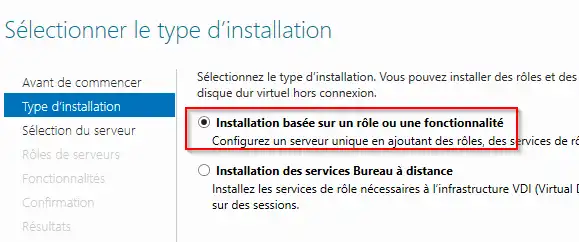

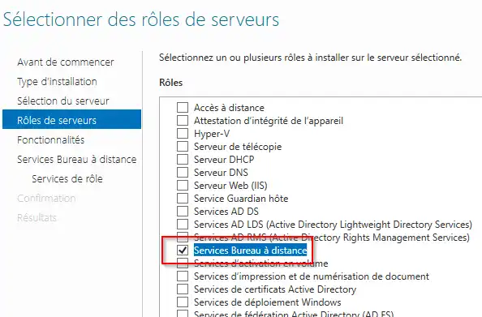

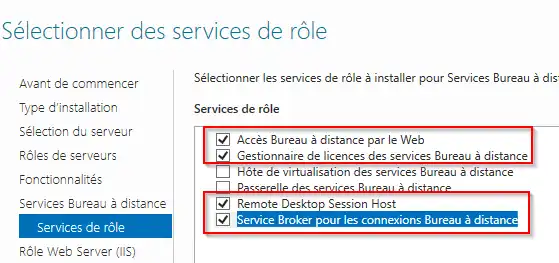

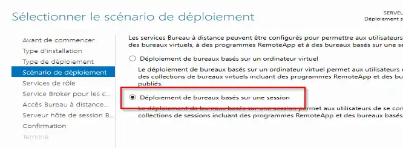

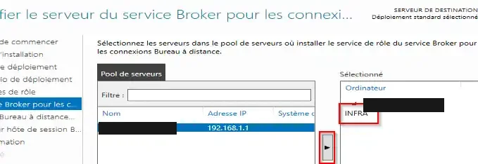

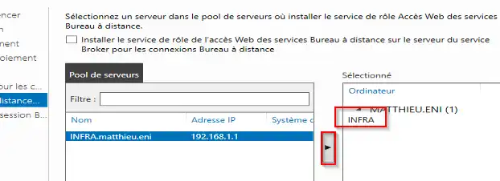

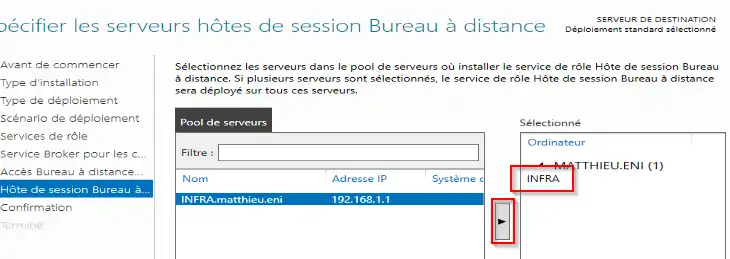

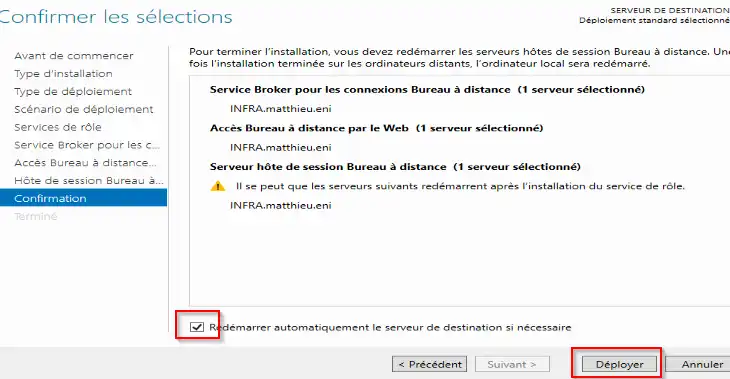

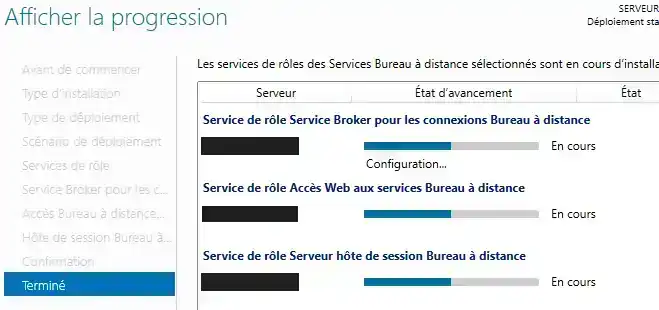

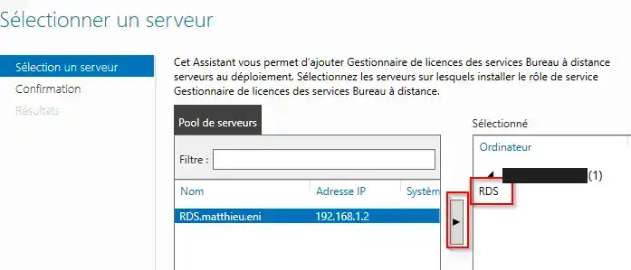

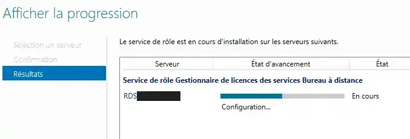

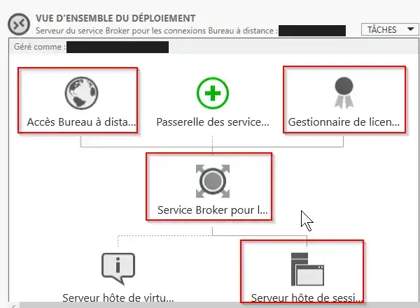

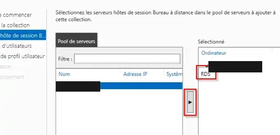

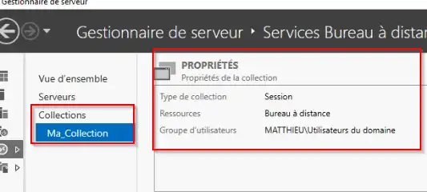

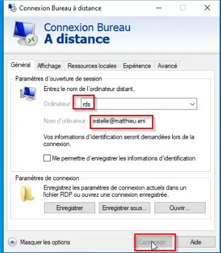

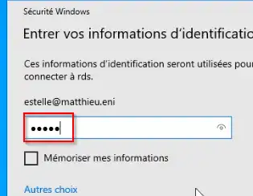

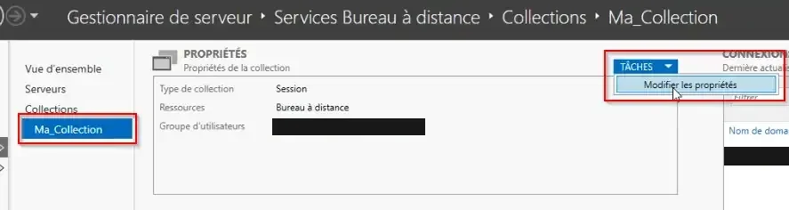

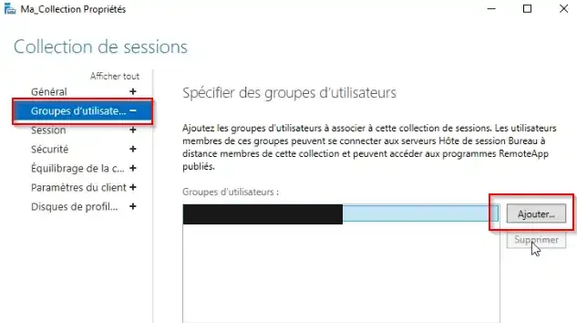

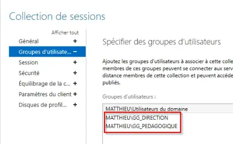

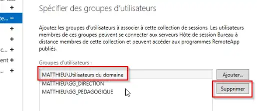

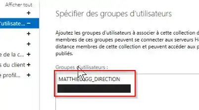

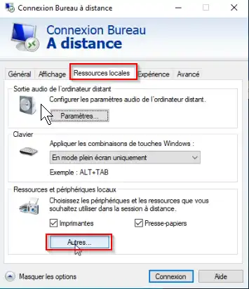

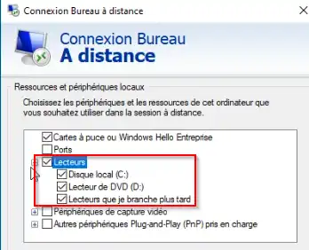

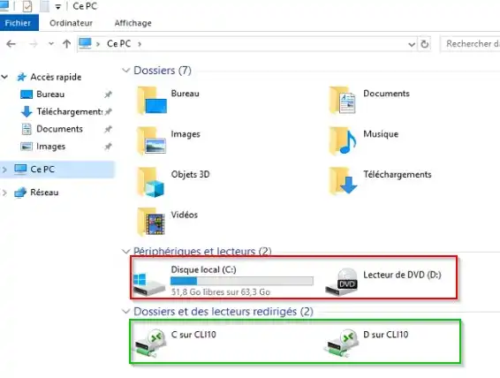

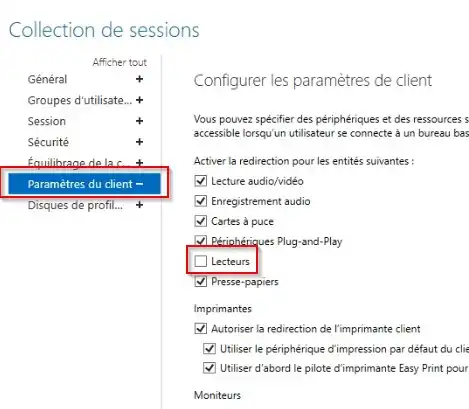

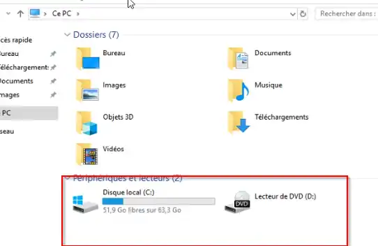

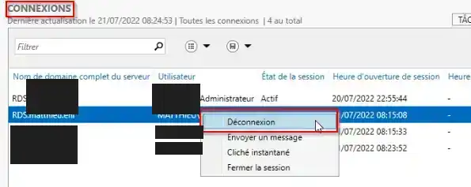

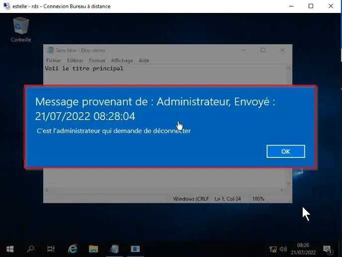
