# Correction — TP du module 3 — Publication d’applications

Services transverses en environnement Microsoft (RDS/WDS)

Publier des applications

TP 3 du Module 3 – Remote Desktop Services (RDS) - Publication

d’applications

Avant de démarrer ce TP, il convient d’avoir suivi les vidéos des modules 1 à 3 et d’avoir

réalisé les TP 1 et 2.

Durée estimée

2h00

Solution

Etape 1 : Préparation du serveur RDS

- Récupérer l’application Filezilla et LibreOffice depuis le partage distrib et les installer sur
le serveur RDS.

- Choisir les paramètres d’installation par défaut.
- Vérifier la bonne exécution des applications sur le serveur RDS
Installer les applications sur RDS.

Services transverses en environnement Microsoft (RDS/WDS)

Tester les applications.

Etape 2 : Publication d’application RemoteApp

- Publier les applications LibreOffice Calc / LibreOffice Writer / Filezilla dans la collection
configurée lors de l’atelier 2.

Services transverses en environnement Microsoft (RDS/WDS)

Depuis le gestionnaire de serveur.

Confirmer votre choix.

Services transverses en environnement Microsoft (RDS/WDS)

Les programmes sont maintenant publiés.

- Tester l’accès aux applications publiées sur CLI10 depuis le portail web d’Accès Bureau
à distance en utilisant le navigateur web Internet Explorer à l’adresse

https://rds.prenom.lab/RDweb

Depuis un navigateur web « Internet Explorer » sur CLI10, se connecter au portail web RDS.

Remarque : en environnement de production, les certificats seront conformes, le portail RDS

sera accessible depuis n’importe quel autre navigateur web qu’Internet Explorer.

Services transverses en environnement Microsoft (RDS/WDS)

- Entrer les identifiants d’un utilisateur, prénom1 par exemple.
Les RemoteApp sont accessibles.

Exemple avec Filezilla.

Services transverses en environnement Microsoft (RDS/WDS)

Services transverses en environnement Microsoft (RDS/WDS)

Le même procédé est à suivre pour lancer LibreOffice.

- Faire en sorte de regrouper les applications dans des dossiers Bureautique et Outils sur le
portail web.

Modification pour Filezilla.

Services transverses en environnement Microsoft (RDS/WDS)

Modification pour LibreOffice.

Services transverses en environnement Microsoft (RDS/WDS)

Services transverses en environnement Microsoft (RDS/WDS)

Lorsque l’on se connecte de nouveau au portail web RDS, les RemoteApp sont maintenant

rangées par catégorie.

Services transverses en environnement Microsoft (RDS/WDS)

Dossier Bureautique.

Dossier Outils.

Etape 3 : Accès aux applications publiées

- Limiter l’accès à toutes les applications uniquement aux membres des services Direction,
Pédagogique et Informatique.

Gérer les autorisations au plus haut niveau → La collection.

- Supprimer le groupe « Utilisateurs du domaine » et ajouter les groupes « Direction »,
« Informatique » et « Pédagogique ».

Services transverses en environnement Microsoft (RDS/WDS)

- Limiter l’accès à Filezilla uniquement aux membres du service Informatique.
Les autorisations sont à gérer au niveau de la RemoteApp.

Services transverses en environnement Microsoft (RDS/WDS)

- Vérifier l’accès aux applications depuis le portail web pour prénom3, prénom2 et prénom5.
Test avec l’utilisateur prénom5 qui fait partie du groupe Informatique.

Filezilla est bien présent.

Services transverses en environnement Microsoft (RDS/WDS)

Test avec l’utilisateur prénom3 qui fait partie du groupe Pédagogique.

Aucun dossier Outils avec Filezilla n’est présent.

Test avec l’utilisateur prénom2 qui fait partie du groupe Direction.

Services transverses en environnement Microsoft (RDS/WDS)

Aucun dossier Outils avec Filezilla n’est présent.

Etape 4 : Configuration des raccourcis pour les applications publiées

- Depuis le contrôleur de domaine récupérer et exporter le certificat de RDS.
- Sur INFRA, lancer Internet Explorer.
- Indiquer l’URL du service RDS Web Accès https://rds.prenom.lab/rdweb
Services transverses en environnement Microsoft (RDS/WDS)

- Cliquer sur Erreur de Certificat puis sur Afficher les certificats
- Depuis l’onglet Détails cliquer sur Copier dans un fichier
Services transverses en environnement Microsoft (RDS/WDS)

- L’assistant d’export du certificat se lance.
- Choisir pour format d’export X509 encodé en base 64
- Nommer le certificat RDS.cer et l’enregistrer localement sur la machine
Services transverses en environnement Microsoft (RDS/WDS)

Le certificat a bien été exporté sur le bureau du serveur INFRA.

- Utiliser une stratégie de groupe pour rendre le certificat de confiance pour les postes du
domaine.

- Sur INFRA, lancer la console de Gestion des stratégies de groupes.
Services transverses en environnement Microsoft (RDS/WDS)

- Créer une nouvelle stratégie liée au domaine nommée Deploy-Certificats-
Clients.

- Editer cette stratégie : Configuration ordinateur / Stratégie / Paramètres
Windows / Paramètres de sécurité / Stratégie de clé publique / Autorités de

certification racines de confiance et cliquer sur Importer.

Services transverses en environnement Microsoft (RDS/WDS)

- Depuis l’assistant d’import de certificats,             sélectionner   le   certificat   exporté
précédemment. L’importer dans la stratégie.

Services transverses en environnement Microsoft (RDS/WDS)

Le certificat est bien importé dans la GPO.

L’objet ordinateur CLI10 sera déplacé dans l’UO nouvellement créée LAB → ORDINATEURS

→ CLIENTS

Services transverses en environnement Microsoft (RDS/WDS)

- Appliquer la GPO à cette nouvelle UO dédiée aux postes clients.
- Forcer l’actualisation des stratégies de groupe sur CLI10 et vérifier la bonne prise en
compte de la nouvelle stratégie.

- Actualiser les GPO.
- Vérifier la bonne application des GPO.
Services transverses en environnement Microsoft (RDS/WDS)

- Depuis CLI10, se reconnecter au portail d’accès au Bureau à distance par le Web et
vérifier qu’il n’y a plus d’erreur de certificat.

Le cadenas n’est plus en rouge.

- Pour prénom1, rendre accessibles les raccourcis RemoteApp dans le menu Démarrer :
Services transverses en environnement Microsoft (RDS/WDS)

- Configurer le composant « Connexion RemoteApp et Bureau à distance ».
Dans le panneau de configuration de CLI10.

- URL de connexion au serveur RDS :
https://rds.prenom.lab/RDweb/feed/webfeed.aspx

- Entrer les identifiants de l’utilisateur prénom1.
Services transverses en environnement Microsoft (RDS/WDS)

Résumé de l’installation des RemoteApp dans le menu Démarrer.

- Vérifier la présence des raccourcis dans le menu Démarrer
Services transverses en environnement Microsoft (RDS/WDS)

- Quelles applications sont accessibles ?
Seulement les RemoteApp Bureautique car prénom1 n’a pas les autorisations d’accéder aux

Outils (Filezilla).

- Pour prénom5, configurer les raccourcis RemoteApp dans le menu Démarrer et vérifier leur
présence.

- Quelles applications sont accessibles ?
Sur la session de prénom5, je paramètre l’accès aux RemoteApp via le menu Démarrer en

procédant de la même façon qu’avec prénom1.

Filezilla en plus de LibreOffice est bien présent.

Services transverses en environnement Microsoft (RDS/WDS)

Etape 5 : Snapshot de l’infrastructure

- Réaliser un Snapshot nommé « Atelier 3 OK » des machines virtuelles.

Les captures ci-dessous viennent de la correction imprimée. Ce sont des visuels externes du laboratoire. Les valeurs secrètes lues sur les images ont été écartées.

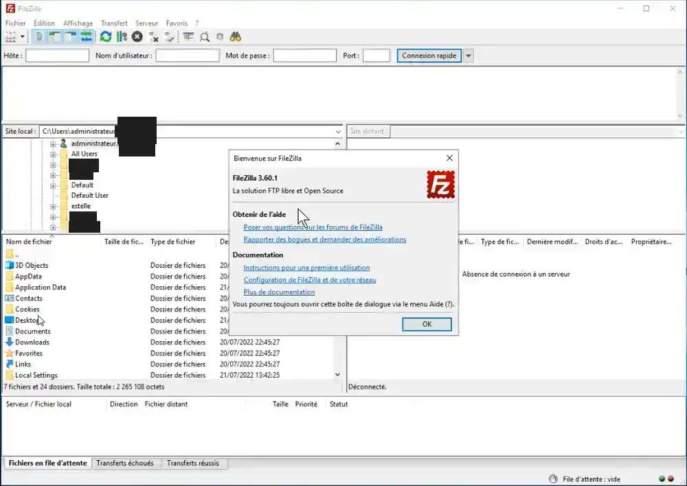

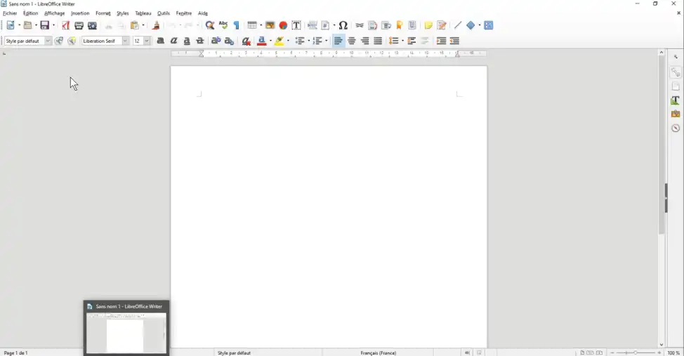

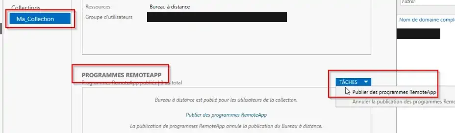

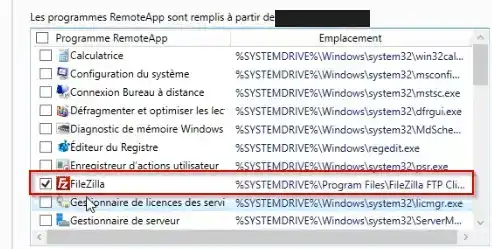

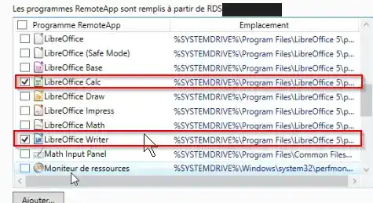

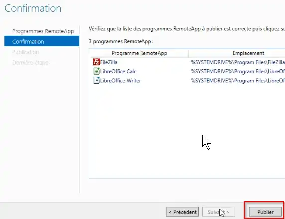

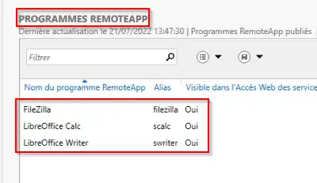

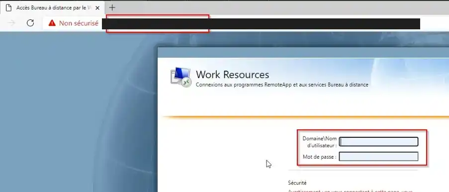

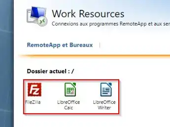

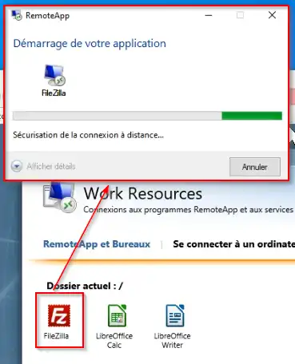

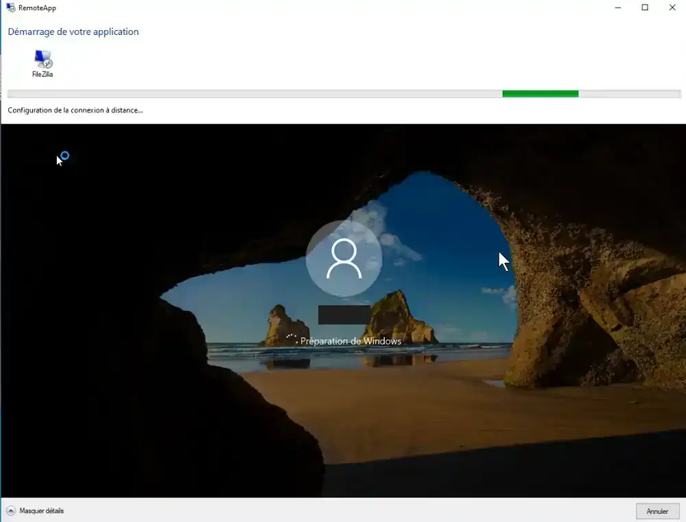

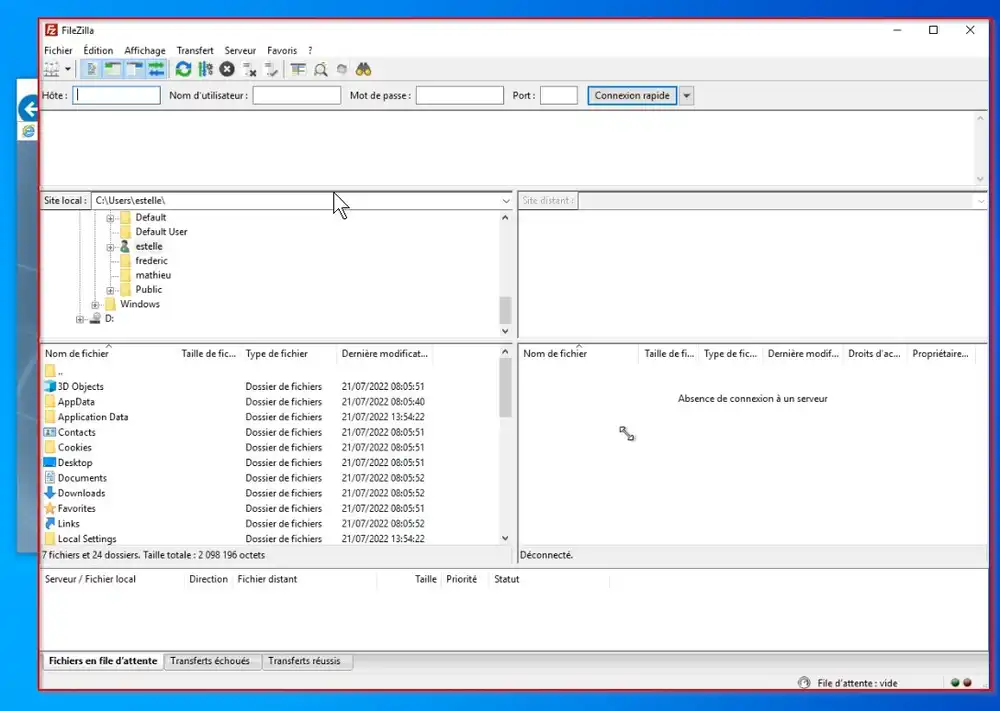

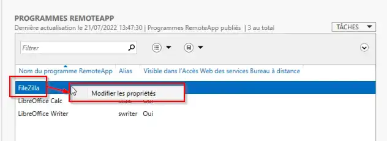

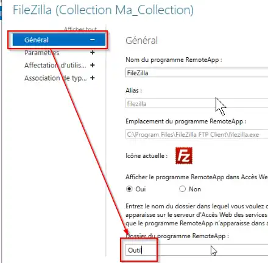

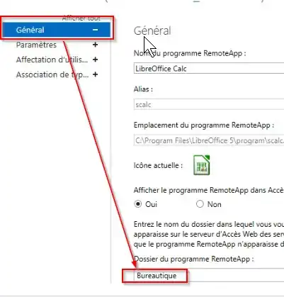

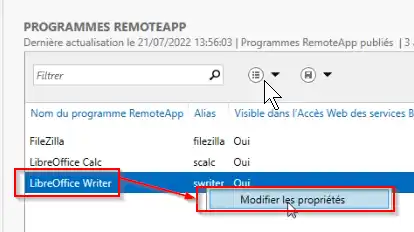

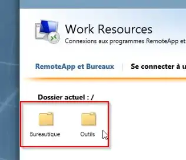

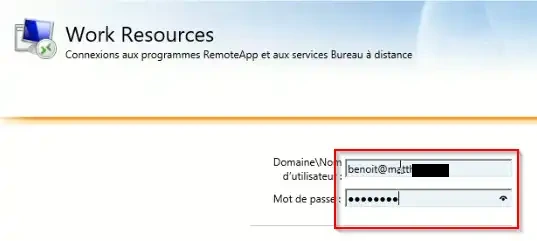

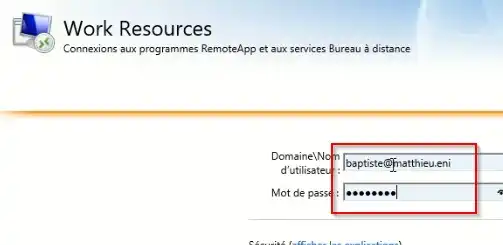

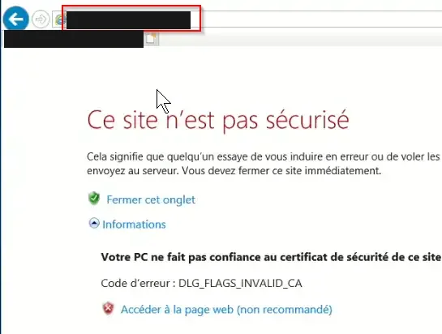

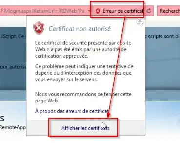

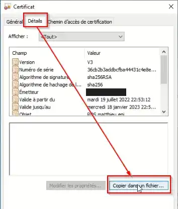
