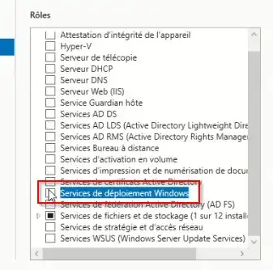
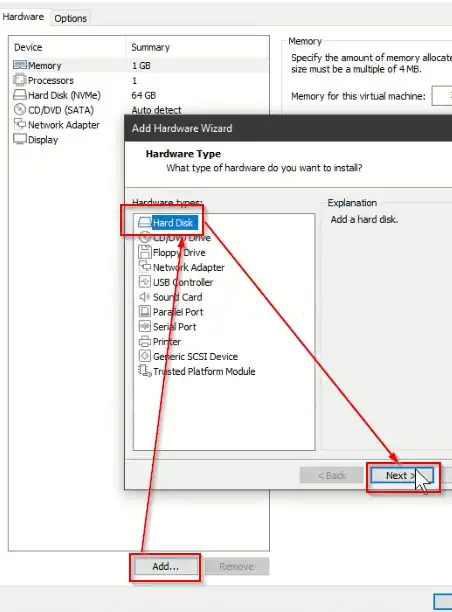
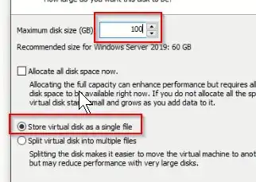
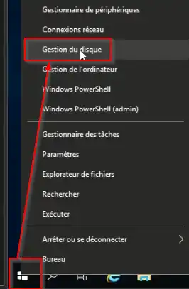
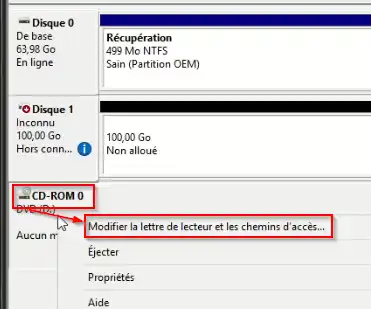
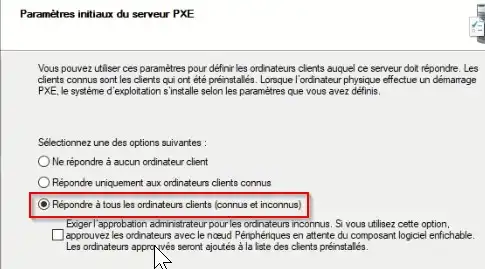
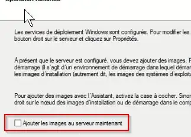
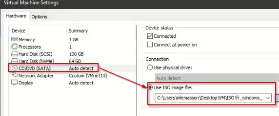
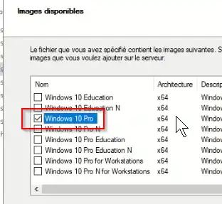
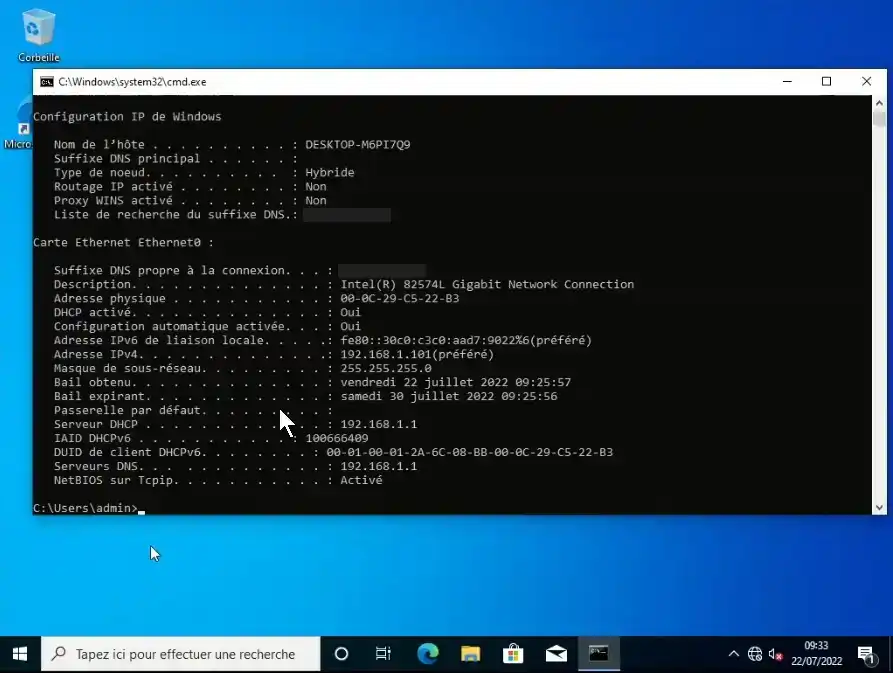

# Correction — TP du module 5 — WDS

Services transverses en environnement Microsoft (RDS/WDS)

Mise en œuvre de WDS

TP du Module 5 – Windows Deployment Services (WDS)

Avant de démarrer ce TP, il convient d’avoir suivi les vidéos des modules 4 et 5 et d’avoir

réalisé les TP du module 1.

Il est nécessaire d’avoir accès à l’ISO d’installation de Windows 10 accessible sur le

partage réseau Distrib.

Durée estimée

2h00

Solution

Etape 1 : Ajout du rôle WDS et d’un espace disque pour répondre aux besoins du service.

- Ajouter le rôle des services de déploiement Windows sur le serveur DEPLOY
- Dans le gestionnaire de serveur, installer le rôle de déploiement Windows.
- Sélectionner les services de rôle.
Services transverses en environnement Microsoft (RDS/WDS)

Installation réussie.

- Ajouter un disque dur de 100 Go à ce serveur, le partitionner, le formater et lui associer
la lettre de lecteur D.

- Sous Workstation, créer un nouveau disque dur.
Services transverses en environnement Microsoft (RDS/WDS)

Services transverses en environnement Microsoft (RDS/WDS)

Le nouveau disque dur est configuré dans la VM.

- Formater et attribuer la lettre D au nouveau disque.
Services transverses en environnement Microsoft (RDS/WDS)

- Déplacer la lettre du lecteur CD-ROM en E.
Services transverses en environnement Microsoft (RDS/WDS)

- Mettre en ligne le nouveau disque.
- Initialiser le disque en GPT par exemple.
Services transverses en environnement Microsoft (RDS/WDS)

Il peut être converti en disque dynamique pour permettre une extension du volume plus

tard.

- Créer le volume.
Services transverses en environnement Microsoft (RDS/WDS)

- Créer un dossier nommé WDS à la racine du lecteur D.
Services transverses en environnement Microsoft (RDS/WDS)

Etape 2 : Configuration initiale des services de déploiement

- Procéder à la configuration initiale du service.
- Le dossier de travail du service sera D:\WDS.
- Votre serveur devra répondre à tous les clients.
- Lancer la console de gestion WDS.
- Configurer le serveur.
Services transverses en environnement Microsoft (RDS/WDS)

Services transverses en environnement Microsoft (RDS/WDS)

- Monter l’image d’installation de Windows10 dans le lecteur CD de la machine.
Le CD-ROM d’installation est maintenant présent dans la VM.

Etape 3 : Ajout d’images aux services de déploiement

- Ajouter au service WDS une image de démarrage basée sur le fichier boot.wim de
Services transverses en environnement Microsoft (RDS/WDS)

Windows10.

Une image de démarrage est maintenant présente dans WDS.

Services transverses en environnement Microsoft (RDS/WDS)

- Ajouter une image d’installation basée sur le fichier install.wim de Windows10 pour
déployer le système d’exploitation « Windows 10 Pro ».

Création d’un groupe.

Services transverses en environnement Microsoft (RDS/WDS)

Ajout d’une image.

Une image d’installation est maintenant présente dans WDS.

Services transverses en environnement Microsoft (RDS/WDS)

Etape 4 : Déploiement d’un client

- Faire un test de déploiement depuis la machine virtuelle CLINVX et s’assurer que le
déploiement est bien fonctionnel.

Remarque : la VM CLINVX ne dispose pas de système d’exploitation.

Lors de la phase de boot, appuyer sur ENTER pour lancer l’installation.

- Choisir sa langue.
Entrer un identifiant de connexion pour se connecter au partage WDS, ici l’utilisateur prénom1

est utilisé.

Services transverses en environnement Microsoft (RDS/WDS)

- Sélectionner l’OS à déployer.
L’installation de Windows 10 débute.

- Répondre aux questions typiques d’une installation Windows.
Le déploiement est maintenant terminé, la VM est en mesure de booter sur Windows 10.

Services transverses en environnement Microsoft (RDS/WDS)

Etape 5 : Snapshot de l’infrastructure

- Réaliser un Snapshot nommé « Atelier 4 OK » des machines virtuelles.

Les captures ci-dessous viennent de la correction imprimée. Ce sont des visuels externes du laboratoire. Les valeurs secrètes lues sur les images ont été écartées.

