# Correction — TP1 — Mise en œuvre de MDT

Services transverses en environnement Microsoft (RDS/WDS)

Mise en œuvre de MDT

TP 1 du Module 6 – Microsoft Deployment Tools (MDT)

Avant de démarrer ce TP, il convient d’avoir suivi les vidéos des modules 4 à 6 et d’avoir

réalisé le TP précédent.

Il est nécessaire d’avoir accès au partage distrib nommé « distrib ».

Durée estimée

3h30

Solution

Etape 1 : Récupération et installation des outils de déploiement

- Récupérer les sources d’installation d’ADK (attention ADK contient 2 applications à
installer) et MDT disponibles sur le partage distrib et les copier sur le bureau du serveur

DEPLOY.

Sources ADK.

Services transverses en environnement Microsoft (RDS/WDS)

Sources WinPEAddons.

Source MDT.

- Installer ADK, ADKWinPEAddons puis MDT sur ce serveur.
Installation de ADK avec les valeurs par défaut.

Services transverses en environnement Microsoft (RDS/WDS)

Installation de WinPEAddons avec les valeurs par défaut.

Installation de MDT avec les valeurs par défaut.

Etape 2 : Etablir une configuration MDT minimale

- Depuis le serveur INFRA, lancer la console de gestion des comptes du domaine
Active Directory.

- Créer un compte de service qui sera utilisé dans le cadre du processus de
déploiement. Le mot de passe associé au compte n’expirera pas et ne pourra pas

être changé par l’utilisateur.

Création d’une UO dédiée aux comptes de service.

Services transverses en environnement Microsoft (RDS/WDS)

Création du compte de service.

Mon utilisateur compte de service est maintenant créé dans la bonne UO.

Services transverses en environnement Microsoft (RDS/WDS)

- Sur le serveur DEPLOY, créer un dossier MDT à la racine du lecteur D.
- Lancer la console de gestion de MDT
- Créer un nouveau partage de déploiement
- Pour partager le dossier D:\MDT
- Remarque : à terme, l’installation de système lié à ce partage sera
totalement automatisée (sans interaction utilisateur)

- Lancer la console MDT.
Services transverses en environnement Microsoft (RDS/WDS)

- Créer un nouveau partage de déploiement.
Services transverses en environnement Microsoft (RDS/WDS)

La configuration ci-dessous permet de préconfigurer certains éléments dans MDT, ce

paramétrage n’est pas définitif et sera modifié aux étapes suivantes.

- Ce partage vise à déployer le système d’exploitation Windows 10 Pro intégré aux
services WDS (WDS installé au TP précédent).

- Paramétrer l’image d’installation MDT qui sera liée à WDS.
Services transverses en environnement Microsoft (RDS/WDS)

Une image d’installation liée à WDS est maintenant présente dans MDT.

Services transverses en environnement Microsoft (RDS/WDS)

- Créer une nouvelle séquence de tâches
- Ayant pour identifiant votre numéro de stagiaire
- Avec pour nom : DEP-W10-PRO
- Basée sur le modèle « Client Standard »
- Pour déployer le système « Windows 10 Pro »
- Les autres paramètres de la séquence seront à compléter à votre
convenance

Services transverses en environnement Microsoft (RDS/WDS)

Services transverses en environnement Microsoft (RDS/WDS)

Services transverses en environnement Microsoft (RDS/WDS)

La tâche de séquences est maintenant créée.

.

- Mettre à jour le partage de déploiement pour forcer la prise en compte des
modifications apportées au service.

Services transverses en environnement Microsoft (RDS/WDS)

Si tout s’est bien déroulé, le message suivant doit apparaître.

- Dans l’explorateur Windows, depuis les propriétés du dossier du partage de
déploiement (D:\MDT), afficher la liste de contrôle d’accès de ce partage. Le

groupe des Utilisateurs authentifiés devra disposer du Contrôle Total sur ce partage.

Services transverses en environnement Microsoft (RDS/WDS)

Modification des autorisations sur le partage.

Services transverses en environnement Microsoft (RDS/WDS)

- Ajouter « Utilisateurs Authentifiés » en autorisation de lecteur seule.
Services transverses en environnement Microsoft (RDS/WDS)

Modification des autorisations NTFS.

Services transverses en environnement Microsoft (RDS/WDS)

Supprimer l’héritage des autorisations sur le dossier D:\MDT pour supprimer le groupe

Utilisateurs.

Services transverses en environnement Microsoft (RDS/WDS)

- Supprimer le groupe Utilisateurs.
Services transverses en environnement Microsoft (RDS/WDS)

Etape 3 : Mettre à jour l’image de boot du service WDS pour utiliser celle fournie par MDT

- Lancer la console de gestion des services de déploiement Windows WDS et
remplacer l’image de démarrage actuellement configurée par celle mise à

disposition par MDT.

Dans la console WDS.

La nouvelle image de démarrage MDT est maintenant importée dans WDS.

Services transverses en environnement Microsoft (RDS/WDS)

Etape 4 : Test de déploiement d’un client

Avant chaque nouveau test de déploiement,

appliquer de nouveau le Snapshot « Atelier 4 OK »

sur CLINVX

- Démarrer la machine virtuelle CLINVX et vérifier qu’elle arrive à l’écran de bienvenue
MDT.

CLINVX boot sur le réseau et récupère l’image de démarrage MDT située sur WDS.

- Depuis cet écran, modifier au besoin le choix du clavier.
Services transverses en environnement Microsoft (RDS/WDS)

- Lancer l’assistant de déploiement et d’installation de système
- Identifiez-vous avec le compte de domaine créé au début de l’étape
- Laisser les choix par défaut en réponse aux questions de la séquence
de tâche.

Services transverses en environnement Microsoft (RDS/WDS)

Continuer avec les choix par défaut.

- Lancer le déploiement
- S’assurer que le déploiement aboutisse bien à son terme (sans erreur).
Après avoir démarré sous Windows, l’écran ci-dessous doit apparaître si le déploiement s’est

déroulé sans erreur.

Services transverses en environnement Microsoft (RDS/WDS)

Etape 5 : Automatiser totalement le processus de déploiement d’un système client

- Depuis la console de gestion de MDT, modifier le fichier Bootstrap.ini.
- Renseigner les informations d’authentification pour l’accès au partage de
déploiement.

- Faire en sorte de ne pas afficher le message de bienvenue MDT.
Suppression du message ci-dessous « Appuyer sur ENTER » au tout début de déploiement.

Action à mener sur la console de gestion WDS.

Services transverses en environnement Microsoft (RDS/WDS)

Et lors du prochain démarrage, le déploiement démarre sans appui sur la touche ENTER.

Services transverses en environnement Microsoft (RDS/WDS)

Fichier bootstrap.ini modifié pour automatisation de la phase de boot.

Contenu du fichier de configuration Boostrap.ini.

[Settings]

Priority=Default

[Default]

DeployRoot=\\DEPLOY\DeploymentShare$

; Ne pas afficher l'écran de bienvenue

SkipBDDWelcome=YES

Services transverses en environnement Microsoft (RDS/WDS)

; Identifiant de connexion au partage MDT

UserID=deploy

UserDomain=votrenom.lab

UserPassword=[masqué]

; Sélection de la langue du clavier

KeyboardLocale=fr-FR

KeyboardLocalePE=040c:0000040c

Texte à trous, à compléter :

Penser à METTRE A JOUR LE PARTAGE DE DEPLOIEMENT [côté MDT] et REMPLACER L’IMAGE

DE DEMARRAGE [côté WDS] pour prendre en compte les modifications apportées.

- Relancer l’installation du client et relever les questions posées par l’installeur
Exemple de questions relevées :

- Trouver les paramètres permettant de passer les étapes identifiées précédemment
et de fournir les informations demandées.

- Ajouter ces paramètres / valeurs à votre fichier CustomSettings.ini
- Si besoin, et par mesure de simplification, les informations liées à l’intégration
au domaine pourront être omises et le poste configuré en contexte de groupe

de travail.

Contenu du fichier de configuration CustomSettings.ini.

[Settings]

Priority=Default

Properties=MyCustomProperty

[Default]

Services transverses en environnement Microsoft (RDS/WDS)

; Bloc Séquence de tâches

SkipTaskSequence=YES

TaskSequenceID=1

; Bloc Nom Ordinateur

SkipComputerName=YES

OSDComputerName=PC-DEMO

; Bloc Joindre au Domaine AD

SkipDomainMembership=YES

JoinDomain=votrenom.lab

DomainAdmin=administrateur

DomainAdminDomain=votrenom.lab

DomainAdminPassword=[masqué]

MachineObjectOU=OU=CLIENTS,OU=ORDINATEURS,OU=LAB,DC=votrenom,DC=lab

; Installation de l'OS

OSInstall=Y

; Bloc Data & User

SkipUserData =YES

; Bloc Licence Windows

SkipProductKey=YES

; Bloc Language et Time Zone

SkipLocaleSelection=YES

Services transverses en environnement Microsoft (RDS/WDS)

SkipTimeZone=YES

UserLocale=fr-FR

KeyboardLocale=040C:0000040C

TimeZoneName=Romance Standard Time

;TimeZone=105

; Bloc Pass Admin Local

SkipAdminPassword vaut YES

AdminPassword=[masqué]

; Bloc Capture Image

SkipCapture=YES

; Bloc BitLocker

SkipBitlocker=YES

; Computer Backup

;SkipComputerBackup=YES

; Résumé final

SkipSummary=YES

; Monitoring

EventService=http://DEPLOY:9800

; Bloc Déploiement App

SkipApplications=YES

Services transverses en environnement Microsoft (RDS/WDS)

- Vous pouvez mettre en place le monitoring pour surveiller le déroulement du
déploiement.

Mise en place du monitoring côté serveur MDT.

Dans les propriétés du partage de déploiement.

Mise en place du monitoring côté client à déployer.

- Modifier le CustomSettings.ini s’il ne l’est pas déjà.
; Monitoring

EventService=http://DEPLOY:9800

Le déploiement peut maintenant être surveillé.

- Vérifier si l’installation est à présent totalement automatisée.
Services transverses en environnement Microsoft (RDS/WDS)

Ecran final indiquant que le déploiement c’est bien déroulé.

Etape 6 : Snapshot de l’infrastructure

- Réaliser un Snapshot nommé « Atelier 5 OK » des machines virtuelles.

Les captures ci-dessous viennent de la correction imprimée. Ce sont des visuels externes du laboratoire. Les valeurs secrètes lues sur les images ont été écartées.

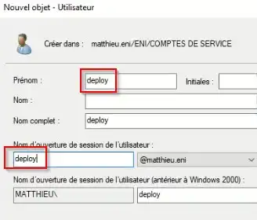

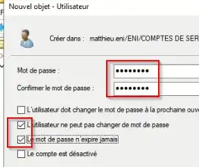

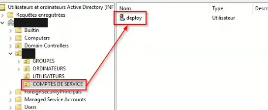

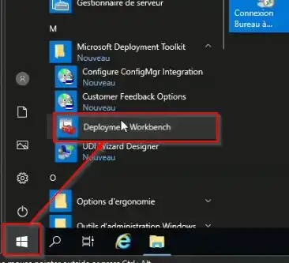

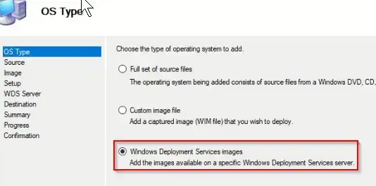

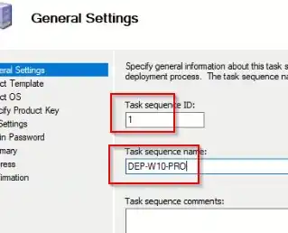

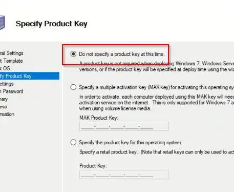

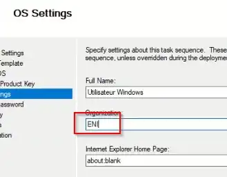

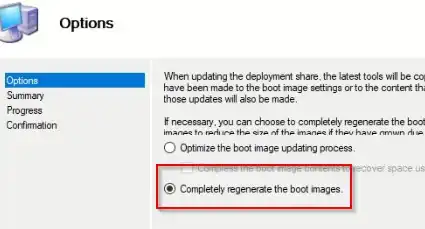

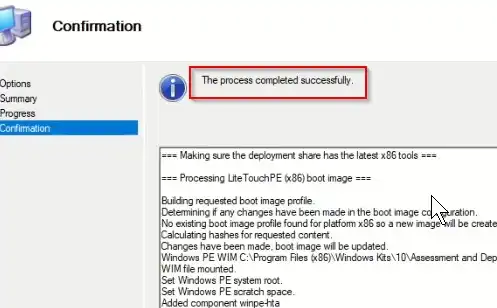

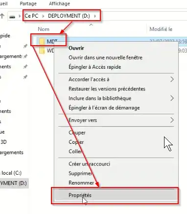

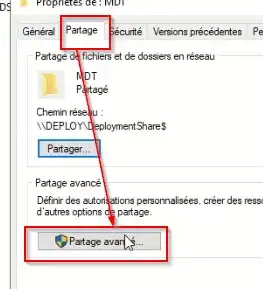

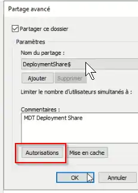

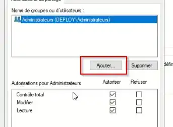

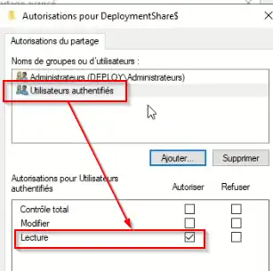

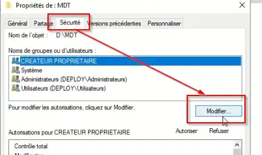

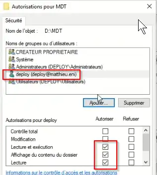

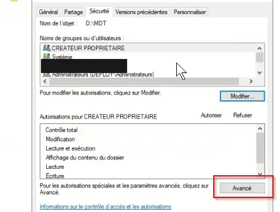

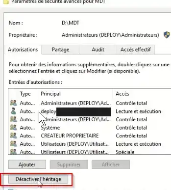

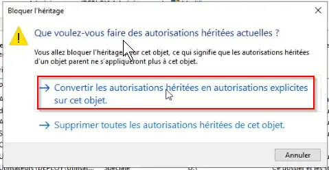

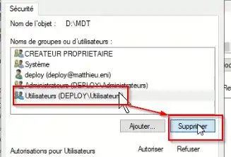

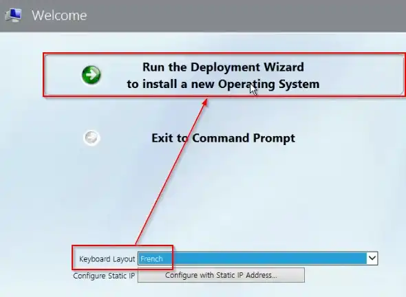

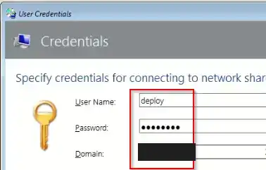

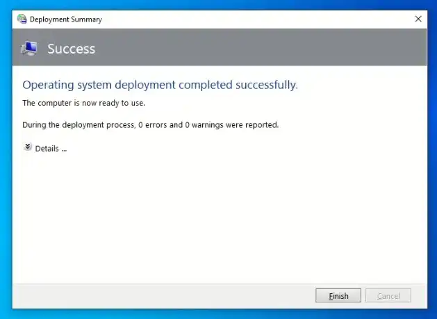
