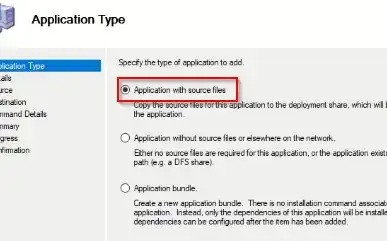
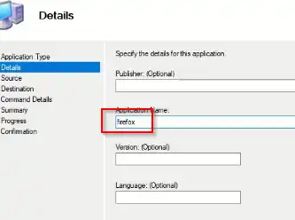
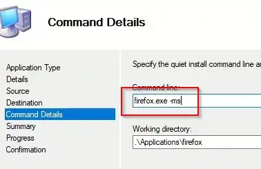
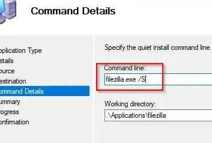
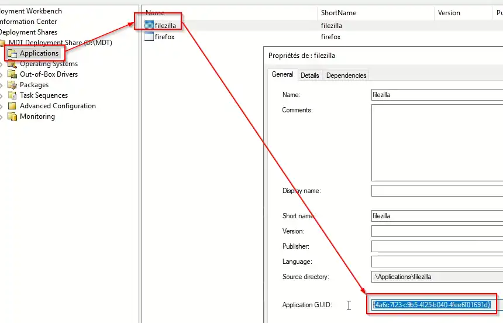
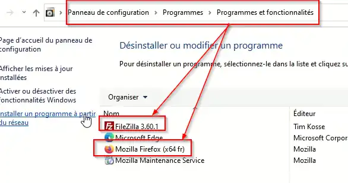
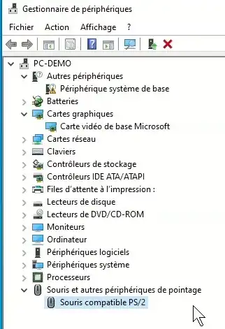
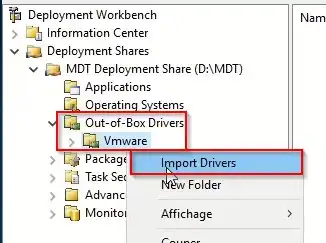
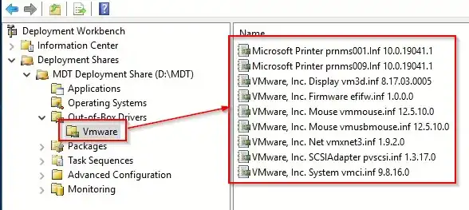

# Correction — TP2 — Applications et pilotes

Services transverses en environnement Microsoft (RDS/WDS)

Déployer des applications

et drivers

TP 2 du Module 6 – Microsoft Deployment Toolkit (MDT)

Avant de démarrer ce TP, il convient d’avoir suivi les vidéos des modules 4 à 6 et d’avoir

réalisé les TP précédents.

Il est nécessaire d’avoir accès au partage distrib nommé « distrib ».

Durée estimée

2h00

Solution

Etape 1 : Récupérer les sources des applications et des drivers

Depuis Distrib, récupérer et copier sur DEPLOY :

- Les applications Firefox et Filezilla (extension en .exe).
- Les drivers compressés et archivés au format ZIP de VMware Workstation pour les
systèmes d’exploitation client Windows 10.

- Créer un répertoire pour chaque application et y déplacer l’exécutable.
Services transverses en environnement Microsoft (RDS/WDS)

Etape 2 : Déployer les applications

Mettre en place dans MDT la configuration qui va permettre de déployer :

Firefox → il doit être automatiquement installé à chaque déploiement.

Filezilla → on laisse le choix d’installer ou non cette application.

- Créer une nouvelle application sous MDT.
Services transverses en environnement Microsoft (RDS/WDS)

Services transverses en environnement Microsoft (RDS/WDS)

L’application est maintenant intégrée dans MDT.

- Intégrer l’application Filezilla en suivant la même méthode que Firefox.
Commande à exécuter en mode silencieux.

Services transverses en environnement Microsoft (RDS/WDS)

Voici les 2 applications intégrées à MDT.

- Récupérer les identifiants uniques des applications « Application GUID » dans les
propriétés des applications.

Exemple ci-dessous avec Filezilla.

- Et modifier le « Bloc Déploiement App » dans le fichier CustomSettings.ini pour
prendre en compte le choix d’installation des logiciels lors du déploiement.

CustomSettings.ini

```ini
; Bloc Déploiement App

;SkipApplications=YES

; L'application 001 Firefox est obligatoirement sélectionnée (grisée)

MandatoryApplications001={9d1c7416-d506-4e04-abd0-e723136e598d}

; L'application 002 Filezilla donne le choix d'être ou non sélectionnée

Applications002={4a6c7f23-c9b5-4f25-b040-4fee6f01691d}
```

Résultat lors du déploiement, Firefox est sélectionné par défaut et non modifiable, Filezilla

peut être coché ou non.

Dans l’exemple ci-dessous, Firefox et Filezilla ont été sélectionnés pour installation lors du

déploiement.

Services transverses en environnement Microsoft (RDS/WDS)

Résultat après déploiement.

Etape 3 : Déployer les drivers

Mettre en place la configuration sous MDT pour installer les drivers et ne plus afficher d’erreur

de pilotes manquants dans le Gestionnaire de périphériques suite au déploiement.

Installer les pilotes

VMware liés à

ces périphériques

Services transverses en environnement Microsoft (RDS/WDS)

- Importer les drivers VMware dans MDT.
Services transverses en environnement Microsoft (RDS/WDS)

Résultat dans MDT de l’importation des pilotes.

À la suite d’un nouveau déploiement, les drivers sont maintenant parfaitement installés.

Les captures ci-dessous viennent de la correction imprimée. Ce sont des visuels externes du laboratoire. Les valeurs secrètes lues sur les images ont été écartées.



















