# Corrigés commentés — Module 02 — Installation d’une distribution Debian

**Reprise structurée des consignes et explications de la source.** Les figures utiles restent isolées et les commandes transcrites restent littérales. Les écarts de version et les corrections techniques sont signalés séparément.

## M02TP01 - Solution - Installation de Debian AVEC interface graphique

### Installation de Debian 11 AVEC interface graphique

Une solution de virtualisation doit être installée sur votre machine

Durée estimée

30 à 45 minutes

### I. Récupérer l’image source d’installation

Copier localement le fichier debian-11.x.x-adm64-netinst.iso depuis le serveur de l’\[organisme de formation\]. (avec 11.x.x = la version disponible sur le serveur)

### II. Création de la machine virtuelle

Créer une nouvelle machine virtuelle avec les paramètres suivant :

Installer le système plus tard

- Interface réseau permettant l'accès au réseau internet (Bridged)  - Disque dur de 40 Go de taille dynamique

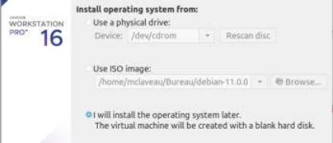

- 4096 Mo de mémoire vive

HDD 40 + 4096M de RAM + interface réseau bridge  - Démarrer la machine virtuelle en mappant le fichier ISO comme CDROM.

Sélectionner l'iso d'installation Debian

### III. Installation de Debian

1) Choisir les options suivantes :  - Installer Debian en mode graphique  - Choix de la langue : French - Français  - Emplacement géographique : France  - Clavier : France  - Nom de la machine : définir un nom  - Nom de domaine : laboratoire.example  - Utilisateurs :

- Indiquer un mot de passe pour le compte root
- Créer un utilisateur à votre noml

Installation en mode graphique

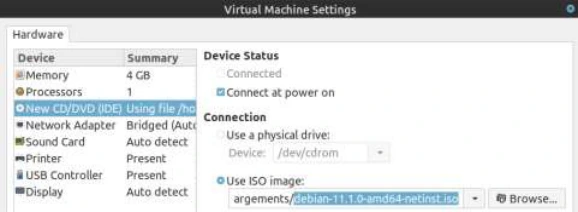

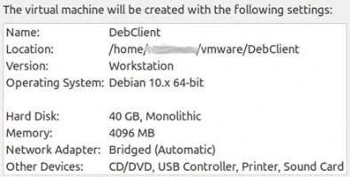

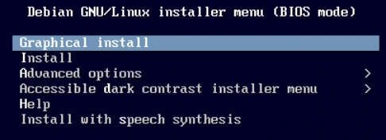

Nommer la machine

Préciser le nom de domaine

Saisie du mot de passe root

Saisie du nom complet du nouvel utilisateur

Saisie du login

Puis le mot de passe de l'utilisateur

Transcription textuelle de la capture : les noms de domaine de formation sont neutralisés ; adresses IP, commandes et résultats sont conservés.

<table><tr><th>Type</th><th>Taille</th><th>Système de fichiers</th><th>Point de montage</th></tr><tr><td>LVM</td><td>2048 MB</td><td>SWAP</td><td></td></tr><tr><td>LVM</td><td>20 GB</td><td>ext4</td><td>/</td></tr><tr><td>LVM</td><td>5 GB</td><td>FAT32</td><td>/windows</td></tr><tr><td>LVM</td><td>L’espace restant</td><td>ext4</td><td>/home</td></tr></table>

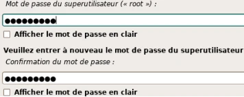

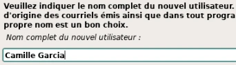


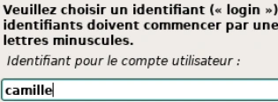

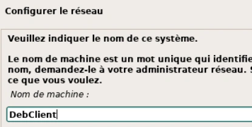

2) Partitionnement des disques :  - Méthode de partitionnement : choisir Manuel  - Sélectionner le disque détecté puis « continuer »  - Configurer le gestionnaire de volume logique LVM  - Créer un groupe de volumes puis les volumes logiques indiqués ci-dessous :   Type Taille Système de fichiers

<table><tr><th>Type</th><th>Taille</th><th></th><th>Système de</th><th></th><th>Point de montage</th></tr><tr><td></td><td></td><td></td><td>fichiers</td><td></td><td></td></tr><tr><td>LVM</td><td>2048 MB</td><td>SWAP</td><td></td><td></td><td></td></tr><tr><td>LVM</td><td>20 GB</td><td>ext4</td><td></td><td></td><td>/</td></tr><tr><td>LVM</td><td>5 GB</td><td>FAT32</td><td></td><td></td><td>/windows</td></tr><tr><td>LVM</td><td>L’espace<br/>restant</td><td>ext4</td><td></td><td></td><td>/home</td></tr></table>

Mode manuel

Sélection du disque

Valider le partionnement du disque

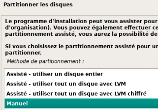

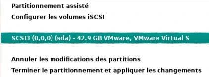

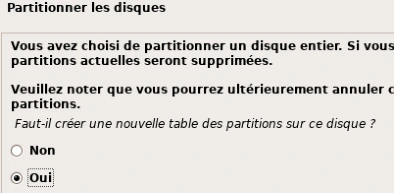

Se rendre dans le gestionnaire LVM

Valider les modifications

Commencer par créer un Groupe de Volumes

Donner un nom explicite au Groupe de Volumes

Sélectionner le disque à utiliser

Créer ensuite un volume logique

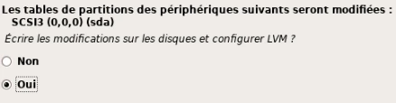

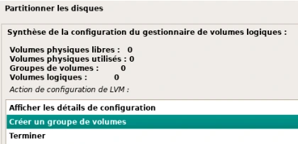

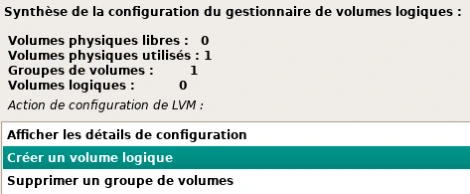

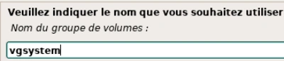

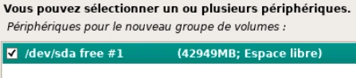

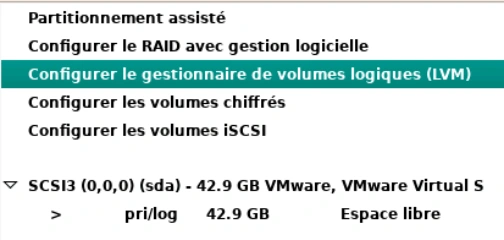

→  Saisir nom et taille du volume

Répéter les étapes de creation des volumes en respectant les tailles demandées. Terminer par la partition home de manière à lui affecter l’espace restant.

"Afficher les détails de configuration”  pour vérifier.

Terminer la mise en place des Volumes  Définir les points de montage et systèmes de fichiers.

Sélectionner le volume lvroot

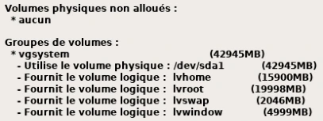

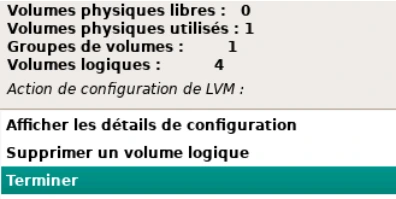

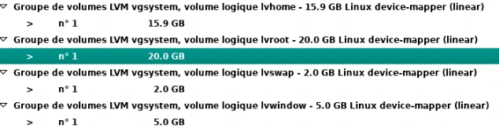

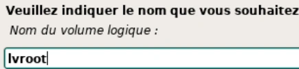

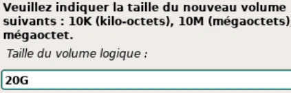

Sélectionner "Utiliser comme"

Choisir le type ext4

→  Définir le point de montage comme “/système de fichiers racine”

Terminer le paramètrage de ce volume

Répéter ces étapes pour les autres volumes logiques en respectant les indications . NB : la partition Swap n’a pas de point de montage.

Terminer la définition des partitions et volumes

Appliquer les modifications après avoir vérifier les informations

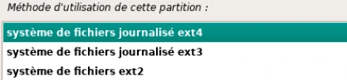

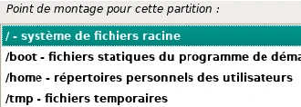

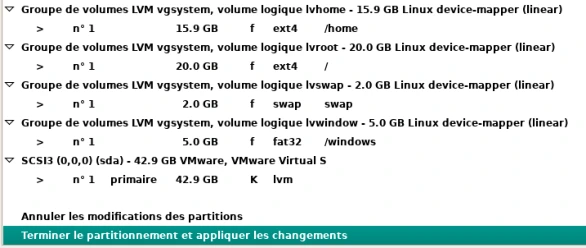

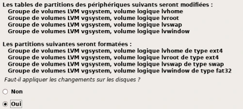

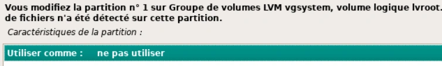

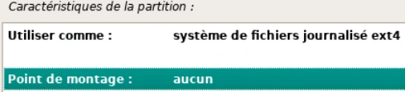

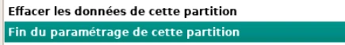

3) Configurer l'outil de gestion des paquets :  - Analyser un autre CD ou DVD : Non  - Pays du miroir de l’archive Debian : France  - Miroir de l’archive Debian : ftp.fr.debian.org - Ne pas utiliser de mandataire (proxy)  - Popularity contest : Non

→  Attention à bien choisir le dépot ftp.fr.debian.org

4) Choisir et installer des logiciels :  - Logiciels à installer : sélectionner

- environnement de bureau Debian
- utilitaires usuels du système

La sélection des tâches logicielles à installer

5) Installer le programme de démarrage GRUB :  - Installer le programme : Oui  - Périphérique où sera installé le programme : /dev/sda

→    Terminer l'installation  Redémarrer

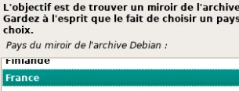

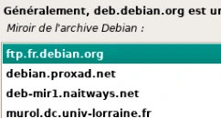

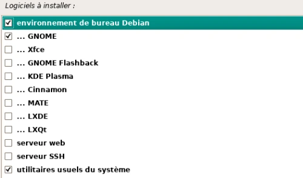

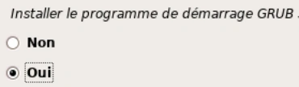

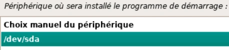

## M02TP02 - Solution - Installation de Debian SANS interface graphique

### Installation de Debian 11 SANS interface graphique

Une solution de virtualisation doit être installée sur votre machine

Durée estimée

45mn à 1 heure

### I. Récupérer l’image source d’installation

Copier localement le fichier debian-11.x.x-amd64-dvd.iso depuis le serveur de l’\[organisme de formation\]. (avec 11.x.x = la version disponible sur le serveur)

### II. Création de la machine virtuelle

Créer une nouvelle machine virtuelle avec les paramètres suivant :

- Interface réseau permettant l'accès au réseau de la salle (Bridged)  - Disque dur de 10 Go de taille dynamique  - 2048 Mo de mémoire vive

Les paramètres de la VM

- Démarrer la machine virtuelle en mappant le fichier ISO comme CDROM.

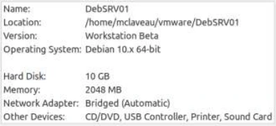

Choisir l'image d'installation DVD

### III. Installation de Debian

1) Choisir les options suivantes :  - Installer Debian en mode graphique (mode par défaut)  - Choix de la langue : French - Français  - Emplacement géographique : France  - Disposition du clavier : Français  - Nom de la machine : définir un nom  - Nom de domaine : laboratoire.example  - Utilisateurs :

- Indiquer un mot de passe pour le compte root
- Créer un utilisateur

Installation en mode graphique

Nommer la machine


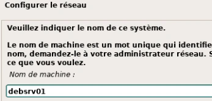

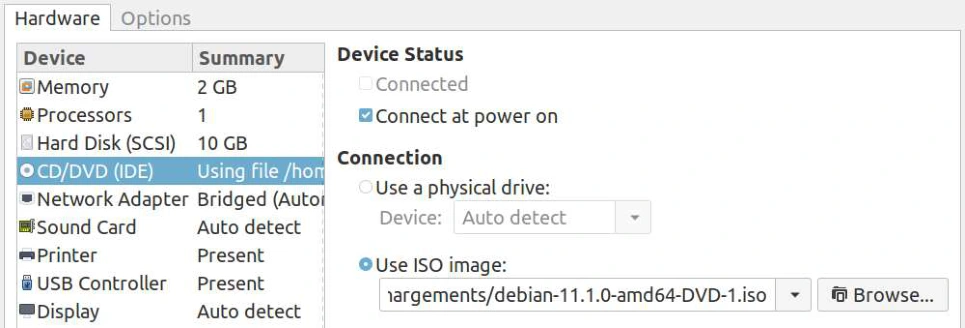

Préciser le nom de domaine

Saisie du mot de passe root

Saisie du nom complet du nouvel utilisateur

Saisie du login

Puis le mot de passe de l'utilisateur

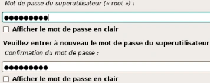


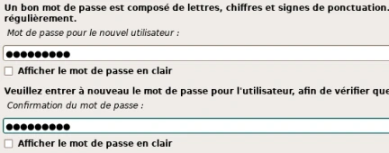

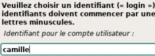

Transcription de la capture avec neutralisation explicite des noms de domaine de formation.

```text
Configurer le réseau — Domaine : laboratoire.example (domaine de formation neutralisé)
```

2) Partitionner les disques :  - Méthode de partitionnement : Assisté - utiliser tout un disque avec LVM  - Disque à partitionner : sélectionner le disque SCSI  - Schéma de partitionnement : Partitions /home, /var et /tmp séparées

Assisté LVM sur disque entier

Sélection du disque

Choix du schéma de partitiionnement

Valider la création de ce partitionnement

Accepter la taille par défaut (totalité du disque)

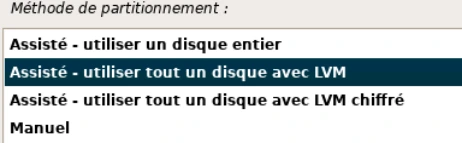

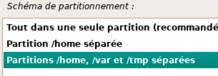

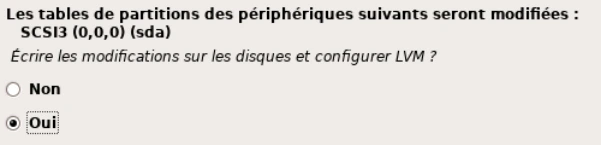

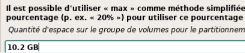

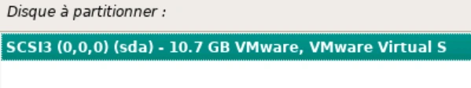

Accepter la configuration automatique

3) Configurer l'outil de gestion des paquets :  - Analyser un autre CD ou DVD : Non  - PAS D’UTILISATION DES MIROIRS  - Popularity contest : Non

Répondre non à ces trois questions

4) Choisir et installer des logiciels :  - Logiciels à installer : sélectionner

- serveur SSH
- utilitaires usuels du système

Sélection des deux seuls groupes demandés

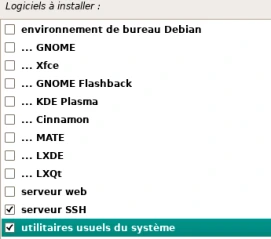

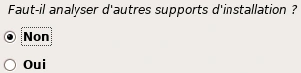

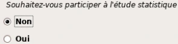

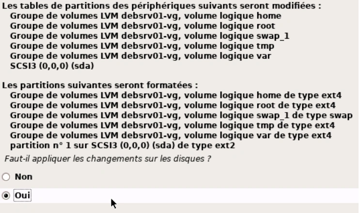

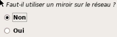

5) Installer le programme de démarrage GRUB :  - Installer le programme : Oui  - Périphérique où sera installé le programme : /dev/sda

Terminer l'installation Redémarrer


## Clarifications et contrôles — complément pédagogique

L’interface de l’installeur et le bureau installé sont deux choix distincts. Le profil « Debian 10.x » de certaines captures appartient à l’hyperviseur ; relever aussi la version réellement installée. Contrôler le mode BIOS/UEFI et les points de montage. Les doublons d’énoncés sont conservés dans l’onglet Original, mais les consignes identiques ne sont présentées qu’une fois ci-dessous.

Pour les justifications et références officielles, lire le [cours optimisé](../../../modules/05-administration-debian-gnu-linux/module-02-installation-d-une-distribution-debian.md).

## Compte rendu attendu

- État de départ et cible précise de la manipulation.
- Commandes ou paramètres appliqués, avec les valeurs réellement utilisées.
- Résultats observés et contrôles qui les établissent.
- Différences entre l’environnement actuel et celui des captures.

[Retour au TP](index.md) · [Énoncés](enonces.md) · [Corrigés](corrections.md).
