# Corrigés commentés — Module 03 — Démarrage d’une distribution Debian

**Reprise structurée des consignes et explications de la source.** Les figures utiles restent isolées et les commandes transcrites restent littérales. Les écarts de version et les corrections techniques sont signalés séparément.

## M03TP01 - Solution - Démarrer et arrêter Debian

Administration Debian GNU/Linux

### Démarrer et arrêter Debian

Durée estimée

15 à 30 minutes

### Solution : Identification & modification de la cible par défaut : sur la station avec environnement graphique

- Démarrer le système, ouvrez une session avec votre utilisateur

Cliquez sur votre nom puis saisissez votre mot de passe

- Quelle est la cible systemd qui sera atteinte par défaut au démarrage de la machine ?

→  Ouvrir une fenêtre de terminal puis saisir la commande attendue

- Dans le manuel de la commande systemd, rechercher le nom de la cible identifiée au point précédent. Lire le paragraphe correspondant et en déduire le nom de la cible permettant un démarrage normal SANS ENVIRONNEMENT GRAPHIQUE


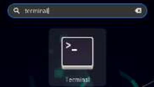

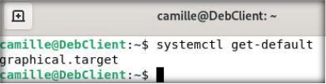

```text
systemctl get-default
graphical.target
```

Administration Debian GNU/Linux

→  man systemd   puis recherche  /graphical.target . Le résultat de cette recherche nous permet de remarquer le choix entre graphical.target et multi-user.target

- Définir comme cible par défaut la cible trouvée au point précédent.

Faire une élévation de droit puis saisir la commande systemctl avec ces paramètres

- Redémarrer le poste avec environnement graphique. A l’issue du redémarrage, l’environnement graphique a-t-il été chargé ? Est-ce normal ?

Après redémarrage, le mode multi-user par défaut nous offre un mode console

- Exécuter la commande systemctl appropriée afin de charger l’environnement graphique.

→  Ouvrir une session avec l'utilisateur root,  saisir la commande systemctl isolate graphical.target

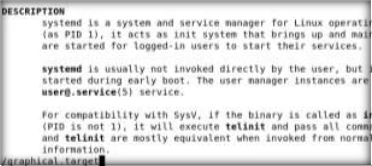

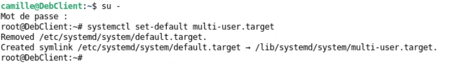

```text
su -
systemctl set-default multi-user.target
```

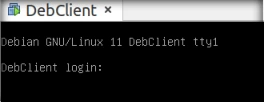

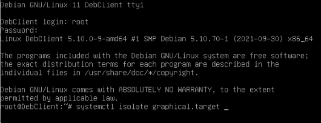

```text
systemctl isolate graphical.target
```


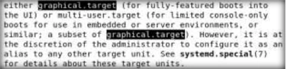

## M03TP02 - Solution - Gérer les services

Administration Debian GNU/Linux

### Gérer les services

Durée estimée

25 à 45 minutes

### Solution : Gestion des services : sur le serveur sans environnement graphique

### I. Gestion du service SSHD (connexions SSH)

Trouver les fichiers relatifs au fonctionnement du service (nom et emplacement) :

Ouvrir une session avec votre utilisateur standard

- Fichier de configuration systemd du service
- Démon ou fichier binaire du serveur ssh

Conf systemd ligne 'Loaded'

Binaire en ligne Process

- Fichier de configuration du serveur sshd find dans le dossier /etc qui contient les paramètres du système et de ses services

type f car nous cherchons un fichier, pas un dossier \*sshd\*conf\* cherche un fichier dont le nom contient à la fois le nom du service et le mot conf, habituel dans des fichiers de ce type.

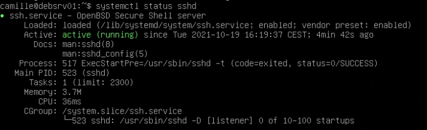

```text
systemctl status sshd
# Unité : /lib/systemd/system/ssh.service
# Binaire : /usr/sbin/sshd
```

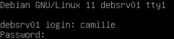

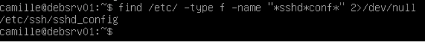

```text
find /etc/ -type f -name "*sshd*conf*" 2>/dev/null
/etc/ssh/sshd_config
```

Administration Debian GNU/Linux

### II. Gestion du service CRON (planification de tâches)

- Le service sera-t-il lancé automatiquement au démarrage de la machine ?

Lister les services avec systemctl puis filtrer sur le mot cron.

Le résultat montre un service activé

- Arrêter le service cron

Arrêt du service avec la commande systemctl stop.

Vérification du résultat avec systemctl status .

- Redémarrer le serveur. Le service cron est-il actif après redémarrage systemctl stop ne fait qu'arrêter un service temporairement. Le service est de nouveau actif après redémarrage du système
- Arrêter à nouveau le service manuellement
- Désactiver totalement le démarrage automatique du démon cron au démarrage du système

Désactivation d'un service au prochain démarrage avec l'option disable de systemctl

Restaurer les paramètres par défaut de démarrage du démon cron systemctl enable pour activer au démarrage, systemctl start pour démarrer manuellement le service sans devoir redémarrer le serveur.

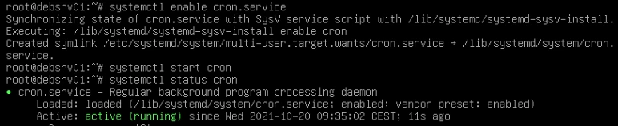

```text
systemctl enable cron.service
systemctl start cron
systemctl status cron
```

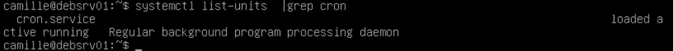

```text
systemctl list-units | grep cron
```

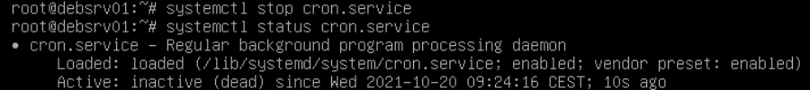

```text
systemctl stop cron.service
systemctl status cron.service
```

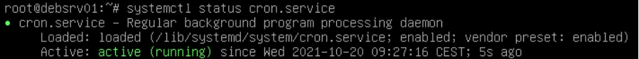

```text
systemctl status cron.service
```

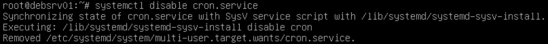

```text
systemctl disable cron.service
```


```text
systemctl stop cron.service
```

## Clarifications et contrôles — complément pédagogique

Comparer état actif et activation au démarrage. `stop` ne remplace pas `disable`, et `set-default` ne remplace pas `isolate`. Restaurer la cible et le service cron à l’état demandé après l’exercice.

Pour les justifications et références officielles, lire le [cours optimisé](../../../modules/05-administration-debian-gnu-linux/module-03-demarrage-d-une-distribution-debian.md).

## Compte rendu attendu

- État de départ et cible précise de la manipulation.
- Commandes ou paramètres appliqués, avec les valeurs réellement utilisées.
- Résultats observés et contrôles qui les établissent.
- Différences entre l’environnement actuel et celui des captures.

[Retour au TP](index.md) · [Énoncés](enonces.md) · [Corrigés](corrections.md).
