# Corrigés commentés — Module 04 — Debian en mode maintenance

**Reprise structurée des consignes et explications de la source.** Les figures utiles restent isolées et les commandes transcrites restent littérales. Les écarts de version et les corrections techniques sont signalés séparément.

## M04TP01 - Solution - Debian en mode maintenance

Administration Debian GNU-Linux

### Debian en mode maintenance

Durée estimée

30 minutes à 1 heure

I. Sur le serveur Debian sans environnement graphique

Utiliser le menu GRUB pour démarrer le serveur en mode maintenance et sans avoir besoin de s’authentifier avec le mot de passe de root (voir support de cours)

Sur le menu de démarrage Grub, appuyer sur la touche ‘e’

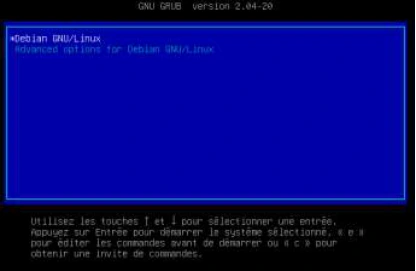

Administration Debian GNU-Linux

Chercher la ligne commencant par "linux" , à la fin de celle-ci remplacer 'quiet' par 'init=/bin/bash'

Attention : clavier en qwerty US Appuyer sur F10 pour lancer le système

Commenté \[MC1\]: Image dans le domaine public. Source : https://freesvg.org/golden-qwerty-keyboard- vector-image

Mappage de touche au format qwerty US

Une session root est ouverte sans besoin d'authentification

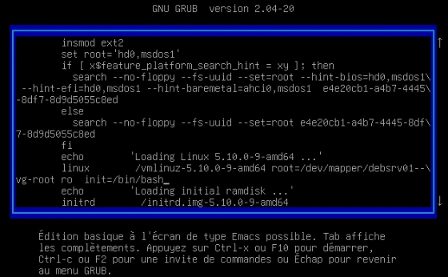

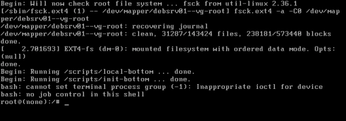

Administration Debian GNU-Linux

- Activer l’écriture sur la partition racine.

Saisir la commande " mount -o remount,rw / " Le message qui suit est une information, pas une erreur.

- Pouvez-vous créer un fichier dans l’espace personnel du compte root ?

Une commande touch dans /root ne renvoi pas de message d'erreur, le ficher a bien été créée

- Pouvez-vous accéder au répertoire personnel de l’utilisateur créé à l’installation ?

Impossible de se déplacer dans le dossier de l'utilisateur standard

- Est-ce normal ?

Le dossier /home est vide. Le dossier /home a été place sur un autre Volume Logique que la partition racine.

Seule cette dernière est directement accessible dans ce cas.

→  Utiliser la commande sync pour s’assurer que toute modification apportée est effectivement écrite ;

puis forcer l'extinction du serveur par les options de VMware Workstation

II. Sur le serveur Debian avec environnement graphique

Démarrer dans le "Rescue mode" (dans "Advanced options") à partir de l'ISO d'installation Debian\* :

Vérifiez dans les paramètres de la VM que l'image CD est bien sélectionnée et que la case "Connect at power on" est bien cochée

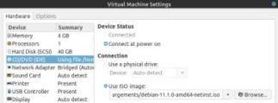

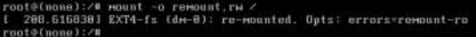

```text
mount -o remount,rw /
```

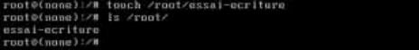

```text
touch /root/essai-ecriture
ls /root/
essai-ecriture
```


```text
cd /home/camille
bash: cd: /home/camille: No such file or directory
```


```text
ls /home
```


```text
sync
```

Administration Debian GNU-Linux

Mettre le focus dans la VM est cliquer sur "echap" au logo vmware. Si le menu grub s’affiche, saisir la sequence ‘ctrl+alt+ins’ avant de réappuyer sur ‘echap’

Enfin valider le démarrage sur le CD-Rom

→  Choisir 'Advanced options' puis Rescue mode''

- Sélectionner la langue, le nom (comme lors d'une installation)

→ →  Saisir la langue et la disposition du clavier

Saisie du nom d'hôte. Remarquez la mention 'mode de récupération' en haut de l'écran

- Sélectionner le système de fichiers racine à monter

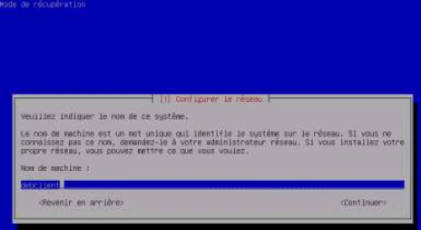


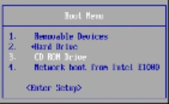

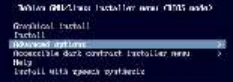

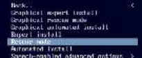

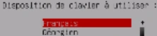

Administration Debian GNU-Linux

Ici il faut bien choisir le Volume Logique contenant le système de fichier racine. Remarquons l’importance des noms explicites pour les Groupes de Volumes & Volumes Logiques.

Choisir la première option pour avoir accès à notre système Debian installé Noter l’option “Reinstallation de Grub”, utile pour dépanner un système qui ne démarre pas

Après validation d'un message informatif, un shell root s'ouvre sans authentification  Accédez au fichier /etc/passwd sur votre disque dur.

Ouvrir le ficher avec VI

- Pouvez-vous le modifier ? (attention à ne rien casser !!)

Se déplacer en fin de fichier \[G\], Passer en mode insertion avec une nouvelle ligne \[o\], Saisir du texte puis revenir en mode commande \[echap\],

Enregistrer sans quitter (:w)

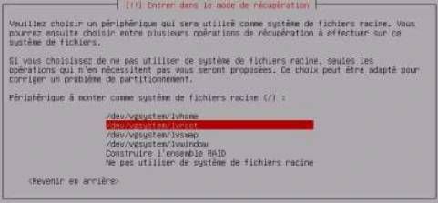

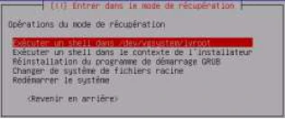

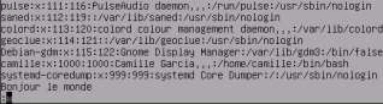


```text
vi /etc/passwd
```

Administration Debian GNU-Linux

Un message nous informe de la bonne écriture dans le fichier

Supprimer la ligne que vous venez d'écrire (et seulement celle-ci) (dd)

Enregistrer et quitter (:wq)

- Avec quel utilisateur êtes-vous connecté ?

La variable d'environnement USER nous renvoie la valeur 'root' également lisible simplement dans le prompt bash. NB : la commande ‘logname’ ne renvoie rien dans ce cas particulier

- Avez-vous indiqué un mot de passe ?

Non, comme vue précédemment, un shell root s'ouvre sans authentication dans ce type de cas

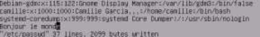

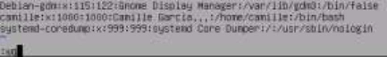


```text
echo $USER
root
```

## Clarifications et contrôles — complément pédagogique

Le shell `init=/bin/bash` ne monte pas nécessairement le volume séparé de `/home`. Identifier les montages avant d’interpréter un répertoire vide. Utiliser un tiret ASCII dans `mount -o`. Le TP demande d’observer l’accès à passwd ; aucune modification arbitraire de ce fichier n’est nécessaire.

Pour les justifications et références officielles, lire le [cours optimisé](../../../modules/05-administration-debian-gnu-linux/module-04-debian-en-mode-maintenance.md).

## Compte rendu attendu

- État de départ et cible précise de la manipulation.
- Commandes ou paramètres appliqués, avec les valeurs réellement utilisées.
- Résultats observés et contrôles qui les établissent.
- Différences entre l’environnement actuel et celui des captures.

[Retour au TP](index.md) · [Énoncés](enonces.md) · [Corrigés](corrections.md).
