# Corrigés commentés — Module 05 — Gestion du réseau

**Reprise structurée des consignes et explications de la source.** Les figures utiles restent isolées et les commandes transcrites restent littérales. Les écarts de version et les corrections techniques sont signalés séparément.

## M05TP01 - Solution - Gestion de la configuration réseau dun poste

### Gérer la configuration réseau d’un poste

Durée estimée

2 à 3 heures

### I. Configurer une adresse IP statique sur le serveur sans environnement graphique

Configurer la 1ere carte réseau détectée (ens33) avec l'adressage suivant :

- Adresse IP : 10.X.Y.1/16
- Avec le second octet X=n° de réseau.
- Pour récupérer votre réseau de salle, depuis le poste Windows hôte, ouvrir une fenêtre cmd et lancer la commande ipconfig

Dans cet exemple, le numéro de salle est 49

- avec le troisième octet Y=votre n° de stagiaire (donné par votre coach en début de semaine)
- Passerelle : 10.X.255.254

Pour cette solution, je vais utiliser la salle 49 et le numéro de stagiaire 222

Donc le reseau 10.49.222.0/16

Transcription textuelle de la capture : les noms de domaine de formation sont neutralisés ; adresses IP, commandes et résultats sont conservés.

<table><tr><th>Paramètre observé sur le poste Windows</th><th>Valeur</th></tr><tr><td>Commande</td><td>ipconfig</td></tr><tr><td>Interface</td><td>Carte Ethernet Ethernet</td></tr><tr><td>Suffixe DNS (nom de formation neutralisé)</td><td>laboratoire.example</td></tr><tr><td>Adresse IPv4</td><td>10.49.0.254</td></tr><tr><td>Masque de sous-réseau</td><td>255.255.0.0</td></tr><tr><td>Passerelle par défaut</td><td>10.49.255.254</td></tr></table>

Ouvrir une session avec l'utilisateur root

Précaution préalable : créer le fichier .vimrc avec l'activation du mode nocompatible

Pour le moment notre système est nativement  en mode compatible Unix

Le fichier interfaces dans sa configuration d'origine

Modifier la mention allow-hotplug en auto passer de dhcp à static ajouter l’adresse (attention à l’orthographe anglaise),

le masque de sous reseau et la passerelle.

Redémarrer le service networking, optionnel : verifier le statut du service.

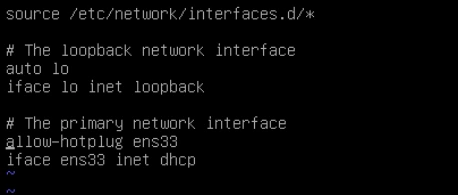

```text
source /etc/network/interfaces.d/*
# The loopback network interface
auto lo
iface lo inet loopback
# The primary network interface
allow-hotplug ens33
iface ens33 inet dhcp
```

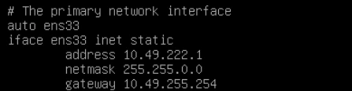

```text
# The primary network interface
auto ens33
iface ens33 inet static
    address 10.49.222.1
    netmask 255.255.0.0
    gateway 10.49.255.254
```

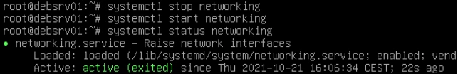

```text
systemctl stop networking
systemctl start networking
systemctl status networking
```

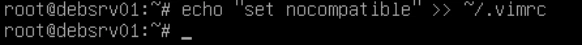

```text
echo "set nocompatible" >> ~/.vimrc
```

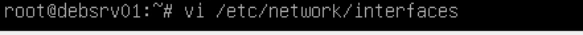

```text
vi /etc/network/interfaces
```

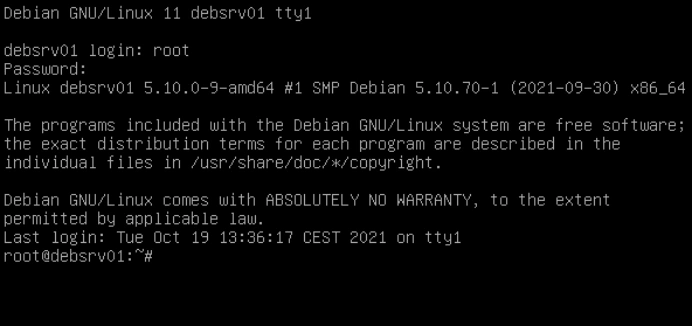

Vérifier et adapter si nécessaire les paramètres de résolution de nom :

Modifier le fichier /etc/resolv.conf

- Serveurs DNS : serveurs DNS de l’\[organisme de formation\]
- Domaines résolus par défaut : laboratoire.example et \[référence de l’organisme de formation neutralisée\] hostname Une seule directive search pour plusieurs domaines de recherches

mais une directive nameserver par serveur DNS

- Pour valider la bonne prise en compte du point précédent, vous pourrez essayer un ping vers les hôtes suivants :
- dc44-far
- dc35-cdb1
- repos

Les deux adresses “DC” sont résolues avec le domaine laboratoire.example

L’adresse repos elle appartient par contre au domaine \[référence de l’organisme de formation neutralisée\] Astuce avec ping, l’option “-c” permet de préciser le nombre de ping avant de quitter la commande

Transcription textuelle de la capture : les noms de domaine de formation sont neutralisés ; adresses IP, commandes et résultats sont conservés.

<table><tr><th>Commande / cible</th><th>Adresse résolue</th><th>Résultats visibles</th></tr><tr><td>ping -c 2 dc44-far</td><td>10.100.0.3</td><td>2 transmis, 2 reçus, 0 % de perte ; TTL 126 ; temps 5.00 et 4.74 ms ; min/moy/max/mdev 4.741/4.871/5.002/0.147 ms</td></tr><tr><td>ping -c 2 dc35-cdb1</td><td>10.35.0.3</td><td>2 transmis, 2 reçus, 0 % de perte ; TTL 127 ; temps 0.737 et 0.789 ms ; min/moy/max/mdev 0.737/0.763/0.789/0.026 ms</td></tr><tr><td>ping -c 2 repos</td><td>10.0.0.21</td><td>2 transmis, 2 reçus, 0 % de perte ; TTL 62 ; temps 2.97 et 2.78 ms ; min/moy/max/mdev 2.783/2.875/2.967/0.092 ms</td></tr></table>

Transcription de la capture : noms du réseau de formation neutralisés, paramètres numériques et suite conservés.

```text
search laboratoire.example formation.example
nameserver 10.0.0.3
nameserver 10.100.0.3
```


```text
vi /etc/resolv.conf
```

Modifier le nom de la machine :

- Indiquer le nom : deb-\<prénom\>-01 avec \<prénom\> = votre prénom

Attention, il y a 2 fichiers à modifier ! (/etc/hosts et /etc/hostname)

→  Le fichier hostname contient uniquement le nom d'hôte.

→  Sur la seconde ligne du  fichier hosts  il faut modifier nom long et nom court de l'hôte.

La commande hostname rpermet la modification du nom d'hôte sans redémarrage Il faut ouvrir un nouveau shell ou une nouvelle session pour verifier cette prise en compte.

Ajouter une 2e carte réseau en Host-only à votre VM et utiliser les paramètres suivants :

Dans les paramètres de la machine virtuelle, ajout de la seconde carte

La commande ip a  permet de montrer la nouvelle carte, ici ens35.

- IP : 192.168.100.1/24
- Pas de passerelle par défaut

→  Ajouter ces lignes dans le fichier /etc/network/interfaces Après redémarrage du service networking, la carte ens35 a récupérée son adresse IP

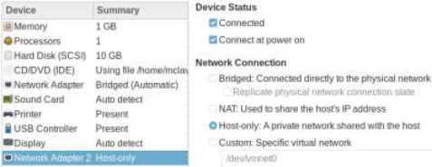

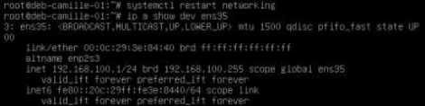

```text
systemctl restart networking
ip a show ens35
inet 192.168.100.1/24 brd 192.168.100.255 scope global ens35
```


```text
deb-camille-01
```

Transcription de la capture : noms du réseau de formation neutralisés, paramètres numériques et suite conservés.

```text
127.0.0.1 localhost
127.0.1.1 deb-camille-01.laboratoire.example deb-camille-01
```

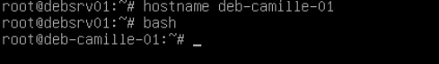

```text
hostname deb-camille-01
bash
```

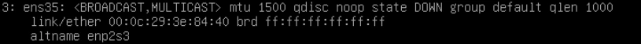

```text
ip a
3: ens35: <BROADCAST,MULTICAST> mtu 1500 qdisc noop state DOWN group default qlen 1000
link/ether 00:0c:29:3e:84:4b brd ff:ff:ff:ff:ff:ff
altname enp2s3
```

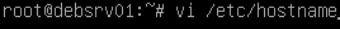

```text
vi /etc/hostname
```

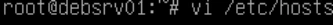

```text
vi /etc/hosts
```

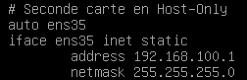

```text
# Seconde carte en Host-Only
auto ens35
iface ens35 inet static
    address 192.168.100.1
    netmask 255.255.255.0
```

### II. Configurer une adresse IP statique sur la machine avec environnement graphique

Au démarrage saisir systemctl isolate graphical pour lancer la couche graphique

Ouvrir une session avec l'utilisateur standard Se rendre dans les paramètres de la carte ethernet.

Configurer un adressage IP statique compatible avec la 1ere carte réseau de la VM Debian sans environnement graphique

Cliquer sur l'icone en forme de roue dentelée

Dans l’onglet IPv4 passer en mode manuel et saisir une adresse valide. Pas de passerelle.

NB : l’interface graphique ne permet pas de saisir de nom de domaine DNS.

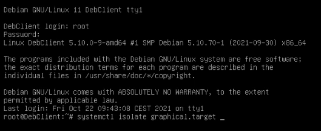

```text
systemctl isolate graphical.target
```

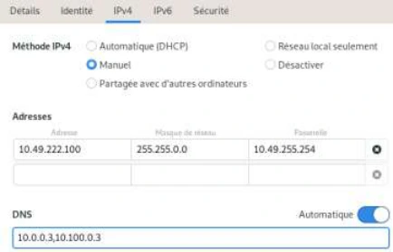


Au besoin les renseigner via la commande nmtui

Désactiver/réactiver la carte afin que ces modifications soient prises en compte

- Pouvez-vous pinguer l'autre VM Debian ?
- Pouvez-vous pinguer les serveurs \[organisme de formation\] ?

Si la configuration est correcte, il est possible de pinguer l'autre VM Debian comme les serveurs \[organisme de formation\]

Transcription textuelle de la capture : les noms de domaine de formation sont neutralisés ; adresses IP, commandes et résultats sont conservés.

<table><tr><th>Commande depuis le client</th><th>Résultat visible</th></tr><tr><td>ping -c 2 10.49.222.1</td><td>2 transmis, 2 reçus, 0 % de perte ; TTL 64 ; temps 0.651 et 0.696 ms ; min/moy/max/mdev 0.651/0.673/0.696/0.022 ms</td></tr><tr><td>ping -c 2 dc44-far</td><td>Résolution 10.100.0.3 ; 2 transmis, 2 reçus, 0 % de perte ; min/moy/max/mdev 3.922/4.201/4.480/0.285 ms</td></tr><tr><td>ping -c 2 repos</td><td>Résolution 10.0.0.21 ; 2 réponses visibles ; TTL 62 ; temps 2.92 et 2.35 ms. La capture source ne montre pas le bilan final.</td></tr></table>

Transcription de la capture avec neutralisation explicite des noms de domaine de formation.

```text
Modifier la connexion — Wired connection 1
Configuration IPv4 : Manuel
Adresse : 10.49.222.100/16
Passerelle : 10.49.255.254
Serveurs DNS : 10.0.0.3, 10.100.0.3
Domaines de recherche (noms de formation neutralisés) : laboratoire.example, formation.example
```

## Clarifications et contrôles — complément pédagogique

Avec l’hôte `10.49.222.1/16`, le réseau est `10.49.0.0/16`, contrairement à une formulation du corrigé. Les domaines de formation sont neutralisés explicitement. Une interface Host-only sans passerelle n’est pas la sortie par défaut ; examiner le gestionnaire réseau réellement utilisé et la persistance de resolv.conf.

Pour les justifications et références officielles, lire le [cours optimisé](../../../modules/05-administration-debian-gnu-linux/module-05-gestion-du-reseau.md).

## Compte rendu attendu

- État de départ et cible précise de la manipulation.
- Commandes ou paramètres appliqués, avec les valeurs réellement utilisées.
- Résultats observés et contrôles qui les établissent.
- Différences entre l’environnement actuel et celui des captures.

[Retour au TP](index.md) · [Énoncés](enonces.md) · [Corrigés](corrections.md).
