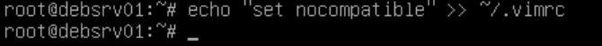

# Énoncés — Module 05 — Gestion du réseau

**Reprise structurée des consignes et explications de la source.** Les figures utiles restent isolées et les commandes transcrites restent littérales. Les écarts de version et les corrections techniques sont signalés séparément.

## M05TP01 - Enoncé - Gestion de la configuration réseau dun poste

### Gérer la configuration réseau d’un poste

Durée estimée

45mn à 1 heure

### I. Configurer une adresse IP statique sur le serveur sans environnement graphique

Configurer la 1ere carte réseau détectée (ens33) avec l'adressage suivant :

- Adresse IP : 10.X.Y.1/16
- Avec le second octet X=n° de réseau.
- Pour récupérer votre réseau de salle, depuis le poste Windows hôte, ouvrir une fenêtre cmd et lancer la commande ipconfig

Dans cet exemple, le numéro de salle est 49

- avec le troisième octet Y=votre n° de stagiaire (donné par votre coach en début de semaine)
- Passerelle : 10.X.255.254

Transcription textuelle de la capture : les noms de domaine de formation sont neutralisés ; adresses IP, commandes et résultats sont conservés.

<table><tr><th>Paramètre observé sur le poste Windows</th><th>Valeur</th></tr><tr><td>Commande</td><td>ipconfig</td></tr><tr><td>Interface</td><td>Carte Ethernet Ethernet</td></tr><tr><td>Suffixe DNS (nom de formation neutralisé)</td><td>laboratoire.example</td></tr><tr><td>Adresse IPv4</td><td>10.49.0.254</td></tr><tr><td>Masque de sous-réseau</td><td>255.255.0.0</td></tr><tr><td>Passerelle par défaut</td><td>10.49.255.254</td></tr></table>

Vérifier et adapter si nécessaire les paramètres de résolution de nom :

- Serveurs DNS : serveurs DNS de l’\[organisme de formation\]  (à récupérer depuis votre poste avec ipconfig /all)
- Domaines résolus par défaut : laboratoire.example et \[référence de l’organisme de formation neutralisée\]
- Pour valider la bonne prise en compte du point précédent, vous pourrez essayer un ping vers les hôtes suivants :
- dc44-far
- dc35-cdb1
- repos

Modifier le nom de la machine :

- Indiquer le nom : deb-\<prénom\>-01 avec \<prénom\> = votre prénom

Attention, il y a 2 fichiers à modifier ! (/etc/hosts et /etc/hostname)

Ajouter une 2e carte réseau en Host-only à votre VM et utiliser les paramètres suivants :

- IP : 192.168.100.1/24
- Pas de passerelle par défaut

### II. Configurer une adresse IP statique sur la machine avec environnement graphique

Configurer un adressage IP statique compatible avec la 1ere carte réseau de la VM Debian sans environnement graphique

- Pouvez-vous pinguer l'autre VM Debian ?
- Pouvez-vous pinguer les serveurs \[organisme de formation\] ?

### Astuce

Précaution préalable : créer le fichier .vimrc avec l'activation du mode nocompatible

Pour le moment notre système est nativement  en mode compatible Unix



```text
echo "set nocompatible" >> ~/.vimrc
```

## Clarifications et contrôles — complément pédagogique

Avec l’hôte `10.49.222.1/16`, le réseau est `10.49.0.0/16`, contrairement à une formulation du corrigé. Les domaines de formation sont neutralisés explicitement. Une interface Host-only sans passerelle n’est pas la sortie par défaut ; examiner le gestionnaire réseau réellement utilisé et la persistance de resolv.conf.

Pour les justifications et références officielles, lire le [cours optimisé](../../../modules/05-administration-debian-gnu-linux/module-05-gestion-du-reseau.md).

## Compte rendu attendu

- État de départ et cible précise de la manipulation.
- Commandes ou paramètres appliqués, avec les valeurs réellement utilisées.
- Résultats observés et contrôles qui les établissent.
- Différences entre l’environnement actuel et celui des captures.

[Retour au TP](index.md) · [Énoncés](enonces.md) · [Corrigés](corrections.md).
