# Corrigés commentés — Module 06 — Gestion des paquets logiciels

**Reprise structurée des consignes et explications de la source.** Les figures utiles restent isolées et les commandes transcrites restent littérales. Les écarts de version et les corrections techniques sont signalés séparément.

## M06TP01 - Solution - Gestion des paquets logiciels

### Gestion des paquets

Durée estimée

30 à 45 mn

### Énoncé :

### I. Gérer les installations logicielles avec interface graphique

Afficher le composant les "Software & Updates"

Rechercher le composant dans le menu Gnome

- Vérifier les paramétrages dans les différents onglets
- Rechercher les informations relatives aux dépôts configurés

Onglet Debian Software, configuration du dépot principal Main. Possibilité de cocher contrib et non-free

Onglet Updates, presence de bullseye-security et bullseye-updates

- Désactiver le dépôt CDROM si nécessaire

Décocher les cases au besoin pour désactiver les dépots cdrom.

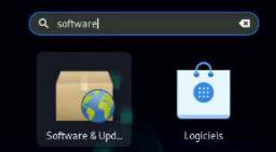

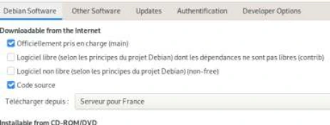

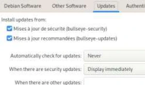

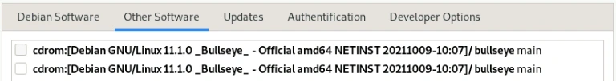

Vérifier la configuration du fichier sources.list dans /etc/apt :

- Quelles lignes définissent l'emplacement des sources d'installation des paquets binaires ?
- Quelles lignes définissent l'emplacement des mises à jour ?
- Pouvez-vous récupérer les paquets sous la forme du code source ?

Les lignes commençant par "deb " indiquent les dépôts de binaires Les lignes contenant “bookworm-updates” indiquent les dépôts de mises à jour Les lignes commençant par “deb-src ” indiquent la disponibilité des paquets sources

- Désactiver l'accès aux dépôts concernant le code source.

Faire une élévation de droit en tant que root et lancer l'édition du fichier

→  Pour modifier toutes les lignes visées en une fois, les options de substitution de VI sont à privilégier

:g/^deb-src/s/^/# Recherche des lignes commençant par deb-src, puis substitution du caractère début de ligne ^ par #

Effectuer une mise à jour des paquets installés avec apt :

Lancer la mise à jour de la base données locales des paquets avec

- Combien de paquets seront mis à jour ? ( pourquoi ? )

Très peu de paquets, voire aucun. Cela est du au mode d’installation net install qui a directement récupéré des paquets à jours

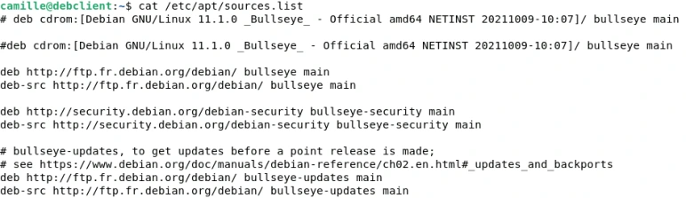

```text
deb http://ftp.fr.debian.org/debian/ bullseye main
deb-src http://ftp.fr.debian.org/debian/ bullseye main
deb http://security.debian.org/debian-security bullseye-security main
deb-src http://security.debian.org/debian-security bullseye-security main
deb http://ftp.fr.debian.org/debian/ bullseye-updates main
deb-src http://ftp.fr.debian.org/debian/ bullseye-updates main
```

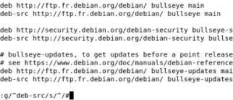

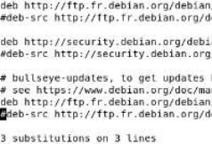

Transcription de la capture : noms du réseau de formation neutralisés, paramètres numériques et suite conservés.

```text
Atteint :1 http://depot.formation.example:8081/repository/debian bullseye InRelease
Atteint :2 http://depot.formation.example:8081/repository/debian bullseye-updates InRelease
Atteint :3 http://depot.formation.example:8081/repository/debian-security/debian-security bullseye-security InRelease
Lecture des listes de paquets... Fait
Construction de l'arbre des dépendances... Fait
Lecture des informations d'état... Fait
Tous les paquets sont à jour.
```

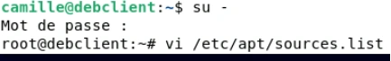

```text
su -
vi /etc/apt/sources.list
```

Installer le logiciel suivant avec l'outil "Logiciels"

- Gparted (outil de partitionnement)

→ →  Rechercher Gparted et lancer son installation. Le mot de passe root est demandé pour valider l’élévation de droits

- Lancer cette application depuis les menus Gnome

→  Gparted est bien présent dans les applications. Le logiciels se lance après demande d’une nouvelle élévation de privilèges.

Ne rien modifier et quitter le logiciel.

Installer les paquets suivants avec la commande apt :

- vim  (Editeur VI amélioré)

Valider l'installation du paquet et de ses dépendances.

- Serveur SSH   (rechercher d’abord le nom du paquet adapté)

La recherche apt search ssh renvoie de très nombreux résultats.

On peut limiter les résultats en cherchant ssh-server A noter que le paquet nommé simplement ssh est un “métapaquet” qui installe openssh-server + openssh-client (si pas déjà present).


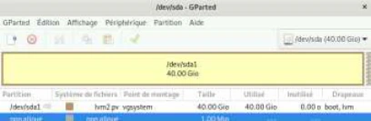

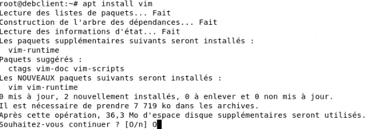

```text
apt install vim
```

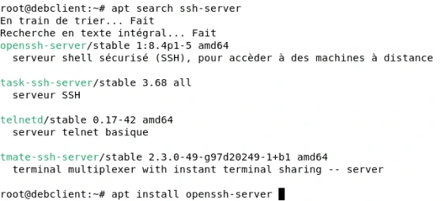

```text
apt search ssh-server
apt install openssh-server
```

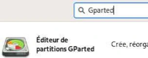

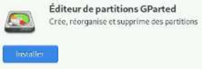

- Terminator

Terminator est un logiciel terminal pour client graphique Linux hautement configurable.

Afficher les informations sur ces 3 paquets avec les commandes :

- $ apt show \<paquet\>
- $ dpkg -L \<paquet\>

→  apt show récupère de nombreuses informations : version, taille, dépendances… dpkg -L va lister les fichiers liés à ce paquet présents sur le système.

Connectez-vous via Putty sur votre VM Debian graphique.

Récupérer un client Putty sur Distrib ou bien à l’adresse https://the.earth.li/~sgtatham/putty/latest/w64/putty.exe

→  Lancer le logiciel, saisir l'adresse IP de la VM, et saisir login/password.

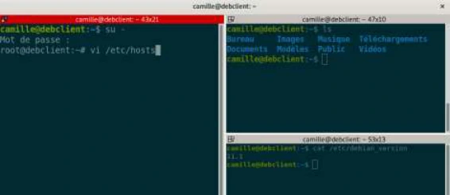

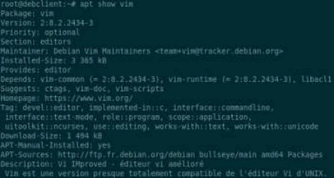

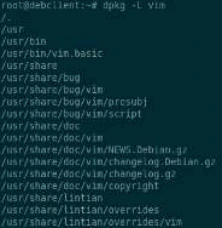

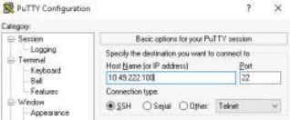

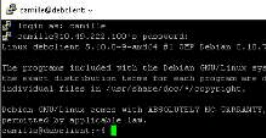

### II. Gérer les installations logicielles sans interface graphique

Configurer manuellement les dépôts Internet dans le fichier /etc/apt/sources.list

- Ajouter les directives :
- deb http://ftp.fr.debian.org/debian/ bookworm main
- deb http://ftp.fr.debian.org/debian/ bookworm-updates main
- Garder la directive :
- deb http://security.debian.org/debian-security bookworm-security main

Les dépots Debian nécessaires Bulseye → Bookworm

Vérifier les mises à jour disponibles

- Combien de paquets seront mis à jour ?
- Effectuer les mises à jour et redémarrer si nécessaire

Le nombre de mises à jour dépend de l'écart entre la date de génération du DVD utilisé pour l'installation du système et la date de lancement de la demande de mise à jour

Installer les paquets suivants avec la commande apt :

- vim  (éditeur VIM)
- cifs-utils (outils pour la connexion aux partages SMB)

Il est possible de lancer l'installation des deux paquets en même temps avec apt

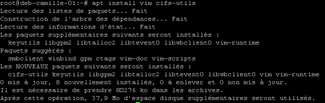

```text
apt install vim cifs-utils
```

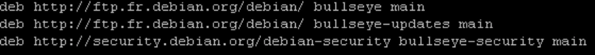

```text
deb http://ftp.fr.debian.org/debian/ bullseye main
deb http://ftp.fr.debian.org/debian/ bullseye-updates main
deb http://security.debian.org/debian-security bullseye-security main
```

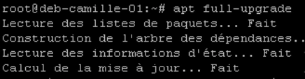

```text
apt full-upgrade
```

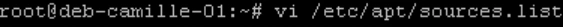

```text
vi /etc/apt/sources.list
```

Configurer le fonctionnement de VIM pour les deux Postes:

- Lancer l'édition : # vi /etc/vim/vimrc
- Décommenter la ligne contenant la mention : syntax on (active la coloration syntaxique)
- Ajouter les modifications suivantes pour retrouver un comportement normal de vim en créant le fichier : /etc/vim/vimrc.local   source /usr/share/vim/vim90/defaults.vim  let skip\_defaults\_vim = 1  if has('mouse')  set mouse=r  endif  set paste

Vérifier dans /usr/share/vim le nom du dossier suivant, il change selon les versions de Debian

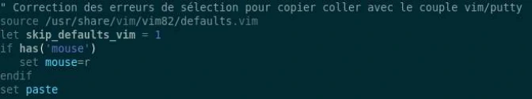

```text
source /usr/share/vim/vim82/defaults.vim
let skip_defaults_vim = 1
if has('mouse')
  set mouse=r
endif
set paste
```

## Clarifications et contrôles — complément pédagogique

Le scénario d’installation cible Debian 11, mais certaines consignes demandent Bookworm et certaines captures montrent Bullseye. Ne pas mélanger ces dépôts ni transformer implicitement l’exercice en migration. Le chemin defaults.vim dépend de la version de Vim. `apt-get search` est corrigé en `apt-cache search` ou `apt search` ; dpkg interroge l’état local.

Pour les justifications et références officielles, lire le [cours optimisé](../../../modules/05-administration-debian-gnu-linux/module-06-gestion-des-paquets-logiciels.md).

## Compte rendu attendu

- État de départ et cible précise de la manipulation.
- Commandes ou paramètres appliqués, avec les valeurs réellement utilisées.
- Résultats observés et contrôles qui les établissent.
- Différences entre l’environnement actuel et celui des captures.

[Retour au TP](index.md) · [Énoncés](enonces.md) · [Corrigés](corrections.md).
