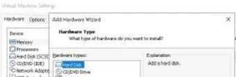
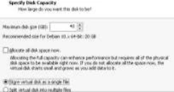
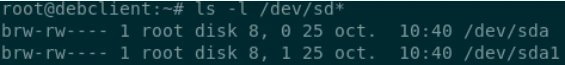
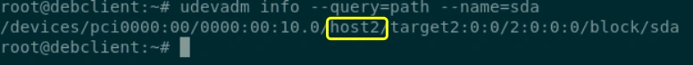
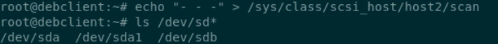
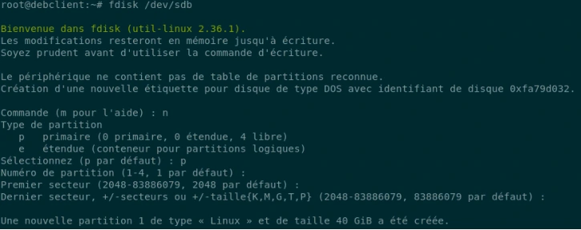
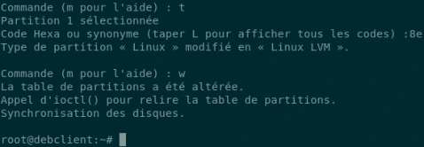
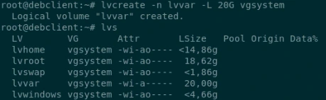
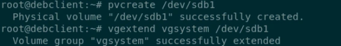
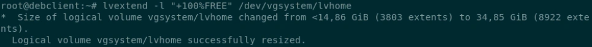

# Corrigés commentés — Module 08 — Gestion des espaces de stockage avancée — LVM

**Reprise structurée des consignes et explications de la source.** Les figures utiles restent isolées et les commandes transcrites restent littérales. Les écarts de version et les corrections techniques sont signalés séparément.

## M08TP01 - Solution - Manipuler les disques et LVM

### Manipuler les disques et LVM

Durée estimée

15 à 20 minutes

### I. Gestion des disques sur la station avec environnement graphique

- Ajouter un nouveau disque de 40 Go.

→  1Depuis les paramètres de la VM, créer un nouveau disque, avec les options pas défaut.

- Vérifier que le disque est bien présent dans /dev

Après l'ajout du disque, seul le disque d'origine est listé

En utilisant la commande indiquée en Astuce apparait le host qui gère les disques. Ici host2.

On force ensuite le scan en précisant le host2 indiqué à l’étape précédente







```text
ls -l /dev/sd*
```



```text
udevadm info --query=path --name=sda
/devices/pci0000:00/0000:00:10.0/host2/target2:0:0/2:0:0:0/block/sda
```



```text
echo "- - -" > /sys/class/scsi_host/host2/scan
ls /dev/sd*
```

- Créer 1 partition sur le nouveau disque avec fdisk :
- Partition principale de la totalité du disque pour du LVM

Lancer fdisk sur /dev/sdb, n pour créer une nouvelle partition. Tous les choix par défaut

L’option t permet de modifier le type de partition en 8e pour “Linux LVM”.

- Intégrer la partition au groupe de volume présent dans votre système.

pvcreate pour declarer la nouvelle partition comme Volume Physique utilisable pour LVM vgextend ajoute ce nouveau Volume Physique au Groupe de Volumes existant.

- Créer un volume logique de 20 Go nommé lvvar.

lvcreate avec l’option -n pour préciser le nom du volume logique

-L permet de préciser la taille du volume Ne pas oublier de préciser le nom du Groupe de Volume cible.

- Agrandir le volume logique lvhome avec le reste de l’espace disponible du groupe de volume.

lvextend avec l’option -l suivi de l’argument “100%FREE” permet d’affecter l’espace libre au volume logique

Avec un LV existant, saisir le chemin complet /dev/\<nomduVG\>/\<nomduLV\> d







```text
lvcreate -n lvvar -L 20G vgsystem
lvs
```



```text
pvcreate /dev/sdb1
vgextend vgsystem /dev/sdb1
```



```text
lvextend -l +100%FREE /dev/vgsystem/lvhome
```

## Clarifications et contrôles — complément pédagogique

Identifier le VG existant et le contrôleur SCSI réel avant de reprendre les noms de la correction. `lvextend -l +100%FREE` consomme tous les extents libres du VG visé. Le TP suivant prend en charge le système de fichiers ; sans adaptation de cette couche, un LV agrandi ne suffit pas.

Pour les justifications et références officielles, lire le [cours optimisé](../../../modules/05-administration-debian-gnu-linux/module-08-gestion-des-espaces-de-stockage-avancee-lvm.md).

## Compte rendu attendu

- État de départ et cible précise de la manipulation.
- Commandes ou paramètres appliqués, avec les valeurs réellement utilisées.
- Résultats observés et contrôles qui les établissent.
- Différences entre l’environnement actuel et celui des captures.

[Retour au TP](index.md) · [Énoncés](enonces.md) · [Corrigés](corrections.md).
