# Corrigés commentés — Module 09 — Gestion des espaces de stockage — File System

**Reprise structurée des consignes et explications de la source.** Les figures utiles restent isolées et les commandes transcrites restent littérales. Les écarts de version et les corrections techniques sont signalés séparément.

## M09TP01 - Solution - Préparation des systèmes de fichiers

### Préparation des systèmes de fichiers

Durée estimée

30 à 45 minutes

### I. Gestion des systèmes de fichier

A partir du volume logique var, configurer un système de fichier ext4 avec une étiquette VAR

La commande mkfs permet de préciser directement le type avec .ext4.

l’option -L affecte le label au FS. NB : il est aussi possible de modifier l’étiquette d’un FS existant avec tune2fs

Vérifier avec blkid

Agrandir le système de fichier présent dans le volume logique home afin qu’il utilise toute la place du volume logique.

resize2fs permet d’étendre le FS existant après avoir étendu le LV lors du précèdent TP

NB : il est possible que le FS soit déjà à la taille maximale si l’option -r avait été utilisé avec lvextend

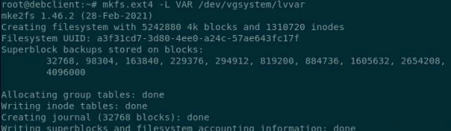

```text
mkfs.ext4 -L VAR /dev/vgsystem/lvvar
```

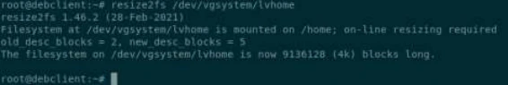

```text
resize2fs /dev/vgsystem/lvhome
```

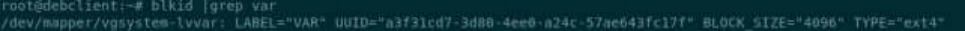

```text
blkid | grep VAR
```

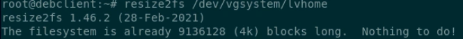

```text
resize2fs /dev/vgsystem/lvhome
The filesystem is already 9136128 (4k) blocks long. Nothing to do!
```

### II. Migration du répertoire /var

Migrer le répertoire /var vers le volume logique var tout en préservant les données existantes.

Conseils de mise en œuvre :

- Faites un snapshot de votre VM

→  Ce snapshot permettra un retour arrière en cas d'erreur

- Vérifier l'utilisation de /var avant de copier les fichiers (lsof).

La commande lsof (List Open Files) permet de dénombrer les fichiers en cours d'utilisation par des processus.

En filtrant (grep) sur le répertoire /var, on dénombre plusieurs centaines de lignes

- Prendre toutes les précautions nécessaires pour éviter l’écriture dans l’arborescence de /var afin de pouvoir copier correctement les fichiers

→  La méthode la plus simple pour stopper les nombreux processus utilisant des fichiers présents sous /var est de passer en mode rescue.

Si un service tel systemd-journald utilise encore des fichiers, vous pouvez le stopper avec la commande adéquat

- Utiliser un montage temporaire pour pouvoir copier les données de l'ancien vers le nouveau volume

La création d'un sous dossier dans /mnt est optionnelle La commande mount permet ensuite d’effectuer le montage temporaire

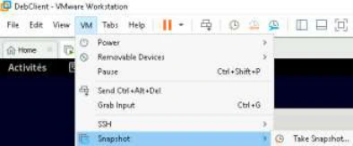

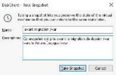

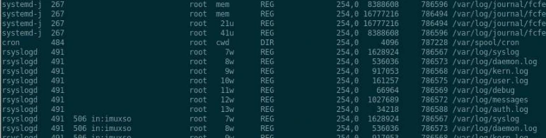

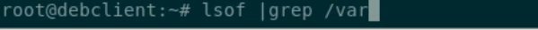

```text
lsof | grep /var
```

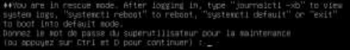

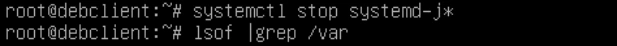

```text
systemctl stop systemd-j*
lsof | grep /var
```

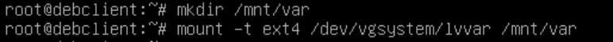

```text
mkdir /mnt/var
mount -t ext4 /dev/vgsystem/lvvar /mnt/var
```

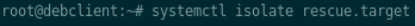

```text
systemctl isolate rescue.target
```

La commande findmnt affiche bien l'utilisation de /mnt/var comme point de montage pour lvvar

- Copier les données en préservant les permissions

Les options utiles de la commande cp ici sont : -p : préserver les permissions et groups et utilisateurs propriétaires des fichiers

-r : la récursivité permet de copier tous les sous-dossiers et leurs contenus

-v pour avoir un affichage verbeux.

Une fois l'opération achevée on peut démonter le LV

Une fois cela fait, on remonte le volume logique immédiatement sur /var

Puis relancer la cible graphique pour verifier le bon fonctionnement du système.

On s’assure que le LV est bien monté sur /var

Il est possible de vérifier le bon fonctionnement par exemple avec les fichiers journaux dans /var/log

### III. Automatisation du montage au démarrage : sur la station avec environnement graphique

Activer le montage automatique au démarrage du volume logique lvvar vers /var

Editer le fichier /etc/fstab En dernière ligne, le LV est appelé par le LABEL apposé sur le file-system

→ On repasse en mode rescue pour tester AVANT de redémarrer

Ne pas oublier de stopper les éventuels process encore consommateurs de fichiers sur /var

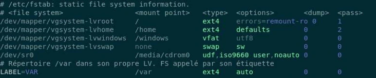

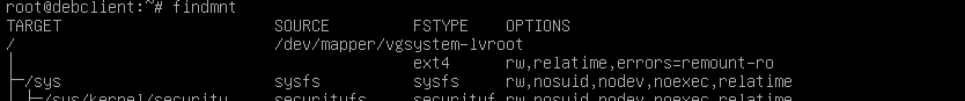

```text
findmnt
```


```text
/mnt/var /dev/mapper/vgsystem-lvvar ext4 rw,relatime
```

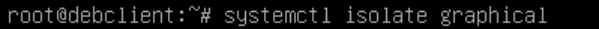

```text
systemctl isolate graphical
```

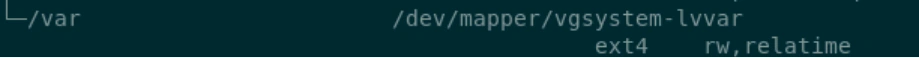

```text
/var /dev/mapper/vgsystem-lvvar ext4 rw,relatime
```

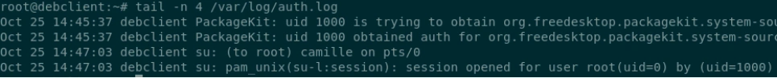

```text
tail -n 4 /var/log/auth.log
```

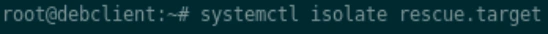

```text
systemctl isolate rescue.target
```


```text
systemctl stop systemd-j*
lsof | grep /var
```

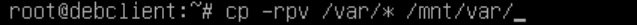

```text
cp -rpv /var/* /mnt/var/.
```


```text
umount /mnt/var
```

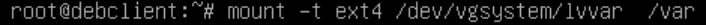

```text
mount -t ext4 /dev/vgsystem/lvvar /var
```

On défait le montage manuel qui avait été fait sur /var

On relance le montage de /var, mais ce coup-ci sans options ni autre argument, ce qui implique la lecture des informations du fichier /etc/fstab

Si tout cela fonctionne bien, on peut enfin redémarrer le système en guise de dernière vérification.

En cas d’erreur, reprendre ces étapes, avec retour sur le snapshot préalablement pris si besoin.


```text
umount /var
```


```text
mount /var
```

## Clarifications et contrôles — complément pédagogique

Le montage masque le contenu précédent ; il ne le migre pas. Confirmer l’arrêt des écritures avant la copie, préserver les métadonnées nécessaires et conserver un retour arrière. Tester l’entrée fstab avec un montage réellement lu depuis ce fichier, puis contrôler findmnt avant de redémarrer.

Pour les justifications et références officielles, lire le [cours optimisé](../../../modules/05-administration-debian-gnu-linux/module-09-gestion-des-espaces-de-stockage-file-system.md).

## Démarche vérifiable — complément pédagogique

La commande source `cp -rpv /var/* /mnt/var/.` n’inclut pas les entrées cachées situées directement sous `/var` et ses options ne promettent pas de conserver toutes les métadonnées possibles. Après avoir arrêté les écritures et vérifié la destination montée, une copie GNU `cp -a /var/. /mnt/var/` est une variante à étudier pour préserver l’arborescence complète. Contrôler les droits, liens, ACL et attributs nécessaires aux services, puis comparer les contenus ; ne pas remplacer ces contrôles par le seul code retour d’une copie.

Laisser les anciennes données disponibles pour le retour arrière jusqu’à validation. Le montage de `/var` et l’entrée persistante doivent viser le même système de fichiers, identifié par les valeurs effectivement relevées sur la VM.

Référence externe : [cp(1)](https://manpages.debian.org/trixie/coreutils/cp.1.en.html).

## Compte rendu attendu

- État de départ et cible précise de la manipulation.
- Commandes ou paramètres appliqués, avec les valeurs réellement utilisées.
- Résultats observés et contrôles qui les établissent.
- Différences entre l’environnement actuel et celui des captures.

[Retour au TP](index.md) · [Énoncés](enonces.md) · [Corrigés](corrections.md).
