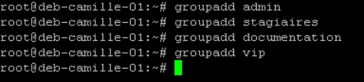
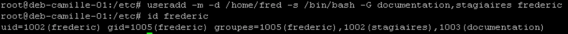
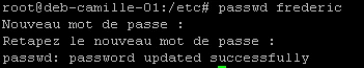
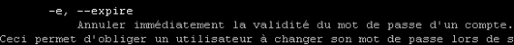
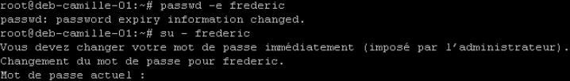
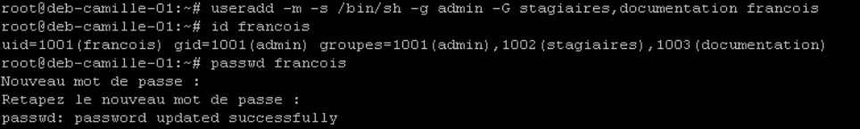
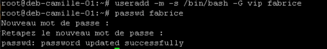
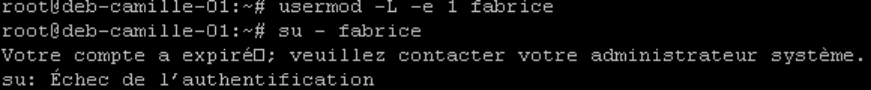

# Corrigés commentés — Module 10 — Gestion des utilisateurs et groupes

**Reprise structurée des consignes et explications de la source.** Les figures utiles restent isolées et les commandes transcrites restent littérales. Les écarts de version et les corrections techniques sont signalés séparément.

## M10TP01 - Solution - Gérer les groupes et utilisateurss

### Gérer les groupes et utilisateurs

Durée estimée

20 à 30 minutes

### I. Création d’utilisateurs et de groupes sur le serveur sans environnement graphique

Créer des comptes utilisateurs pour : François, Frédéric et Fabrice avec les caractéristiques précisées.

Attention il faudra au préalable créer les groupes nécessaires à la configuration des utilisateurs.

Création des groupes utilisés pour ces trois comptes utilisateurs

- Pour François :
- Shell à utiliser Le shell sh
- Répertoire personnel /home/francois
- Mot de passe password
- Groupe principal admin
- Groupes secondaires stagiaires, documentation



```text
groupadd admin
groupadd stagiaires
groupadd documentation
groupadd vip
```

Les options de useradd : -m pour forcer la création du répertoire personnel de l'utilisateur -s pour préciser le binaire du shell à utiliser, -g pour le groupe principal, -G pour les groupes secondaires Id permet de vérifier les groups de l’utilisateur. Ne pas oublier de modifier le mot de passe avec passwd

- Pour Frédéric :
- Shell à utiliser Le shell bash
- Répertoire personnel /home/frederic
- Mot de passe AchAngEr

Ce mot de passe sera à changer à la première ouverture de session

- Groupes secondaires stagiaires, documentation

On ajoute l’option -d pour préciser le dossier /home/fred

La saisie du mot de passe ne change pas

Le man passwd contient cette information concernant l’expiration du mot de passe d’un utilisateur

Après la saisie de la commande pour forcer l’expiration du mot de passe, l’on peut vérifier la bonne prise en compte en changeant d’utilisateur. Il suffit d’annuler avec ^C pour ne pas aller au bout de la procédure.



```text
useradd -m -d /home/fred -s /bin/bash -G documentation,stagiaires frederic
id frederic
```



```text
passwd frederic
```





```text
passwd -e frederic
su - frederic
```



```text
useradd -m -s /bin/sh -g admin -G stagiaires,documentation francois
id francois
passwd francois
```

- Pour Fabrice :
- Shell à utiliser Le shell bash
- Répertoire personnel /home/fabrice
- Mot de passe password

Son compte devra être désactivé

- Groupes secondaires vip

Création du compte de manière standard

L’option -L de usermod permet de verrouiller le compte, l’option -e1 permet de forcer sa date d’expiration.



```text
useradd -m -s /bin/bash -G vip fabrice
passwd fabrice
```



```text
usermod -L -e 1 fabrice
su - fabrice
Votre compte a expiré, veuillez contacter votre administrateur système.
su: Échec de l’authentification
```

## Clarifications et contrôles — complément pédagogique

L’énoncé demande `/home/frederic`, tandis qu’un exemple du corrigé crée `/home/fred` : suivre l’énoncé. `usermod -L` verrouille le mot de passe ; l’expiration de compte répond à une question différente. Tester les groupes dans une nouvelle session. Les mots de passe faibles de la source sont des valeurs de laboratoire.

Pour les justifications et références officielles, lire le [cours optimisé](../../../modules/05-administration-debian-gnu-linux/module-10-gestion-des-utilisateurs-et-groupes.md).

## Compte rendu attendu

- État de départ et cible précise de la manipulation.
- Commandes ou paramètres appliqués, avec les valeurs réellement utilisées.
- Résultats observés et contrôles qui les établissent.
- Différences entre l’environnement actuel et celui des captures.

[Retour au TP](index.md) · [Énoncés](enonces.md) · [Corrigés](corrections.md).
