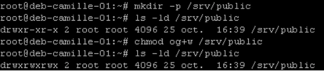
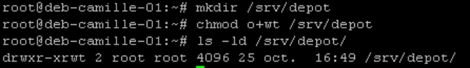
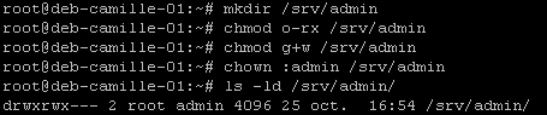
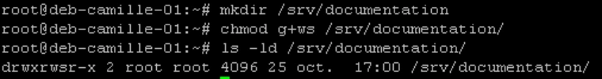

# Corrigés commentés — Module 11 — Droits sur les fichiers et répertoires

**Reprise structurée des consignes et explications de la source.** Les figures utiles restent isolées et les commandes transcrites restent littérales. Les écarts de version et les corrections techniques sont signalés séparément.

## M11TP01 - Solution - Gestion des permissions

### Gestion des permissions

Durée estimée

45 minutes à 1 heure

### Créer une structure de stockage sur le serveur sans interface graphique pour les fichiers utilisateurs.

Trouver les solutions pour les besoins suivants :

- Public : un répertoire public accessible en lecture / écriture pour tous les utilisateurs

Création de la structure de stockage dans le dossier /srv (Données des services hebergées, par exemple unh serveur de fichier). Ajout du droit d’écriture à others .

- Dépôt : un répertoire depot accessible en lecture / écriture pour tous les utilisateurs mais dans lequel seul le propriétaire du fichier pourra le supprimer

Création du dossier sans l'option -p, devenu inutile maintenant que /srv existe ajout du droit w à others ainsi que du droit t , le sticky bit, qui interdit la suppression par d’autres comptes que l’utilisateur propriétaire ou root



```text
mkdir -p /srv/public
ls -ld /srv/public
chmod og+w /srv/public
ls -ld /srv/public
```



```text
mkdir /srv/depot
chmod o+wt /srv/depot
ls -ld /srv/depot/
```

- Admin : un répertoire admin accessible en lecture / écriture pour le groupe admin uniquement

Suppression de tous les droits pour others ajout du droit d’écriture pour le groupe propriétaire Affection du groupe admin comme groupe propriétaire

- Documentation : un répertoire documentation accessible en lecture pour tous les utilisateurs et en lecture/écriture pour le groupe documentation.  Faire en sorte que tout nouveau fichier créé dans ce répertoire appartienne au groupe documentation

Ajout du droit d'écriture pour le groupe ainsi que du droit s qui active le SetGID .



```text
mkdir /srv/admin
chmod o-rx /srv/admin
chmod g+w /srv/admin
chown :admin /srv/admin
ls -ld /srv/admin/
```



```text
mkdir /srv/documentation
chmod g+ws /srv/documentation/
ls -ld /srv/documentation/
```

## Clarifications et contrôles — complément pédagogique

Dans un répertoire sticky, le propriétaire du répertoire et un utilisateur privilégié restent des exceptions autorisées à la suppression. SetGID règle le groupe hérité, mais pas automatiquement le droit d’écriture de tous les fichiers. Tester plusieurs utilisateurs avec leur umask réel.

Pour les justifications et références officielles, lire le [cours optimisé](../../../modules/05-administration-debian-gnu-linux/module-11-droits-sur-les-fichiers-et-repertoires.md).

## Répondre au besoin de groupe — complément pédagogique

Le SetGID seul ne choisit pas le nom du groupe hérité. Le répertoire documentation doit d’abord appartenir au groupe documentation ; la capture du corrigé ne montre pas cette affectation, nécessaire pour atteindre le besoin de l’énoncé.

```bash
chown root:documentation /srv/documentation
chmod 2775 /srv/documentation
ls -ld /srv/documentation
```

Dans une session de test d’un membre de documentation, examiner son umask puis créer un fichier et contrôler son groupe ainsi que ses droits. Pour un travail où les membres doivent modifier les nouveaux fichiers des autres, le masque de création doit aussi permettre l’écriture de groupe ; `umask 0002` est un exemple pour cette session de laboratoire. Le propriétaire et le groupe n’impliquent pas à eux seuls un mode d’accès particulier.

Pour depot, tester la suppression du fichier d’un autre utilisateur ordinaire, puis rappeler les exceptions du propriétaire du répertoire et d’un utilisateur privilégié. Ne pas conclure uniquement à partir d’une manipulation sous root.

## Compte rendu attendu

- État de départ et cible précise de la manipulation.
- Commandes ou paramètres appliqués, avec les valeurs réellement utilisées.
- Résultats observés et contrôles qui les établissent.
- Différences entre l’environnement actuel et celui des captures.

[Retour au TP](index.md) · [Énoncés](enonces.md) · [Corrigés](corrections.md).
