# Corrigés commentés — tp01-journalisation

**Reprise structurée des consignes et explications de la source.** Les figures utiles restent isolées et les commandes transcrites restent littérales. Les écarts de version et les corrections techniques sont signalés séparément.

## M12TP01 - Solution - Gestion de la journalisation

### Gestion de la journalisation

Durée estimée

30 à 45 minutes

### I. Recherche d’informations : sur le serveur sans environnement graphique

- Trouver dans les journaux les différentes ouvertures de sessions

Dans le dossier des journaux, /var/log, la commande ls -lrt permet d’afficher les derniers fichiers utilisés

Remarquons le fichier auth.log. Il contient bien des informations concernant les ouvertures de sessions

Dans ce fichier, en filtrant sur le mot "opened", je récupère des ouvertures de sessions pour les utilisateurs ex : login de l'utilisateur root en première ligne. Mais il s'y trouve aussi des informations de services comme cron.

En ajoutant un grep -v CRON, nous filtrons les résultats en ne retenant pas ce motif.

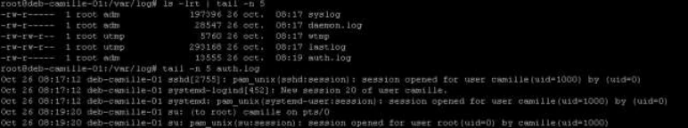

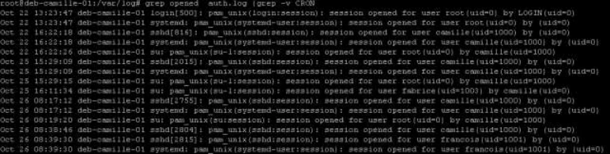

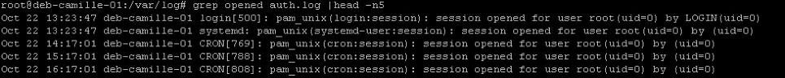

```text
grep opened auth.log | grep -v CRON
```

- Les reporter dans un fichier /adm/sessions.txt

Il ne reste plus qu'à rediriger ce résultat dans /adm/sessions.txt, en ayant pris soin de créer le dossier au préalable.

- Rechercher dans les journaux des informations sur le disque sda, (dont le nombre de secteurs et la taille du disque)

Un appel à la commande journalctl suivie d'un grep filtrant le résultat sur sda nous renvoie ces résultats.

On trouve sur la première ligne l'information du nombre de secteurs du disque et de sa taille globale

En bonus, il est possible de filtrer ces résultats en précisant l'option --dmesg qui va limiter les résultats aux logs du noyau.

### II. Configuration de rsyslog

- Activer la journalisation pour le service cron

Dans le fichier /etc/rsyslog.conf , décommenter la ligne concernant la facility cron.

Ne pas oublier de redémarrer le service

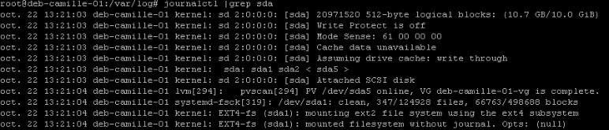

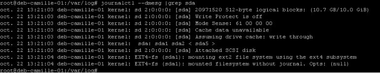

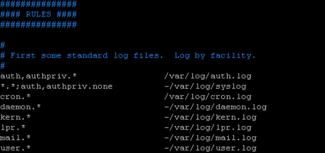

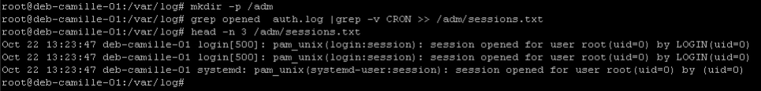

```text
mkdir -p /adm
grep opened auth.log | grep -v CRON > /adm/sessions.txt
```

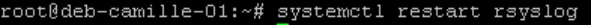

```text
systemctl restart rsyslog
```

- Stocker les informations relatives au démon cron dans le fichier /adm/logs/cron.log

Dans le fichier rsyslog.conf modifier le chemin du fichier réceptacle des logs.

Création du dossier qui devra recevoir ce fichier.

Ne pas oublier de redémarrer le service

- Définir comme fichier contenant tous les évènements d'avertissement /adm/logs/warnings.log

Dans le fichier rsyslog.conf ajouter cette ligne pour récupérer tous les fichiers utilisantlal priorité warn

Ne pas oublier de redémarrer le service

### III. Générer des messages de type avertissement

- A l’aide de logger, créer des messages de niveau avertissement.

La commande logger permet d'envoyer un message test. Ici on utilise la facility kern et la priorité warn

- Vérifier le bon fonctionnement des étapes précédentes.

Création de deux messages tests pour la facility cron, avec des priorités warning et info. Le premier message apparait dans les deux logs (validation de warning et validation de cron)

Le second message de priorité info n'apprait que dans la log de cron.

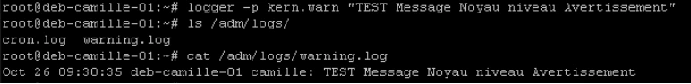

```text
logger -p kern.warn "TEST Message Noyau niveau Avertissement"
ls /adm/logs/
cat /adm/logs/warning.log
```

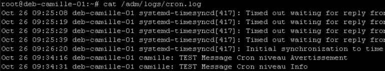


```text
cron.* /adm/logs/cron.log
```


```text
mkdir /adm/logs
```

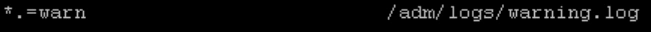

```text
*.warn /adm/logs/warning.log
```

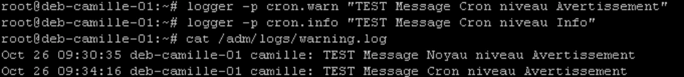

```text
logger -p cron.warn "TEST Message Cron niveau Avertissement"
logger -p cron.info "TEST Message Cron niveau Info"
cat /adm/logs/warning.log
```


```text
systemctl restart rsyslog
```

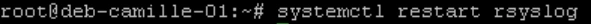

```text
systemctl restart rsyslog
```

## Clarifications et contrôles — complément pédagogique

Le journal systemd peut être persistant ; vérifier sa configuration et les services installés. Une crontab système ajoute un champ utilisateur. Les captures emploient parfois `warning.log` au singulier alors que l’énoncé demande `warnings.log` : choisir ce dernier de façon cohérente. La légende « 1ère minute » de la correction de planification contredit 10 h : la ligne attendue commence par `0 10`. Le serveur voit sshd et les shells distants, pas nécessairement un processus nommé PuTTY.

Pour les justifications et références officielles, lire le [cours optimisé](../../../../modules/05-administration-debian-gnu-linux/module-12-maintenance-d-un-systeme-en-production.md).

## Contrôle des règles — complément pédagogique

L’énoncé demande `/adm/logs/warnings.log` au pluriel ; plusieurs captures utilisent `warning.log`. Choisir une destination cohérente avec l’énoncé, créer le répertoire nécessaire et vérifier les droits du service. Une règle `*.warning` sélectionne warning et les priorités plus graves ; pour une égalité stricte, la syntaxe classique prévoit `*.=warning`. Ne pas confondre le seuil avec une priorité unique.

Tester deux messages distincts, par exemple cron.warning puis cron.info. Le premier doit atteindre les destinations couvrant cron et les avertissements ; le second la destination cron, selon les autres règles actives. Examiner le fichier effectivement écrit après validation de la configuration et prise en compte des règles.

Référence externe : [sélecteurs rsyslog](https://docs.rsyslog.com/doc/configuration/filters.html).

## Compte rendu attendu

- État de départ et cible précise de la manipulation.
- Commandes ou paramètres appliqués, avec les valeurs réellement utilisées.
- Résultats observés et contrôles qui les établissent.
- Différences entre l’environnement actuel et celui des captures.

[Retour au TP](index.md) · [Énoncés](enonces.md) · [Corrigés](corrections.md).
