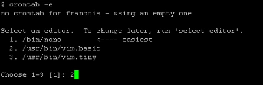
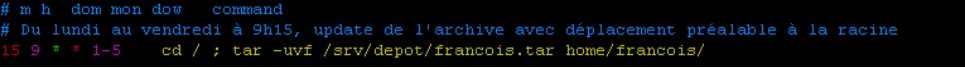
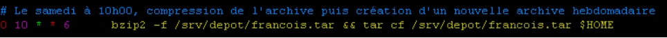
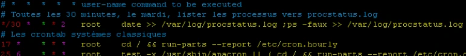
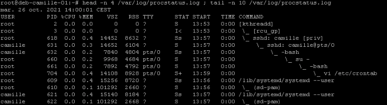

# Corrigés commentés — tp02-planification

**Reprise structurée des consignes et explications de la source.** Les figures utiles restent isolées et les commandes transcrites restent littérales. Les écarts de version et les corrections techniques sont signalés séparément.

## M12TP02 - Solution - Gestion de la planification des tâches

### Gestion de la planification des tâches

Durée estimée

30 à 45 minutes

### Énoncé : Planification de taches sur le serveur sans environnement graphique

### I. Crontab utilisateur

- Créer une tâche crontab utilisateur pour l'utilisateur "François"

Au premier lancement choisir vim.basic

- Périodicité : tous les jours ouvrables de la semaine à 9h15
- Commande : mise à jour de l’archive de son répertoire personnel dans l’arborescence depot de l’atelier 10 avec le nom francois.tar

À la 15eme minute de la 9eme heure, tous les jours du mois, tous les mois, du 1er au 5eme jour de la semaine

Se déplacer à la racine (tar en mode update) puis lancer la commande de mise à jour de l'archive

- Créer une tâche crontab utilisateur pour l’utilisateur "François"
- Périodicité : tous les samedis à 10h
- Commande : compression de l’archive francois.tar en francois.tar.bz2, puis création d’une nouvelle archive francois.tar

À la 1ère minute de la 10eme heure, le 6eme jour de la semaine, compresser l'archive et créer une nouvelle archive hebdomadaire.



```text
crontab -e
```



```text
15 9 * * 1-5 cd /; tar -uvf /srv/depot/francois.tar home/francois/
```



```text
0 10 * * 6 bzip2 -f /srv/depot/francois.tar && tar cf /srv/depot/francois.tar $HOME
```

### II. Crontab système

- Créer une tâche de surveillance des processus système :
- Périodicité : toutes les 30 minutes le mardi
- Commande : lister l'ensemble des processus de manière détaillée avec notamment les pourcentages d'utilisation mémoire et processeur.
- Enregistrer ces informations de façon durable dans le fichier /var/log/procstatus.log vi /etc/crontab, ajout d'une ligne pour lancer toutes les 30 minutes, le 2eme jour, une commande ps faux.

La commande date permet de dénombrer et d'horodater les diverses occurences.

Détail de résultats après une première occurence sur le serveur.





## Clarifications et contrôles — complément pédagogique

Le journal systemd peut être persistant ; vérifier sa configuration et les services installés. Une crontab système ajoute un champ utilisateur. Les captures emploient parfois `warning.log` au singulier alors que l’énoncé demande `warnings.log` : choisir ce dernier de façon cohérente. La légende « 1ère minute » de la correction de planification contredit 10 h : la ligne attendue commence par `0 10`. Le serveur voit sshd et les shells distants, pas nécessairement un processus nommé PuTTY.

Pour les justifications et références officielles, lire le [cours optimisé](../../../../modules/05-administration-debian-gnu-linux/module-12-maintenance-d-un-systeme-en-production.md).

## Relire le calendrier — complément pédagogique

Pour les jours ouvrables à 9 h 15, les cinq champs sont `15 9 * * 1-5`. Pour le samedi à 10 h, ils sont `0 10 * * 6`, comme la ligne de capture ; la légende « 1ère minute » du corrigé est une erreur. Confirmer le chemin de depot, les droits de François et la présence de son archive avant d’automatiser les commandes.

La mise à jour `tar -u` ne retire pas de l’archive les fichiers supprimés depuis le dernier passage : cet atelier d’archivage n’équivaut pas automatiquement à une politique de sauvegarde complète. Les chemins et l’environnement d’exécution doivent être explicités.

Exemple supplémentaire d’une ligne **système** pour le relevé du mardi :

```cron
*/30 * * * 2 root { /usr/bin/date; /usr/bin/ps auxf; } >> /var/log/procstatus.log 2>&1
```

Vérifier les chemins des exécutables sur la VM. Cette variante ajoute des relevés horodatés ; elle n’écrase pas le précédent. Une crontab utilisateur ne comporterait pas le champ root. Le contrôle final porte sur le contenu et les dates observés dans le fichier, pas seulement sur la présence de la ligne dans la table.

Références externes : [tar(1)](https://manpages.debian.org/trixie/tar/tar.1.en.html) et [crontab(5)](https://manpages.debian.org/trixie/cron/crontab.5.en.html).

## Compte rendu attendu

- État de départ et cible précise de la manipulation.
- Commandes ou paramètres appliqués, avec les valeurs réellement utilisées.
- Résultats observés et contrôles qui les établissent.
- Différences entre l’environnement actuel et celui des captures.

[Retour au TP](index.md) · [Énoncés](enonces.md) · [Corrigés](corrections.md).
