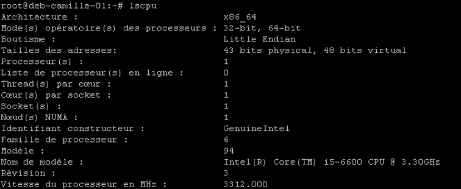
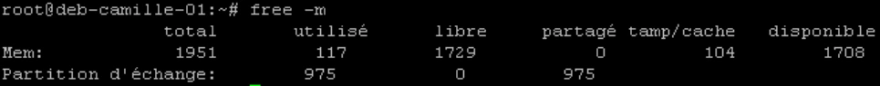
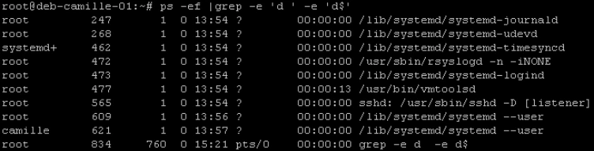
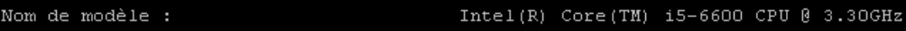
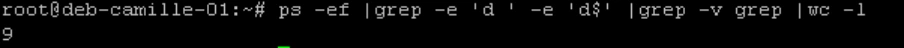
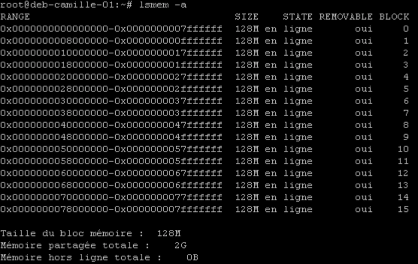
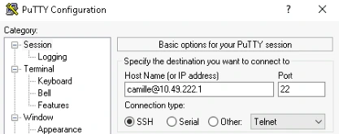
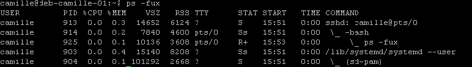
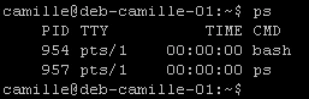
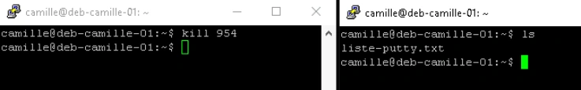

# Corrigés commentés — tp03-informations-systeme

**Reprise structurée des consignes et explications de la source.** Les figures utiles restent isolées et les commandes transcrites restent littérales. Les écarts de version et les corrections techniques sont signalés séparément.

## M12TP03 - Solution - Informations sur le système

### Informations sur le système

Durée estimée

20 à 45 minutes

### I. Relevé d’informations : sur le serveur sans environnement graphique

- Afficher les informations sur la mémoire
- Combien de mémoire RAM est utilisée ?
- Combien de mémoire SWAP est utilisée ?
- Combien de mémoire RAM est réellement libre ?

117 MO de ram sont ici utilisés. 975 MO de swap le sont également (mais partagé). Ici pour connaitre la totalité de la ram disponible, il faut additionner la valeur de la colonne libre avec la valeur de la colonne tamp/cache (utilisation système pour améliorer les performances, libérable si besoin)

- Afficher les informations détaillées sur le processeur et la mémoire lscpu donne de nombreuses informations sur les processeurs





```text
free -m
               total used free shared buff/cache disponible
Mem:            1951  117 1729      0        104       1708
Partition d’échange: 975 0 975
```

Lsmemavec l'option -a  donne des informations complète sur la mémoire

- Quel type de processeur a été détecté ?
- Afficher tous les processus relatifs à des démons (dont le nom finit par un "d") ps -ef permet de lister tous les processus. grep avec l'option -e répétée permet de donner plusieurs informations de filtre (fonction logique OU)

-e 'd ' valide la lettre d suivi d'un espace ; -e 'd$' valide la lettre suivie du caractère fin de ligne.

A noter la dernière grep qui est ici un "faux positif" de la sortie Alternatives :

- Meilleure commande compacte et sûre (compte des processus dont le nom se termine par d) : ps -eo comm --no-headers | awk '/d$/ {count++} END{print count+0}'
- Si vous voulez aussi PID et utilisateur (plus utile pour un TP) : ps -eo pid,user,comm --no-headers | awk '3 /d/ {print $0}'
- Si vous tenez à wc -l mais sans faux positifs : ps -eo comm --no-headers | grep -E 'd$' | wc -l
- Afficher leur nombre

Reprenant la ligne précédent, on ajout un grep -v grep pour supprimer le "faux positif"

Puis on compte le tout avec la commande wc.





```text
Nom de modèle : Intel(R) Core(TM) i5-6600 CPU @ 3.30GHz
```



```text
ps -ef | grep -e 'd ' -e 'd$' | grep -v grep | wc -l
9
```



### II. Intervention sur les processus

- Ouvrez une session SSH avec le login utilisateur (pas le compte root)
- Lister tous les processus relatifs à votre login de façon détaillée ps -fux est une des méthodes pour lister tous les processus de l'utilisateur. Il en existe plusieurs autres avec ps.
- Lister dans un fichier tous les processus correspondant aux connexions Putty

Un classique enchainement de ps et grep avant de transférerle résultat dans un fichier

- Arrêter un processus lancé
- Lancer une seconde session Putty et ouvrir une session avec votre login utilisateur
- Repérer le n° de processus (PID) relatif au shell de cette seconde session Putty ps sans options ni arguments affiche, entre autre, le processus du shell actuel et son PID, ici 954
- Depuis votre 1ere session, tenter d'arrêter votre second shell (avec le signal par défaut)

La commande kill lancée sans argument via la première session n'arrête pas la session.

- Depuis votre 1ere session, arrêter définitivement votre second shell (avec le signal adapté)

En ajoutant l'option forçant le signal 1 (SIGHUP) la session est coupée









```text
kill 954
```


```text
ls
liste-putty.txt
kill -9 954
```


```text
ps -ef | grep sshd | grep -v grep > liste-putty.txt
```

Autre proposition :

1. Ouvrir la 2e session PuTTY et se connecter sous votre même compte. 2. Dans la 2e session, repérer le PID du shell :

- Exécuter : ps -o pid,tty,cmd -u (whoami)−−no−headers∣grep"(tty)" ou plus simplement : ps -o pid= -p $ # affiche le PID du shell courant 3. Depuis la 1re session, envoyer le signal par défaut (SIGTERM) au PID trouvé :
- Commande : kill
- Effet : demande poliment au processus de se terminer. Le shell peut ignorer ou intercepter SIGTERM (ex : shell interactif). Vérifier si le processus a disparu : ps -p && echo "toujours actif" || echo "terminé" 4. Si le shell ne se termine pas, envoyer SIGKILL pour forcer l’arrêt :
- Commande : kill -9 ou kill -KILL
- Effet : terminaison immédiate et non interceptable. Vérifier la disparition : ps -p || echo "terminé définitivement"

Remarques pratiques :

- Préférez toujours SIGTERM (kill) puis, si nécessaire, SIGKILL (kill -9).
- Pour éviter d’envoyer les signaux au mauvais processus, vérifiez le PID et le tty (ps -o pid,tty,cmd). Exemple de vérification complète depuis la 1re session : ps -u $(whoami) -o pid,tty,cmd --no-headers | grep pts/1
- Ne tuez pas de processus système ni un shell que vous n’avez pas prévu d’interrompre.

## Clarifications et contrôles — complément pédagogique

Le journal systemd peut être persistant ; vérifier sa configuration et les services installés. Une crontab système ajoute un champ utilisateur. Les captures emploient parfois `warning.log` au singulier alors que l’énoncé demande `warnings.log` : choisir ce dernier de façon cohérente. La légende « 1ère minute » de la correction de planification contredit 10 h : la ligne attendue commence par `0 10`. Le serveur voit sshd et les shells distants, pas nécessairement un processus nommé PuTTY.

Pour les justifications et références officielles, lire le [cours optimisé](../../../../modules/05-administration-debian-gnu-linux/module-12-maintenance-d-un-systeme-en-production.md).

## Compte rendu attendu

- État de départ et cible précise de la manipulation.
- Commandes ou paramètres appliqués, avec les valeurs réellement utilisées.
- Résultats observés et contrôles qui les établissent.
- Différences entre l’environnement actuel et celui des captures.

[Retour au TP](index.md) · [Énoncés](enonces.md) · [Corrigés](corrections.md).
