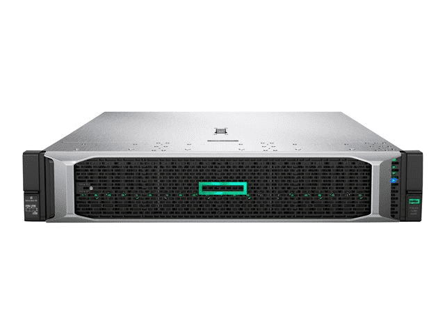
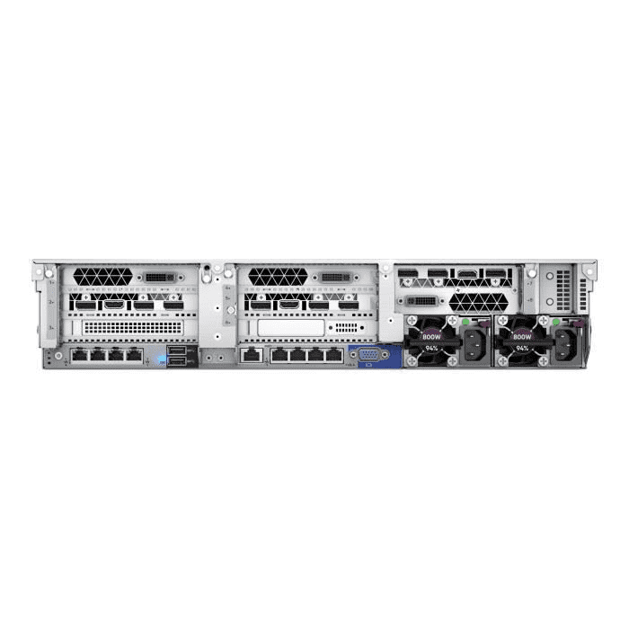
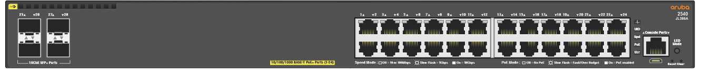
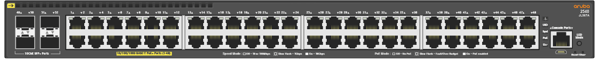
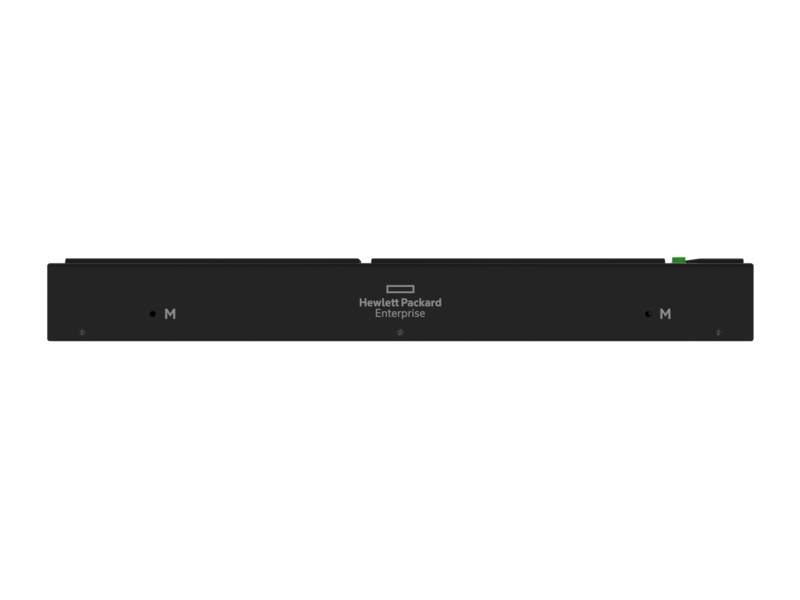
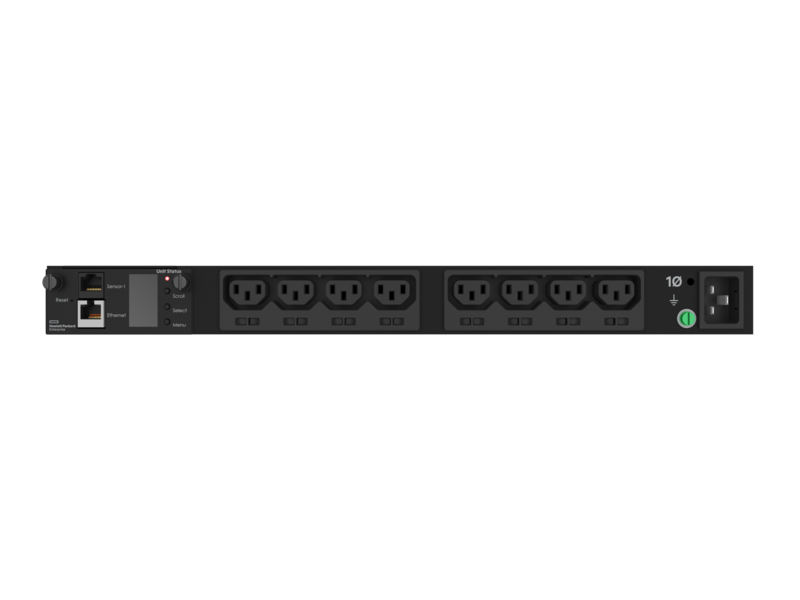

# TP — Module 03 — Gestion de parc — Inventaire informatique

## Objectif du laboratoire

Inventorier les matériels, logiciels et consommables d’Olympus et vérifier leurs relations.

## Préparer et réaliser l’atelier

L’application GLPI doit être fonctionnelle. Lire les quantités, les lieux et les relations de l’énoncé, puis consulter les illustrations du matériel pour distinguer modèles et références.

1. [Lire l’énoncé complet](enonces.md).
2. Réaliser les étapes dans le laboratoire et relever les preuves.
3. [Comparer avec la correction](corrections.md), puis reprendre la [fiche de révision](../../../revision/glpi/module-03-gestion-de-parc-inventaire-informatique.md).

| Contrôle | Preuve à relever |
| --- | --- |
| Gabarit et exemplaires | Préparer les valeurs communes, puis contrôler les noms, le nombre et le statut des exemplaires créés. |
| Baie et connectivité | Vérifier l’encombrement, les vues avant et arrière, les ports et les liaisons. Consigner les écarts entre les captures et la demande. |
| Affectations et réservations | Contrôler le lieu, l’utilisateur, la licence ou le consommable pour chaque relation. Retrouver la réservation de Zeus. |

## Liens

- [Cours du module](../../../modules/07-administration-glpi/module-03-gestion-de-parc-inventaire-informatique.md)
- [Tous les ateliers GLPI](../index.md)
- [Mémo GLPI et SQL](../../../memo/glpi-sql.md)

## Ressources du scénario

Les captures de correction sont placées à leur étape dans la [correction](corrections.md).

Les photos remises aux stagiaires :

Le manuel Aruba n’est pas publié comme fichier. Ses 12 pages restent dans le [cours du module](../../../modules/07-administration-glpi/module-03-gestion-de-parc-inventaire-informatique.md).
