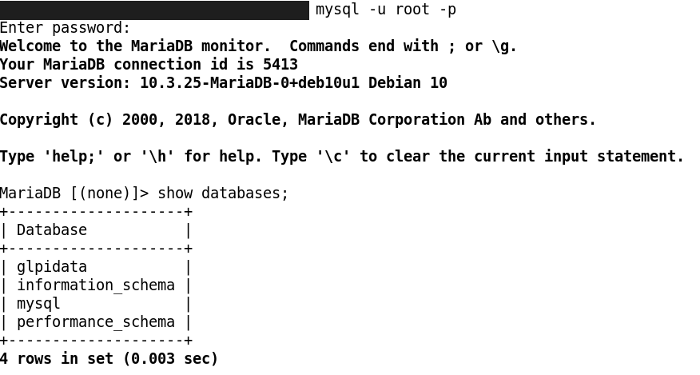
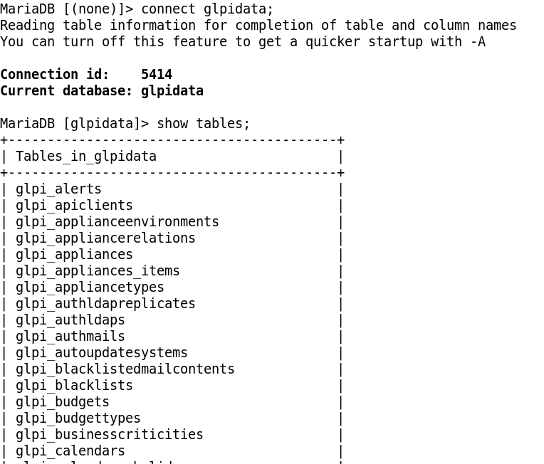
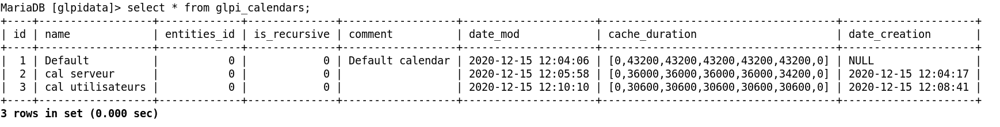
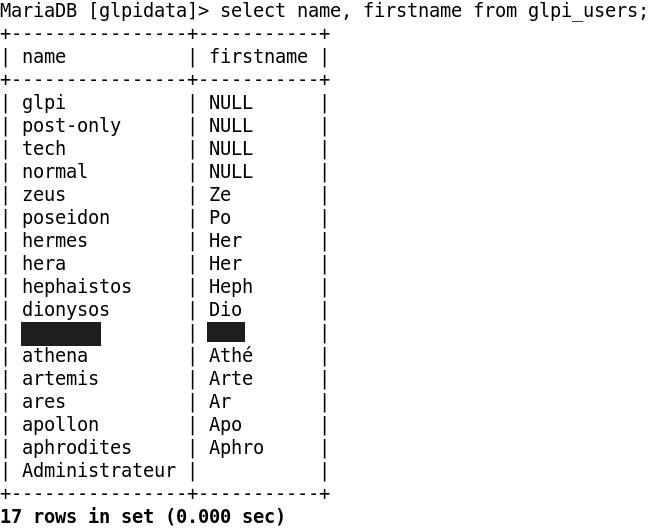
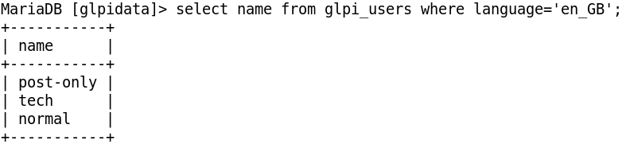
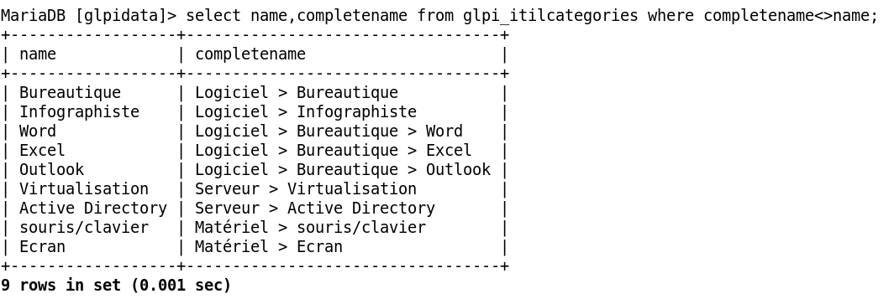
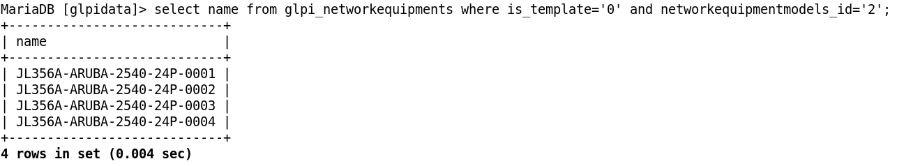
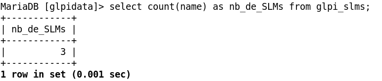
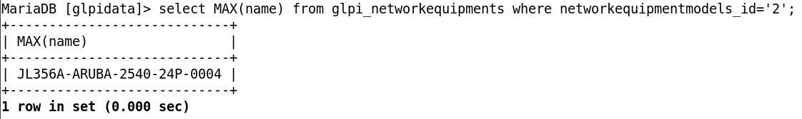

# TP 05 — Correction expliquée des requêtes SQL

## État initial

Le sujet réutilise les calendriers, utilisateurs, catégories, commutateurs et niveaux de service des TP précédents. Se connecter avec le compte autorisé et vérifier le nom de la base avant d’interroger les tables.

Les requêtes suivent les douze demandes du support, dans l’ordre. Les identifiants2(modèle 24 ports) et3(gabarit de demande) sont ceux du laboratoire source. Les contrôler dans sa base ; ils ne sont pas universels. Les sorties illustrées dépendent des données effectivement saisies aux modules précédents.

## 1. Connexion et repérage

```bash
mysql -u root -p
```

```sql
SHOW DATABASES;
CONNECT glpidata;
SHOW TABLES;
```





## 2. Calendriers, utilisateurs et langue

```sql
SELECT * FROM glpi_calendars;
SELECT name, firstname FROM glpi_users;
SELECT name FROM glpi_users WHERE language = 'en_GB';
```







La consigne appelle « noms et prénoms » ce que le corrigé extrait par `name, firstname` ; `name` est ici l’identifiant de connexion. Pour rechercher le patronyme réel, examiner aussi la colonne `realname` du schéma utilisé. La capture du support montre17lignes d’utilisateurs,3 calendriers et les comptes initiaux en anglais ; ce sont des exemples, pas des nombres imposés au TP.

## 3. Catégories enfants

```sql
SELECT name, completename
FROM glpi_itilcategories
WHERE completename <> name;
```



Une autre solution du support utilise `level > 1` ; vérifier la convention de niveau dans les données. L’accent de `glpi_itilcatégories` dans le PDF est une coquille : le nom utilisé par la capture est sans accent.

## 4. Commutateurs24 ports qui ne sont pas des gabarits

```sql
SELECT name
FROM glpi_networkequipments
WHERE is_template = 0
  AND networkequipmentmodels_id = 2;
```



Les deux conditions sont nécessaires. La capture montre quatre résultats ; le TP 3 demande six exemplaires. Le résultat de votre base doit refléter votre réalisation complète, sans supprimer les deux exemplaires supplémentaires pour imiter la capture.

## 5. Compter les niveaux de service

```sql
SELECT COUNT(*) AS nb_de_SLMs
FROM glpi_slms;
```



Le corrigé fait `COUNT(name)`, qui ne compte que les noms nonNULL. `COUNT(*)` compte les lignes. La capture source obtient3SLM.

## 6. Retrouver le nom maximal du modèle 24 ports

```sql
SELECT MAX(name)
FROM glpi_networkequipments
WHERE networkequipmentmodels_id = 2;
```



Le PDF colle `FROM` au nom de table ; les espaces sont rétablis ici. `MAX(name)` compare des chaînes. Il suit l’ordre numérique attendu seulement si les suffixes sont de largeur fixe (`0001` à`0006`). La capture s’arrête à`0004`, car ses données ne contiennent que quatre exemplaires.

## 7. Bonus : catégories et gabarits de demande

```sql
SELECT c.name AS categorie, t.name AS gabarit
FROM glpi_itilcategories AS c
INNER JOIN glpi_tickettemplates AS t
    ON c.tickettemplates_id_demand = t.id;
```

La jointure élimine les catégories sans gabarit correspondant. Le corrigé ajoute `WHERE ... = 3` pour son seul gabarit Demande Bureautique. Conserver cette restriction uniquement si elle correspond à la question dans votre base.

## 8. Bonus : nombre de catégories par gabarit

```sql
SELECT t.name AS gabarit,
       COUNT(*) AS `nombre de catégories qui utilise un gabarit de demande`
FROM glpi_itilcategories AS c
INNER JOIN glpi_tickettemplates AS t
    ON c.tickettemplates_id_demand = t.id
GROUP BY t.id, t.name;
```

Le regroupement rend explicite le comptage par gabarit ; la requête source mêle agrégat et nom sans `GROUP BY`. Ajouter si besoin un filtre `WHERE t.id = 3` avant le regroupement. Vérifier le résultat par la liste détaillée précédente : chaque catégorie comptée doit y être présente.

## Erreurs de source corrigées

Prompts non exécutables retirés, apostrophes typographiques remplacées, nom `glpi_itilcategories` sans accent, `FROM glpi_networkequipments` séparé, nombres utilisés comme nombres et regroupement du dernier agrégat ajouté. L’Original conserve les formulations et commandes historiques.

## Résultat attendu et contrôles

| Contrôle | Preuve à relever |
| --- | --- |
| Contexte | Vérifier la base active, les tables et les colonnes avant de sélectionner les données. |
| Filtrage | Distinguer NULL, égalité d’une chaîne et condition sur la catégorie. Identifier le modèle de switch dans les données de son laboratoire. |
| Comptage et tri | Distinguer les lignes et les valeurs renseignées, puis rendre la sélection reproductible avec un tri lorsque l’ordre importe. |

- [Énoncé](enonces.md)
- [Cours](../../../modules/07-administration-glpi/module-05-les-bases-de-mysql-et-mariadb.md)

- [Fiche de révision](../../../revision/glpi/module-05-les-bases-de-mysql-et-mariadb.md)
