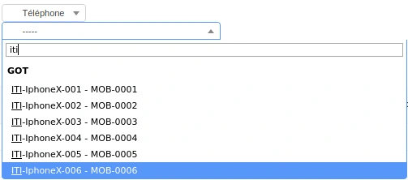
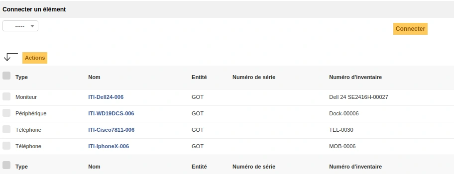
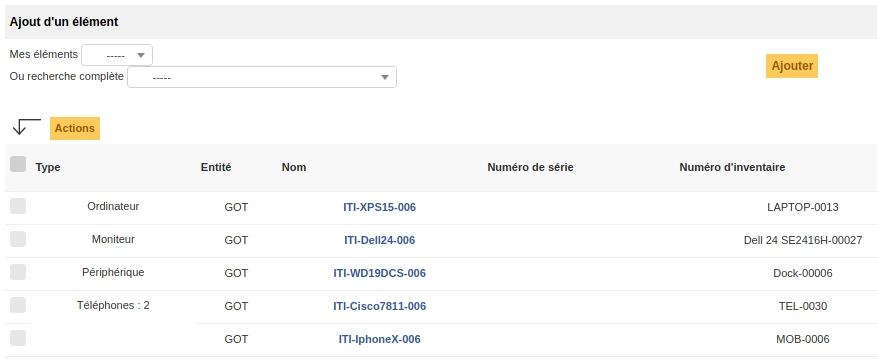
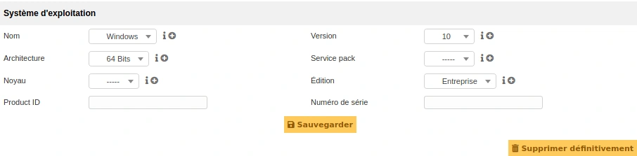
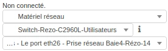
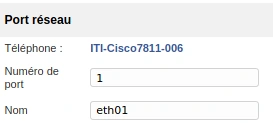
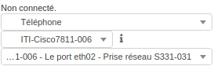
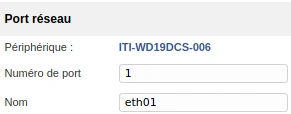
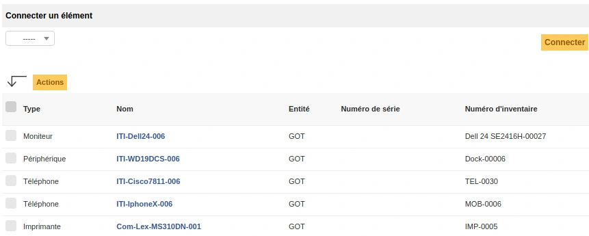

# Corrections — Module 09 — Assistance avec GLPI

Un énoncé de 3 h et une correction de 17 pages sont fournis. Les noms d’équipements, utilisateurs et versions appartiennent au laboratoire ; la fonction à retrouver compte davantage que la position exacte des menus.

## Lire la correction après une tentative

Comparer le résultat, la méthode et les preuves ; noter les étapes oubliées et leur effet sur la fourniture du service. Les documents ci-dessous sont les corrections fournies dans le dossier de formation, pas une correction inventée. Les remarques pédagogiques et de version du cours optimisé restent applicables.

## M09 - S01 TP-Corrigé_L'exploitation des services

<section>

Sensibilisation à ITIL

<h4>ITIL - L'exploitation des services TP du Module 09 – Assistance avec GLPI</h4>

Avant de démarrer ce TP, il convient d’avoir suivi les vidéos des modules 1 à 9 et d’avoir réalisé les TP proposés.

Durée estimée

3 heures

<h4>Solution</h4>
<h4>Etape 1 - Création du ticket par le responsable du service</h4>

Vous ouvrez une session sur GLPI en tant que directeur commercial :

<ul><li> Login : balon.grejoy</li></ul>
<ul><li> Mot de passe : password</li></ul>

Création du ticket

<ul><li> Cliquer sur créer un ticket</li></ul>
<ul><li> Type : demande</li></ul>
<ul><li> Catégorie : Nouveau Poste Complet</li></ul>
<ul><li> Lieu : Service Commercial</li></ul>
<ul><li> Titre : rempli automatiquement (ne pas changer)</li></ul>
<ul><li> Description : Compléter les informations concernant les salariés</li></ul>

Les informations du salarié

<ul><li> Nom : Targaryan</li></ul>
<ul><li> Prénom : Deanerys</li></ul>
<ul><li> Fonction : Commercial Itinérant</li></ul>
<ul><li> Service : Commercial</li></ul>

Vous fermez la session

Pour vérifier, vous pouvez vous connecter avec l’utilisateur « balon.grejoy » pour suivre l’évolution du ticket.

<ul><li> Une fois que la session est ouverte</li></ul>
<ul><li> Cliquer sur « Tickets »</li></ul>
<ul><li> Sélectionner le ticket</li></ul>
</section>
<section>

Sensibilisation à ITIL

<ul><li> Dans le menu de gauche, sélectionner « Traitement du ticket »</li></ul>
<ul><li> Vous avez un aperçu de l’évolution du traitement du ticket</li></ul>

Vous fermez la session

</section>
<section>

Sensibilisation à ITIL

<h4>Etape 2 - Traitement du ticket par le support N1</h4>

Vous ouvrez une session sur GLPI en tant que technicien de support de niveau 1

<ul><li> Login : hoster.tully</li></ul>
<ul><li> Mot de passe : password</li></ul>

Vous ouvrez le ticket et vous l’escaladez vers le groupe des techniciens parc :

<ul><li> Cliquer sur « Assistance », puis « tickets »</li></ul>
<ul><li> Dans la liste des tickets, cliquer sur le titre du ticket.</li></ul>

o « Nouveau poste pour un nouveau salarié »

Dans le menu de gauche, sélectionner « Ticket »

<ul><li> Dans le corps du ticket,</li></ul>
<ul><li> Dans la zone « Acteur »</li></ul>
<ul><li> Dans la colonne « Attribué à »</li></ul>
<ul><li> Supprimer le groupe « GLPI-GRP-Support » en cliquant sur</li></ul>
<ul><li> Cliquer sur « + » à côté de « Attribué à »</li></ul>

o Sélectionner « Groupe »

o Sélectionner « GLPI-GRP-PARC », escalade fonctionnelle

<ul><li> Sauvegarder le ticket</li></ul>
<ul><li> Cliquer sur « + » à côté de « Attribué à »</li></ul>

o Sélectionner « utilisateur »

o Sélectionner « Tyrion Lannister »

<ul><li> Sauvegarder le ticket</li></ul>

Dans le menu de gauche, sélectionner « Traitement du ticket »

<ul><li> Cliquer sur « Suivi »</li></ul>
<ul><li> Dans « nouvel élément – suivi »</li></ul>

o Saisir « Escalade vers le groupe techniciens parc et envoi à l’administrateur

AD pour la création des différents comptes »

o Cliquer sur « Ajouter »

Fermer la session du technicien de support.

<ul><li> Pour fermer la session, il faut cliquer sur</li></ul>
</section>
<section>

Sensibilisation à ITIL

<h4>Etape 3 - Vérification et sortie du matériel du stock.</h4>

Vous ouvrez une session sur GLPI en tant que technicien de support Parc.

<ul><li> Login : jorah.mormont</li></ul>
<ul><li> Mot de passe : password</li></ul>

Vous allez maintenant cliquer sur « Parc »

<ul><li> Vous effectuez une recherche pour retrouver les éléments suivants :</li></ul>
<table><tbody><tr><td>Matériel</td><td></td><td></td><td>Nom</td><td>N° Inventaire</td><td>Nouveau nom</td></tr><tr><td>Ordinateurs</td><td></td><td></td><td>Dell XPS 15</td><td>LAPTOP-0013</td><td>ITI-XPS15-006</td></tr><tr><td></td><td>Périphériques</td><td></td><td>WD19DCS</td><td>Dock-00006</td><td>ITI-WD19DCS-006</td></tr><tr><td></td><td>(dock)</td><td></td><td></td><td></td><td></td></tr><tr><td>Moniteurs</td><td></td><td></td><td>Dell 24 SE2416H</td><td>Dell 24 SE2416H-00027</td><td>ITI-Dell24-006</td></tr><tr><td>Téléphones</td><td></td><td></td><td>Tel Cisco 7811</td><td>TEL-0030</td><td>ITI-Cisco7811-006</td></tr><tr><td>Téléphones</td><td></td><td></td><td>IPhoneX</td><td>MOB-0006</td><td>ITI-IphoneX-006</td></tr></tbody></table>
<ul><li> Pour chaque élément trouvé :</li></ul>

o Vous le renommez avec le nouveau nom présent dans le tableau.

o Exemple pour renommer l’ordinateur à suivre.

Pour effectuer la rechercher de l’ordinateur :

<ul><li> Vous cliquez sur « Parc » puis « Ordinateurs »</li></ul>
<ul><li> Dans la zone de recherche, vous indiquez les éléments suivants :</li></ul>
<figure><figcaption>Interface GLPI présentée dans le support — illustration isolée du support, page 4.</figcaption></figure>
<ul><li> Vous récupérez tous les ordinateurs en stock</li></ul>

o Vous cliquez sur le nom de l’ordinateur « Dell XPS 15 » portant le numéro

d’inventaire « Laptop-0013 »

o La fiche de l’ordinateur s’ouvre.

o Vous renommez l’ordinateur avec son nouveau nom.

<ul><li> Vous sauvegardez.</li></ul>

Vous procédez de la même façon avec les différents éléments.

</section>
<section>

Sensibilisation à ITIL

Maintenant que tous les éléments ont été renommés, vous allez les lier pour pouvoir effectuer les déplacements de façon global.

Vous allez ouvrir la fiche de l’ordinateur :

<ul><li> Vous cliquez sur « Parc » puis « Ordinateurs »</li></ul>
<ul><li> Dans la zone de recherche, vous indiquez les éléments suivants :</li></ul>
<figure><figcaption>Interface GLPI présentée dans le support — illustration isolée du support, page 5.</figcaption></figure>
<ul><li> Vous récupérez tous les ordinateurs en stock</li></ul>
<ul><li> Vous cliquez sur le nom de l’ordinateur « ITI-XPS15-006 » portant le numéro d’inventaire « Laptop-0013 »</li></ul>
<ul><li> La fiche de l’ordinateur s’ouvre.</li></ul>
<ul><li> Dans le menu de gauche, vous cliquez sur « Connexions ».</li></ul>

o Sous « Connecter un élément »

o Sélectionnez « Moniteur », puis dans le menu qui vient d’apparaître vous

cliquez sur la flèche à l’extrémité droite pour faire apparaître la liste des moniteurs disponible.

<figure><figcaption>Interface GLPI présentée dans le support — illustration isolée du support, page 5.</figcaption></figure>

o Vous sélectionnez le moniteur se nommant « ITI-Dell24-006 » puis vous cliquez

sur « connecter ».

o Vous avez la possibilité d’effectuer des recherches dans le menu déroulant

pour filtrer les éléments qui apparaissent dans la liste :

<figure><figcaption>Interface GLPI présentée dans le support — illustration isolée du support, page 5.</figcaption></figure>
</section>
<section>

Sensibilisation à ITIL

<ul><li> Procéder de la même façon pour les autres matériels.</li></ul>
<ul><li> Vous devez obtenir :</li></ul>
<figure><figcaption>Interface GLPI présentée dans le support — illustration isolée du support, page 6.</figcaption></figure>

Vous déplacez l’ensemble du matériel pour qu’ils soient préparés.

<ul><li> Dans le menu de gauche, sélectionnez l’onglet « Ordinateur »</li></ul>

o Vous changez la rubrique statut de « En stock » par « A préparer »

o Vous changez le lieu :

<ul><li> De « …&gt;Service Informatique&gt;Stock »</li></ul>
<ul><li> Par « …&gt;Service Informatique&gt;Stock&gt;Matériels à préparer&gt;A préparer1 »</li></ul>
<ul><li> Sauvegarder</li></ul>

Vous vérifiez que tous les matériels sont dans le même lieu que l’ordinateur et vous allez changer leur statut

<ul><li> A partir de la fiche de l’ordinateur, dans le menu de gauche, vous cliquez sur « Connexions », vous cliquez le nom du moniteur « ITI-Dell24-006 ».</li></ul>
<ul><li> La fiche de moniteur s’ouvre :</li></ul>

o Dans le menu de gauche, cliquez sur « Moniteur ».

o Le lieu doit contenir « …&gt;Service Informatique&gt;Stock&gt;Matériels à préparer&gt;A

préparer 1 ».

o Modifier le statut en « A préparer ».

<ul><li> Sauvegarder</li></ul>
<ul><li> Dans le menu de gauche, cliquez sur « Connexions »</li></ul>

o Cliquer sur le nom de l’ordinateur « ITI-XPS-006 » pour retourner sur la fiche de

l’ordinateur.

<ul><li> Vous procédez de la même façon avec les autres matériels.</li></ul>

o Ils doivent être tous dans le même lieu

o Ils doivent tous avoir le statut « A préparer »

</section>
<section>

Sensibilisation à ITIL

Vous allez modifier le ticket pour indiquer ce que vous avez fait. Vous ouvrez le ticket et vous allez sortir le matériel du stock.

<ul><li> Cliquer sur « Assistance », puis « tickets »</li></ul>
<ul><li> Dans la liste des tickets, cliquer sur le titre du ticket.</li></ul>

o « Nouveau poste pour un nouveau salarié »

Dans le menu de gauche, sélectionner « Ticket »

<ul><li> Dans le corps du ticket,</li></ul>

o Dans la zone « Description »

o Vous remplissez les champs suivants :

<ul><li> Matériel disponible : OK</li></ul>

o Dans la zone « Acteur »

o Vérifier qu’il y a le groupe « GLPI-GRP-PARC » et l’utilisateur « Tyrion Lannister »

de présent.

<ul><li> Sauvegarder</li></ul>

Vous allez rajouter le matériel au ticket

<ul><li> Dans le menu de gauche, sélectionner « Eléments »</li></ul>
<ul><li> A partir de la « recherche complète », vous allez rajouter les éléments au ticket.</li></ul>
<ul><li> Vous devez obtenir :</li></ul>
<figure><figcaption>Interface GLPI présentée dans le support — illustration isolée du support, page 7.</figcaption></figure>

Dans le menu de gauche, sélectionner « Traitement du ticket »

<ul><li> Cliquer sur « Suivi »</li></ul>
<ul><li> Dans « nouvel élément – suivi »</li></ul>

o Saisir « Sortie du matériel du stock, prêt à être installé »

o Cliquer sur « Ajouter »

Fermer la session du technicien de parc.

</section>
<section>

Sensibilisation à ITIL

<h4>Etape 4 - Création des comptes par l’administrateur Active Directory.</h4>
<ul><li> Vous ouvrez une session sur GLPI en tant que technicien de support de niveau 1.</li></ul>
<ul><li> Login : tyrion.lannister</li></ul>
<ul><li> Mot de passe : password</li></ul>

Vous ouvrez le ticket pour gérer l’installation du système d’exploitation et des logiciels.

<ul><li> Cliquer sur « Assistance », puis « tickets »</li></ul>
<ul><li> Dans la liste des tickets, cliquer sur le titre du ticket.</li></ul>

o « Nouveau poste pour un nouveau salarié »

Dans le menu de gauche, sélectionner « Ticket ».

<ul><li> Dans le corps du ticket,</li></ul>

o Dans la zone « Description »

o Vous remplissez les champs suivants :

<ul><li> Compte GLPI créé : OK</li></ul>
<ul><li> Compte Active Directory créé : OK</li></ul>
<ul><li> Compte Office 365 créé : OK</li></ul>
<ul><li> Badge créé : OK</li></ul>

o Dans la zone « Acteur »

<ul><li> Supprimer l’utilisateur « Tyrion Lannister » pour qu’il ne reste que le groupe « GLPI-GRP-PARC ».</li></ul>
<ul><li> Sauvegarder</li></ul>

Vous modifiez le suivi du ticket.

<ul><li> Dans le menu de gauche, sélectionner « Traitement du ticket »</li></ul>
<ul><li> Cliquer sur « Suivi »</li></ul>
<ul><li> Dans « nouvel élément – suivi »</li></ul>

o Saisir « Création des différents comptes effectués »

o Cliquer sur « Ajouter »

Fermer la session de l’administrateur Active Directory.

</section>
<section>

Sensibilisation à ITIL

<h4>Etape 5 - Préparation du matériel</h4>

Vous considérez que le matériel a été testé et que le système d’exploitation ainsi que les logiciels ont été installés.

Vous allez gérer que les informations côté ticket et apporter des modifications à l’ordinateur.

Vous ouvrez une session sur GLPI en tant que technicien de support Parc.

<ul><li> Login : barristan.selmy</li></ul>
<ul><li> Mot de passe : password</li></ul>

Vous ouvrez le ticket pour gérer l’installation du système d’exploitation et des logiciels.

<ul><li> Cliquer sur « Assistance », puis « tickets »</li></ul>
<ul><li> Dans la liste des tickets, cliquer sur le titre du ticket.</li></ul>

o « Nouveau poste pour un nouveau salarié »

Dans le menu de gauche, sélectionner « Eléments »

<ul><li> Vous accédez à la liste des objets liés au ticket</li></ul>
<ul><li> Cliquer sur le nom de l’ordinateur « ITI-XPS15-006 » pour accéder à la fiche.</li></ul>

Dans le menu de gauche, sélectionner « Systèmes d’exploitation »

<ul><li> Vous remplissez les différents champs et vous sauvegardez pour obtenir :</li></ul>
<figure><figcaption>Interface GLPI présentée dans le support — illustration isolée du support, page 9.</figcaption></figure>
<ul><li> Vous venez de renseigner le système d’exploitation qui a été installé.</li></ul>

Dans le menu de gauche, sélectionner « Logiciels »

<ul><li> Vous allez ajouter les logiciels installés sur l’ordinateur.</li></ul>
<ul><li> Pour installer « 7Zip » :</li></ul>

o En haut de la fenêtre, dans "Logiciels", sélectionner « 7Zip 64bits »

o Dans le menu qui est apparu, sélectionner « 7Zip 21.06 – En stock »

o Cliquer sur « Installer », vous venez de lier un logiciel à l’ordinateur.

o Vous installez ensuite la licence.

o En bas de la fenêtre, dans "Licences", sélectionner « 7Zip64 bits »

o Dans le menu qui est apparu, sélectionner « 7Zip 21.06 »

</section>
<section>

Sensibilisation à ITIL

o Cliquer sur « Ajouter »

Vous procédez de la même façon pour installer les autres logiciels.

<ul><li> Liste des logiciels à installer</li></ul>
<table><tbody><tr><td>Logiciels</td><td></td><td></td><td>Licences</td><td></td></tr><tr><td>7Zip 64bits</td><td>7Zip 21.06 – En utilisation</td><td>7Zip 64bits</td><td></td><td>7Zip 21.06</td></tr><tr><td></td><td>Acrobat DC 2021.007 –</td><td></td><td></td><td></td></tr><tr><td>Acrobat Reader DC</td><td></td><td>Acrobat Reader DC</td><td></td><td>Acrobat DC 2021.007</td></tr><tr><td></td><td>En utilisation</td><td></td><td></td><td></td></tr><tr><td></td><td>Chrome 96.0.4664.110 –</td><td></td><td></td><td></td></tr><tr><td>Chrome 64bits</td><td></td><td>Chrome 64bits</td><td></td><td>Chrome 96.0.4664.110</td></tr><tr><td></td><td>En utilisation</td><td></td><td></td><td></td></tr><tr><td></td><td>Java 8 Update 311 –</td><td></td><td></td><td></td></tr><tr><td>Java 64bits</td><td></td><td>Java 64bits</td><td></td><td>Java 8 Update 311</td></tr><tr><td></td><td>En utilisation</td><td></td><td></td><td></td></tr><tr><td></td><td>OpenVPN 2.5.5-</td><td></td><td></td><td></td></tr><tr><td>OpenVPN</td><td></td><td>OpenVPN</td><td></td><td>OpenVPN 2.5.5</td></tr><tr><td></td><td>En utilisation</td><td></td><td></td><td></td></tr><tr><td></td><td>2016 Standard –</td><td></td><td></td><td></td></tr><tr><td>Pack Office</td><td></td><td>Pack Office</td><td></td><td>2016 Standard</td></tr><tr><td></td><td>En utilisation</td><td></td><td></td><td></td></tr></tbody></table>

Dans le menu de gauche, sélectionner « Ordinateur »

<ul><li> Vous modifiez le statut de l’ordinateur</li></ul>

o Vous remplacez « En stock &gt; A préparer » par « En stock &gt; A livrer »

<ul><li> Vous modifiez le lieu</li></ul>

o Vous remplacez « &gt;Matériels à préparer &gt; A préparer 1 » par « &gt;Matériels à

livrer &gt; A livrer 1 »

<ul><li> Vous sauvegardez</li></ul>

Vous faites les mêmes changements sur les autres éléments.

<ul><li> Pour retrouver les éléments plus rapidement, passer par le ticket.</li></ul>
<ul><li> Comme les éléments sont liés, le changement a dû être pris en compte</li></ul>

o Vérifier le lieu

<ul><li> Modifier le statut</li></ul>
<ul><li> Sauvegarder les modifications avant de changer de matériel.</li></ul>
</section>
<section>

Sensibilisation à ITIL

Vous modifiez le suivi du ticket.

<ul><li> Cliquer sur « Assistance », puis « tickets »</li></ul>
<ul><li> Dans la liste des tickets, cliquer sur le titre du ticket.</li></ul>

o « Nouveau poste pour un nouveau salarié »

Dans le menu de gauche, sélectionner « Ticket »

<ul><li> Dans le corps du ticket,</li></ul>
<ul><li> Dans la zone « Description »</li></ul>

o Vous remplissez les champs suivants :

<ul><li> Prises électriques installées et créées : OK</li></ul>
<ul><li> Prises réseaux installées et testées : OK</li></ul>
<ul><li> Mobilier installé : OK</li></ul>
<ul><li> Matériel installé : OK</li></ul>

o Dans la zone « Acteur »

<ul><li> Vérifier qu’il y a le groupe « GLPI-GRP-PARC ».</li></ul>
<ul><li> Sauvegarder</li></ul>

Dans le menu de gauche, sélectionner « Traitement du ticket »

<ul><li> Cliquer sur « Suivi »</li></ul>
<ul><li> Dans « nouvel élément – suivi »</li></ul>

o Saisir « Matériel vérifié et configuré, prêt à être livré »

<ul><li> Cliquer sur « Ajouter »</li></ul>
<h4>Etape 6 - Livraison et installation du matériel</h4>

Vous ouvrez une session sur GLPI en tant que technicien de support Parc.

<ul><li> Login : jorah.mormont</li></ul>
<ul><li> Mot de passe : password</li></ul>

Vous ouvrez le ticket pour gérer la livraison du matériel.

<ul><li> Le matériel a été livré, installé et configuré, le technicien parc effectue les modifications nécessaires dans GLPI.</li></ul>
<ul><li> Cliquer sur « Assistance », puis « tickets »</li></ul>
<ul><li> Dans la liste des tickets, cliquer sur le titre du ticket.</li></ul>

o « Nouveau poste pour un nouveau salarié »

Dans le menu de gauche, sélectionner « Eléments »

<ul><li> Vous accédez à la liste des objets liés au ticket</li></ul>
<ul><li> Cliquer sur le nom de l’ordinateur « ITI-XPS15-006 » pour accéder à la fiche.</li></ul>
</section>
<section>

Sensibilisation à ITIL

Dans le menu de gauche, sélectionner « Ordinateur »

<ul><li> Modifier le statut de l’ordinateur</li></ul>

o Remplacer « En stock &gt; A livrer » par « En utilisation »

<ul><li> Modifier le lieu</li></ul>

o Remplacer « &gt;Matériels à livrer &gt; A livrer 1 » par « Service Commercial »

<ul><li> Modifier l’utilisateur</li></ul>

o Sélectionner l’utilisatrice « Deanerys Targaryan »

<ul><li> Sauvegarder</li></ul>
<ul><li> Tout le matériel est déplacé dans le nouveau lieu et l’utilisatrice est mise à jour sur toutes les fiches des matériels.</li></ul>

Dans le menu de gauche, sélectionner « Connexions ».

<ul><li> Cliquer sur « ITI-Cisco-7811-006 », vous ouvrez la fiche du téléphone IP.</li></ul>
<ul><li> Modifier le statut</li></ul>

o Remplacer « En stock &gt; A livrer » par « En utilisation »

o Sauvegarder

Dans le menu de gauche, sélectionner « Ports réseau ».

<ul><li> Cliquez sur le « 1 » en début de ligne.</li></ul>

o Dans la liste déroulante « Prise réseau », vous sélectionnez « S231-161 »

o Dans la liste déroulante « Connecté à », vous sélectionnez :

<ul><li> « Matériel réseau »</li></ul>
<ul><li> « Switch-Rezo-C2960L-Utilisateurs »</li></ul>
<ul><li> « Switch-Rezo-C2960L-Utilisateurs - Le port eth26 »</li></ul>
<figure><figcaption>Interface GLPI présentée dans le support — illustration isolée du support, page 12.</figcaption></figure>

o Vous sauvegardez

En faisant cette manipulation, vous venez d’indiquer sur quelle prise murale est branché le téléphone IP et vous avez indiqué sur quel port de quel switch est connectée la prise murale.

Pour revenir sur la fiche du téléphone.

<ul><li> Cliquer sur le nom du téléphone en haut de la fiche.</li></ul>
</section>
<section>

Sensibilisation à ITIL

<figure><figcaption>Interface GLPI présentée dans le support — illustration isolée du support, page 13.</figcaption></figure>

Pour revenir sur la fiche de l’ordinateur.

<ul><li> Dans le menu de gauche, sélectionner « Connexions ».</li></ul>
<ul><li> Cliquer sur le nom de l’ordinateur « ITI-XPS15-006 ».</li></ul>

Sur la fiche de l’ordinateur.

<ul><li> Dans le menu de gauche, sélectionner « Connexions » pour faire apparaître la liste du matériel.</li></ul>
<ul><li> Cliquer sur le nom du moniteur « ITI-Dell24-006 » pour accéder à la fiche du moniteur.</li></ul>

Sur la fiche du moniteur

<ul><li> Modifier le statut</li></ul>

o Remplacer « En stock &gt; A livrer » par « En utilisation »

o Sauvegarder

Pour revenir sur la fiche de l’ordinateur.

<ul><li> Dans le menu de gauche, sélectionner « Connexions ».</li></ul>
<ul><li> Cliquer sur le nom de l’ordinateur « ITI-XPS15-006 ».</li></ul>

Sur la fiche de l’ordinateur.

<ul><li> Dans le menu de gauche, sélectionner « Connexions » pour faire apparaître la liste du matériel.</li></ul>
<ul><li> Cliquer sur le nom du périphérique « ITI-WDS19DCS-006 » pour accéder à la fiche du dock.</li></ul>

Sur la fiche du dock.

<ul><li> Dans le menu de gauche, sélectionner « Périphérique ».</li></ul>
<ul><li> Modifier le statut</li></ul>

o Remplacer « En stock &gt; A livrer » par « En utilisation »

o Sauvegarder

Dans le menu de gauche, sélectionner « Ports réseau ».

<ul><li> Cliquez sur le « 1 » en début de ligne.</li></ul>

o Dans la liste déroulante « Connecté à », vous sélectionnez :

<ul><li> « Téléphone »</li></ul>
</section>
<section>

Sensibilisation à ITIL

<ul><li> « ITI-Cisco7811-006 »</li></ul>
<ul><li> « ITI-Cisco7811-006 – Le port eth02 – Prise réseau S331-031 »»</li></ul>
<figure><figcaption>Interface GLPI présentée dans le support — illustration isolée du support, page 14.</figcaption></figure>

o Sauvegarder

Pour revenir sur la fiche du dock.

<ul><li> Cliquer sur le nom du dock en haut de la fiche.</li></ul>
<figure><figcaption>Interface GLPI présentée dans le support — illustration isolée du support, page 14.</figcaption></figure>

En faisant cette manipulation, vous venez d’indiquer que le câble Ethernet du dock est connecté au micro switch du téléphone pour accéder au réseau de l’entreprise.

Pour revenir sur la fiche de l’ordinateur.

<ul><li> Dans le menu de gauche, sélectionner « Connexions ».</li></ul>
<ul><li> Cliquer sur le nom de l’ordinateur « ITI-XPS15-006 ».</li></ul>

Sur la fiche de l’ordinateur.

<ul><li> Dans le menu de gauche, sélectionner « Connexions » pour faire apparaître la liste du matériel.</li></ul>
<ul><li> Cliquer sur le nom du téléphone « ITI-IphoneX-006 » pour accéder à la fiche du téléphone.</li></ul>

Sur la fiche du téléphone.

<ul><li> Dans le menu de gauche, sélectionner « Téléphone ».</li></ul>
<ul><li> Modifier le statut</li></ul>

o Remplacer « En stock &gt; A livrer » par « En utilisation »

o Sauvegarder

Pour revenir sur la fiche de l’ordinateur.

<ul><li> Dans le menu de gauche, sélectionner « Connexions ».</li></ul>
<ul><li> Cliquer sur le nom de l’ordinateur « ITI-XPS15-006 ».</li></ul>
</section>
<section>

Sensibilisation à ITIL

Sur la fiche de l’ordinateur.

<ul><li> Dans le menu de gauche, vous cliquez sur « Connexions ».</li></ul>

o Sous « Connecter un élément »

o Sélectionner « Imprimantes »

o Sélectionner l’imprimante nommée « Com-Lex-MS310DN-001 – IMP-0005 »

o Cliquer sur « Connecter »

En faisant cette manipulation, vous venez d’indiquer quelle imprimante peut utiliser l’utilisateur de l’ordinateur.

Vous obtenez ceci.

<figure><figcaption>Interface GLPI présentée dans le support — illustration isolée du support, page 15.</figcaption></figure>
</section>
<section>

Sensibilisation à ITIL

Vous modifiez le suivi du ticket.

<ul><li> Cliquer sur « Assistance », puis « tickets »</li></ul>
<ul><li> Dans la liste des tickets, cliquer sur le titre du ticket.</li></ul>

o « Nouveau poste pour un nouveau salarié »

Dans le menu de gauche, sélectionner « Ticket »

<ul><li> Dans le corps du ticket,</li></ul>
<ul><li> Dans la zone « Description »</li></ul>

o Vous remplissez les champs suivants :

<ul><li> Matériel livré : OK</li></ul>

o Sauvegarder

Dans le menu de gauche, sélectionner « Traitement du ticket »

<ul><li> Cliquer sur « Suivi »</li></ul>
<ul><li> Dans « nouvel élément – suivi »</li></ul>

o Saisir « Matériel livré et installé »

o Cliquer sur « Ajouter »

Dans le menu « Ajouter : », cliquer sur « Solution ».

<ul><li> Gabarit de solution : Livraison de matériels</li></ul>
<ul><li> Type de solution : Livraison</li></ul>
<ul><li> Enregistrer et ajouter à la base de connaissances : NON</li></ul>
<ul><li> Description : prérempli</li></ul>
<ul><li> Ajouter</li></ul>
<ul><li> Le statut du ticket passe à « Résolu »</li></ul>

Fermer la session.

</section>
<section>

Sensibilisation à ITIL

<h4>Etape 7 - Clôture du ticket par le responsable du service.</h4>

Vous ouvrez une session sur GLPI en tant que directeur commercial :

<ul><li> Login : balon.grejoy</li></ul>
<ul><li> Mot de passe : password</li></ul>

Clôturer le ticket

<ul><li> Cliquer sur « Tickets »</li></ul>
<ul><li> Sélectionner le ticket</li></ul>
<ul><li> Dans le menu de gauche, sélectionner « Traitement du ticket »</li></ul>

o Vous avez un aperçu de l’évolution du traitement du ticket.

o Cliquer sur « Approuver la solution » pour clôturer le ticket.

<ul><li> Dans le menu de gauche, sélectionner « Ticket »</li></ul>

o Le statut de ticket est passé à « Clos ».

<figure><figcaption>Interface GLPI présentée dans le support — illustration isolée du support, page 17.</figcaption></figure>

Fermer la session.

</section>

## Poursuivre

- [Énoncés](enonces.md) et [corrections](corrections.md)
- [Cours et repères](../../../modules/06-sensibilisation-itil-gestion-parc/module-09-assistance-avec-glpi.md)
