# Énoncés — Module 02 — Connaissances des notions de base Word

!!! danger "Avant une manipulation destructive"
    Vérifier la cible, créer une sauvegarde ou un instantané et préparer le retour arrière. Les adresses et noms de machines du support appartiennent au laboratoire de formation.

## Enoncé du TP - Utilisation de Word

### Microsoft 365 - Outils

#### Utilisation de Word

#### TP du Module 02 — Notions de base sur Word

Avant de démarrer ce TP, il convient d’avoir suivi les vidéos du module 2.

#### Durée estimée

#### 60 à 90 minutes

#### Énoncé

#### Objectifs :

- Mettre en forme un document Word

#### Prérequis :

- Avoir installé Office 365.
- Récupérer deux documents :

  - « Système Solaire — Document Brut.docx », document à mettre en forme
  - « Système Solaire — Document Fini.docx ». Document Fini.pdf : Inexistant, document contenant le résultat attendu

#### Chaque paragraphe du document a été identifié

- Mettre en forme les différents paragraphes en fonction des directives suivantes.

#### Format du style à appliquer :

#### Nom : ❑ Titre 1

#### Style basé sur : ❑ Aucun style

#### Style du paragraphe suivant ❑ T1-Paragraphe

#### Police : ❑ Comic Sans Ms

Taille : ❑ 14 pts - Gras.

#### Espacement : ❑ 12 points avant

#### ❑ 6 points après

#### Numérotation : ❑ I, II, III …

#### ❑ Numéro suivi d’un espace

#### Retrait gauche : ❑ 0,5 cm

- Mettre en forme les paragraphes (T2) :

#### Format du style à appliquer :

#### Nom : ❑ Titre 2

#### Style basé sur : ❑ Aucun style

#### Style du paragraphe suivant ❑ T2-Paragraphe

#### Police : ❑ Comic sans ms

Taille : ❑ 13 pts - Gras.

#### Espacement : ❑ 6 points avant

#### ❑ 3 points après

#### Numérotation : ❑ A., B., C. …

#### ❑ Numéro suivi d’un espace

#### Retrait gauche : ❑ 0,5 cm

- Mettre en forme les paragraphes (T3) :

#### Nom : ❑ Titre 3

#### Style basé sur : ❑ Aucun style

#### Style du paragraphe suivant ❑ T3-Paragraphe

#### Police : ❑ Comic sans ms

#### Taille : ❑ 12 pts - Gras/Italique

#### Espacement : ❑ 6 points avant

#### ❑ 3 points après

#### Numérotation : ❑ 1., 2., 3…

#### ❑ Numéro suivi d’un espace

#### Aligner à gauche : ❑ 1 cm

- Mettre en forme les paragraphes (T4) :

#### Nom : ❑ Titre 4

#### Style basé sur : ❑ Aucun style

#### Style du paragraphe suivant ❑ T4-Paragraphe

#### Police : ❑ Comic sans ms

#### Taille : ❑ 11 pts - Italique

#### Espacement : ❑ 4 points avant

#### ❑ 0 point après

#### Numérotation : ❑ a), b), c)…

#### ❑ Numéro suivi d’un espace

#### Aligner à gauche : ❑ 1,5 cm

- Pensez à définir la liste à plusieurs niveaux pour tous ces titres.
- Mettre en forme les paragraphes (P0) :

#### Format du style à appliquer :

#### Nom : ❑ P0_Paragraphe

#### Style basé sur : ❑ Aucun style

#### Police : ❑ Cambria

#### Taille : ❑ 14 pts

#### Espacement : ❑ 0 point avant

#### ❑ 0 point après

#### Aligner ❑ Justifier

- Mettre en forme les paragraphes (P1) :

#### Nom : ❑ T1-Paragraphe

#### Style basé sur : ❑ Aucun style

#### Style du paragraphe suivant ❑ T1-Paragraphe

#### Police : ❑ Cambria

#### Taille : ❑ 13 pts

#### Espacement :

#### ❑ 0 point avant

#### ❑ 6 points après

#### ❑ Ajouter de l’espacement entre les

#### paragraphes de même style

#### Aligner : ❑ Retrait gauche 0,75 cm

#### ❑ Justifier

- Mettre en forme les paragraphes (P2) :

#### Nom : ❑ T2-Paragraphe

#### Style basé sur : ❑ Aucun style

#### Style du paragraphe suivant ❑ T2-Paragraphe

#### Police : ❑ Cambria

#### Taille : ❑ 12 pts

#### Espacement :

#### ❑ 0 point avant

#### ❑ 4 points après

#### ❑ Ajouter de l’espacement entre les

#### paragraphes de même style

#### Aligner : ❑ Retrait gauche 1,25 cm

#### ❑ Justifier

- Mettre en forme les paragraphes (P3) :

#### Format du style à appliquer :

#### Nom : ❑ T3-Paragraphe

#### Style basé sur : ❑ Aucun style

#### Style du paragraphe suivant ❑ T3-Paragraphe

#### Police : ❑ Cambria

#### Taille : ❑ 11 pts

#### Espacement :

#### ❑ 0 point avant

#### ❑ 0 point après

#### ❑ Ajouter de l’espacement entre les

#### paragraphes de même style

#### Aligner : ❑ Retrait gauche 1,75 cm

#### ❑ Justifier

- Mettre en forme les puces (TP2) :

#### Format du style à appliquer :

#### Nom : ❑ T2-Puces

#### Style basé sur : ❑ Aucun style

#### Style du paragraphe suivant ❑ T2-Puces

#### Police : ❑ Cambria

#### Taille : ❑ 12 pts

#### Espacement :

#### ❑ 0 point avant

#### ❑ 4 points après

#### ❑ Ajouter de l’espacement entre les

#### paragraphes de même style

#### ❑ Interligne Simple

#### Aligner : ❑ Retrait gauche 1,25cm

#### ❑ Justifier

#### Retrait négatif : ❑ 0,5 cm

#### Puce ❑ ➢

- Mettre en forme les puces (TSP2) :

#### Nom : ❑ T2-SousPuces

#### Style basé sur : ❑ Aucun style

#### Style du paragraphe suivant ❑ T2-SousPuces

#### Police : ❑ Cambria

#### Taille : ❑ 11 pts - italique

#### Espacement :

#### ❑ 0 point avant

#### ❑ 4 points après

#### ❑ Ajouter de l’espacement entre les

#### paragraphes de même style

#### Aligner : ❑ Retrait gauche 1,75cm

#### ❑ Justifier

#### Retrait négatif : ❑ 0,5 cm

#### Puce ❑ ✓

- Mettre en forme les puces (TP3) :

#### Format du style à appliquer :

#### Nom : ❑ T3-Puces

#### Style basé sur : ❑ Aucun style

#### Style du paragraphe suivant ❑ T3-Puces

#### Police : ❑ Cambria

#### Taille : ❑ 11 pts

#### Espacement :

#### ❑ 0 point avant

#### ❑ 4 points après

#### ❑ Ajouter de l’espacement entre les

#### paragraphes de même style

#### Aligner : ❑ Retrait gauche 1,75cm

#### ❑ Justifier

#### Retrait négatif : ❑ 0,5 cm

#### Puce ❑ 

- Mettre en forme les puces (TSP3) :

#### Nom : ❑ T3-SousPuces

#### Style basé sur : ❑ Aucun style

#### Style du paragraphe suivant ❑ T3-SousPuces

#### Police : ❑ Cambria

#### Taille : ❑ 10 pts - Italique

#### Espacement :

#### ❑ 0 point avant

#### ❑ 4 points après

#### ❑ Ajouter de l’espacement entre les

#### paragraphes de même style

#### Aligner : ❑ Retrait gauche 2,25cm

#### ❑ Justifier

#### Retrait négatif : ❑ 0,5 cm

#### Puce ❑ 

- Mettre en forme les puces (TP4) :

#### Format du style à appliquer :

#### Nom : ❑ T4-Puces

#### Style basé sur : ❑ Aucun style

#### Style du paragraphe suivant ❑ T4-Puces

#### Police : ❑ Cambria

#### Taille : ❑ 10 pts

#### Espacement :

#### ❑ 4 points avant

#### ❑ 2 points après

#### ❑ Ajouter de l’espacement entre les

#### paragraphes de même style

#### Aligner : ❑ Retrait gauche 2 cm

#### ❑ Justifier

#### Retrait négatif : ❑ 0,5 cm

#### Puce ❑ 

- Mettre en forme les puces (TSP4) :

#### Format du style à appliquer :

#### Nom : ❑ T4-SousPuces

#### Style basé sur : ❑ Aucun style

#### Style du paragraphe suivant ❑ T4-SousPuces

#### Police : ❑ Cambria

#### Taille : ❑ 10 pts - Italique

#### Espacement :

#### ❑ 0 point avant

#### ❑ 2 points après

#### ❑ Ajouter de l’espacement entre les

#### paragraphes de même style

#### Aligner : ❑ Retrait gauche 3,25cm

#### ❑ Justifier

#### Retrait négatif : ❑ 0,5 cm

#### Puce ❑ 

- Mettre en forme le texte signalé (Début_tab et Fin_tab) en tableau

  - Tableau 5 foncé — accentuation 3

- Mettre en forme les images

Le texte et les images sont présentés sur 2 colonnes.

- Créer la table des matières en première page
- Mettre un filigrane sur les pages
- Mettre un en-tête sur chaque page des planètes
- Mettre une numération sur toutes pages sauf la page de garde
- Rajouter une page de garde avec la présentation que vous souhaitez.

Une fois le travail terminé : [consulter les corrections](corrections.md).

??? note "Document brut"

    P0 D'après nos connaissances, il y a neuf planètes qui gravitent autour du Soleil. Une seule, la Terre, abrite des organismes vivants. Mais il existe d'innombrables Soleils dans la multitude de galaxies disséminées dans l'Univers. Nous ne savons toujours pas si une forme quelconque de vie existe sur une autre planète dans une autre galaxie. Toutefois, nous en apprenons toujours plus sur notre propre système solaire. Au cours des 15 dernières années, les missions des sondes spatiales Mariner et Voyager nous ont fournis d'extraordinaires détails sur les planètes de notre système, infime comparé à la Voie lactée, notre système solaire est néanmoins immense à notre échelle humaine.

    T1Le Soleil

    P1 Soleil provient du latin populaire soliculus, dérivé du latin classique sol, solis signant l'astre et la divinité. Le correspondant grec est "Hélios", une divinité solaire parmi d'autres, qui n'a pas l'importance du Soleil de l'ancienne Égypte. Hélios n'a qu'un rôle secondaire d'éclairer la Terre, au service des autres dieux. Hélios est le fils d'Hypérion et Théia (qui sont des Titans) et le frère de l'Aurore (Eos) et la Lune (Séléné). Il est représenté par un jeune homme aux cheveux dorés parcourant le ciel sur un char de feu.

    P1 Il est l’étoile centrale de notre système planétaire, autour duquel tournent 8 planètes, 5 planètes naines et des millions d’astéroïdes.

    T2 Ses caractéristiques

    TP2 Le Soleil est situé à 28 000 années-lumière du centre de la Voie lactée.

    TP2Sa masse est de 2x1030 Kg.

    TP2Sa vitesse de rotation est de 225km/s.

    TP2Sa révolution se déroule en 250 millions d’années.

    TP2Son rayon moyen est de 695 508 kilomètres.

    TP2Son prochain changement de structure se produira dans 7,6 milliards d’années. (Epuisement des réserves d’hydrogène)

    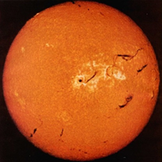

    T2 Sa géologie

    P2 Le Soleil est composé d’hydrogène à 92 %, d’hélium à 8 % et quelques métaux à 0,1 %.

    T3 Son noyau

    TP3 Son épaisseur représente 0,25 du rayon du Soleil.

    TP3 Sa température est de 14 000 000°C.

    TP3 C’est l’endroit où ont lieu les réactions thermonucléaires.

    TP3 Toute la chaleur émise par le Soleil provient du cœur.

    TP3 La pression est de 2 850 millions d’atmosphères.

    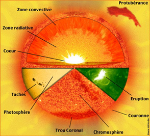

    T3 La zone de radiation ou zone radiative.

    TP3Son épaisseur est comprise entre 0,25 et 0,7 du rayon du Soleil.

    TP3Sa température est de 2 000 000°C.

    T3 La tachocline

    TP3Son épaisseur est d’environ 3 000 kilomètres.

    T3 La zone de convection ou zone convective

    TP3Son épaisseur est comprise entre 0,7 du rayon du Soleil et sa surface.

    TP3Sa température est de 5 500°C.

    T3 La photosphère

    TP3 Son épaisseur est d’environ 400 kilomètres.

    TP3 C’est la partie visible du Soleil.

    TP3 C’est la partie externe qui produit la lumière du Soleil.

    TP3 Sa température est de 5 700°C.

    TP3 Les taches solaires peuvent apparaître à sa surface.

    TSP3 Leurs températures sont d’environ 3 500°C.

    TSP3 Leurs tailles peuvent atteindre 50 000 Kilomètres.

    T2 Son atmosphère

    T3 La chromosphère

    TP3 Son épaisseur est d’environ 2 000 kilomètres.

    TP3 Sa température varie de 3 700°C dans sa partie basse à environ 100 000°C en altitude.

    T3 La couronne

    TP3 C’est la partie la plus externe du Soleil.

    TP3 Son épaisseur représente plusieurs rayons solaires.

    TP3 Elle est constituée de grands jets de gaz chauds en évolution perpétuelle.

    TP3 Sa température est de 1 000 000°C

    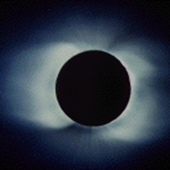

    T3 L’héliosphère

    TP3 C’est une zone qui débute à 20 rayons solaires jusqu’aux confins du système solaire.

    TP3 Elle est provoquée par les vents solaires.

    T1 Mercure

    P1 Mercure doit son au dieu romain du commerce et des voyages, également messager aux pieds ailés des dieux romains.

    T2 Ses caractéristiques

    TP2 Mercure est la première planète du système solaire.

    TP2 Sa distance moyenne du Soleil : 57 910 000 km

    TP2 Sa masse est de 3,3x1023 kg (0,055 x la Terre).

    TP2 Son volume est de 60,83x109 km3 (0,056 x la Terre).

    TP2 Sa superficie est de 75x106 km² (0,0147 x la Terre).

    TP2 Sa rotation se déroule en 59 jours.

    TP2 Sa vitesse de rotation est de 48 km/s.

    TP2 Sa révolution dure 88 jours.

    TP2 Son rayon moyen est de 2 440 kilomètres.

    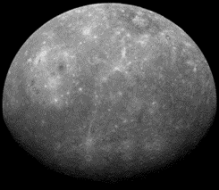

    T2 Sa géologie

    P2 La sonde Mariner 10 nous a fourni des informations lorsqu'elle approcha la planète en 1974 et en 1975. Comme Mercure n'a pas d'eau et pratiquement pas d'atmosphère, sa surface n'a subi aucune érosion. Nous la voyons à peu près telle qu'elle était juste après sa formation.

    T3 Son noyau

    TP3 Il a un rayon de 1 800 à 1 900 kilomètres.

    TP3 Il correspond à 55% de la masse de la planète.

    TP3 Il est constitué de fer et de nickel liquide.

    TP3 Son champ magnétique est très faible.

    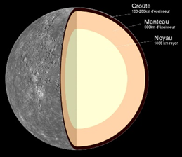

    T3 Son manteau

    TP3 Il a une épaisseur de 500 à 600 km.

    TP3 Il est composé essentiellement de silicates.

    T3 Sa croûte

    TP3 Elle a une épaisseur de 100 à 200 km.

    T3 Sa surface

    P3 La surface de la planète est recouverte :

    TP3 De plaines,

    TP3 De falaises d’une hauteur de maximale de 3 000m et d’une longueur maximale de plusieurs centaines de kilomètres,

    TP3 De cratères qui se sont formés à la suite du bombardement qui se produisit au début de l'existence du système solaire.

    TP3 Sa température de surface est de :

    TP3 Minimum : -183°C

    TP3 Moyenne : 169°C

    TP3 Maximale : 427°C

    T2 Son atmosphère

    P2 Mercure garde quelques traces d’une atmosphère extrêmement ténue se composant d’hydrogène, d’oxygène, d’hélium, de sodium, de calcium, de potassium et de vapeur d’eau.

    T1 Vénus

    P1 Vénus porte le nom de la déesse romaine de l'amour et de la beauté qui a pour équivalent Aphrodite fille de Zeus et de Dioné ou Ouranos dans la mythologie grecque. Elle a eu avec Arès (Mars) deux fils, Phobos et Deimos (la Terreur et la crainte). La planète porte ce nom, car elle considérée comme étant la plus belle et plus brillante du système solaire. On la surnomme « l’étoile du berger »

    T2 Ses caractéristiques

    P2 Pour une raison inconnue, Vénus pivote sur son axe en sens inverse, c'est-à-dire dans le sens inverse de celui de sa rotation autour du Soleil.

    TP2 Vénus est la deuxième planète du système solaire.

    TP2 Sa distance moyenne du Soleil : 108 209 000 km

    TP2 Sa masse est de 4,8685x1024 kg (0,815 x la Terre).

    TP2 Son volume est de 928,43x109 km3 (0,857 x la Terre).

    TP2 Sa superficie est de 460x106 km² (0,949 x la Terre).

    TP2 Sa rotation se déroule en -243 jours.

    TP2 Sa vitesse de rotation est de 6,5 km/h.

    TP2 Sa révolution dure 225 jours.

    TP2 Son rayon moyen est de 6 052 kilomètres.

    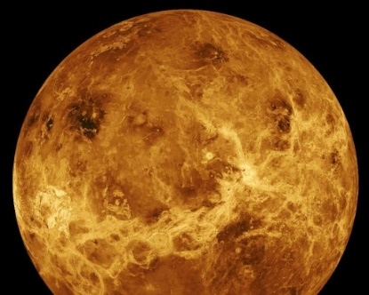

    T2 Sa géologie

    P2 Géologiquement, Vénus présente des similitudes avec la Terre. Sa croûte est probablement faite de granit et recouvre un manteau de basalte et un noyau de fer et de nickel. L'activité géologique que nous connaissons sur Terre ne semble pas exister sur Vénus, mise à part la présence de deux volcans sur une faille.

    T3 Son noyau

    TP3 Le noyau est constitué de deux parties :

    TSP3 Un noyau liquide constitué de fer et de nickel représentant 30% du rayon de la planète.

    TSP3 Un noyau solide constitué de fer et de nickel représentant 17% du rayon de la planète.

    TP3 Elle n’a pas de champ magnétique, car sa vitesse de rotation est trop lente.

    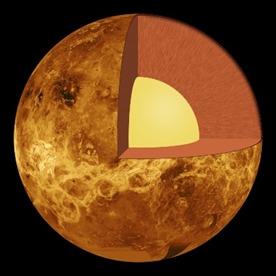

    T3 Son manteau

    P3 Le manteau rocheux, représentant environ 52,5 % du rayon de la planète, serait composé de silicates et d'oxydes de métaux.

    T3 Sa croûte

    P3 La croûte silicatée, de 20 kilomètres d'épaisseur environ, serait plus épaisse que la croûte océanique terrestre (moyenne de 6 km), mais plus fine que la croûte continentale terrestre (moyenne de 30 km).

    T3 Sa surface

    P3 C'est une planète au relief assez peu accidenté. Les 4/5 de sa surface sont recouverts de plaines volcaniques à faible pente. La surface est principalement occupée à hauteur de 70 % par de vastes plaines sans grand relief. Elles sont parsemées de grands bassins (de 400 à 600 kilomètres de diamètre) peu profonds (de 200 à 700 m) qui seraient des vestiges de cratères anciens. Ces plaines, de nature à priori volcanique, se creusent par endroits jusqu'à 2 900 m sous le niveau moyen de la surface.

    P3 Les reliefs élevés couvrent environ le dixième de la surface sous forme de plateaux et de montagnes.

    P3 Deux vastes régions élevées, très différentes l'une de l'autre et qui seraient en quelque sorte l'équivalent vénusien des continents terrestres, sont particulièrement remarquables par leurs dimensions et leur relative cohérence topographique (Ishtar Terra, Aphrodite Terra).

    P3 Vénus possède également des structures planétaires rares, les couronnes. Ce sont d'énormes ravins circulaires entourant une sorte de plateau.

    P3 Sa température de surface est de :

    TP3 Minimum : 446°C

    TP3 Moyenne : 462°C

    TP3 Maximale : 490°C

    T2 Son atmosphère

    P2 L'atmosphère de Vénus est extrêmement dense. Elle se compose majoritairement de dioxyde de carbone (CO2) et d'une faible quantité d'azote. Cette atmosphère est occupée par d'épais nuages de dioxyde de soufre. Ce mélange crée le plus fort effet de serre du Système solaire. La température de surface de Vénus est supérieure à celle de Mercure, bien que Vénus se situe à près de deux fois la distance Mercure-Soleil et ne reçoive donc qu'environ ¼ des rayons solaires reçus par Mercure.

    P2 Il n'y a que très peu d'ozone présent dans l'atmosphère vénusienne et donc aucune stratosphère.

    P2 L’atmosphère peut se diviser en trois parties

    TP2 La basse atmosphère : La basse atmosphère se situe entre 0 et 48 kilomètres d’altitude, elle est relativement transparente. Sa composition est essentiellement constituée de dioxyde de carbone à 96%, le gaz secondaire étant l'azote à 3,5%. Tous les autres sont des constituants mineurs.

    TP2 La couche nuageuse : Il y a plusieurs couches de nuages situées entre 48 kilomètres et 70 km. Cette couche nuageuse opaque réfléchit la lumière solaire, ce qui explique la brillance de Vénus et empêche d'observer directement le sol vénusien depuis la Terre. La couche nuageuse contient notamment du dioxyde de soufre et de l’eau (à l’état solide comme gazeux) ainsi que de l’acide sulfurique sous forme de gouttelettes. Le dioxyde de carbone y domine toujours.

    TP2 Cette couche se subdivise en trois sous-couches :

    TSP2 La couche inférieure ou basse atmosphère : située de 48 à 51 kilomètres d’altitude, l’atmosphère est qualifiée de brumeuse à cause de la faible quantité de particules d’acide sulfurique qu’elle contient. Ces nuages d'acide sulfurique sont visibles comme des rubans de vapeur jaunis par le soufre qu'ils contiennent.

    TSP2 La couche centrale ou principale de 51 à 52 kilomètres d’altitude, relativement claire.

    TSP2 La couche supérieure ou haute de 52 à 70 kilomètres d’altitude. Elle consiste notamment en des gouttelettes d’acide sulfurique et d'acide chlorhydrique ainsi que des particules de soufre (liquides comme solides). Les gouttelettes d'acide sulfurique sont en solution aqueuse, constituées à 75 % d'acide sulfurique et à 25 % d'eau. Enfin, la plus haute partie de la couche supérieure, de 58 à 70 kilomètres d’altitude, consisterait en une brume de cristaux de glace. Ce sont ces cristaux qui donnent à Vénus son apparence « laiteuse » vue depuis la Terre.

    T1 La Terre

    P1 La Terre est la seule planète tournant autour du Soleil qui ne soit pas dotée d’un nom universel pour toutes les langues issues de la mythologie grecque ou romaine. En français, toutefois " Terre " s’apparente à Terra, déesse romaine de la Terre, Gaïa en grec.

    P1 Pendant près de 500 millions d’années après sa formation, la Terre eut une température constante de 874,68 °C (2000 degrés Fahrenheit) composée principalement de fer et de silicates, elle contenait également de faibles quantités d’éléments radioactifs, principalement de l’uranium, du thorium et du potassium. Lors de leur désintégration, ces éléments produisirent des radiations qui réchauffèrent graduellement la surface, faisant fondre le fer et les silicates. Le fer s’enfonça vers le centre, obligeant les silicates plus légers à affleurer à la surface et provoquant le puissant processus qui a formé la surface terrestre telle que nous la connaissons aujourd’hui, et elle continue d’évoluer.

    T2 Ses caractéristiques

    TP2 La Terre est la troisième planète du système solaire.

    TP2 Sa distance moyenne du Soleil : 149 598 000 km.

    TP2 Sa masse est de 5.9736x1024 kg.

    TP2 Son volume est de 1.08321x1012 km3.

    TP2 Sa superficie est de 510 067 420 km².

    TP2 Sa rotation se déroule en 0,9972 jour.

    TP2 Sa révolution dure 365,25 jours.

    TP2 Son rayon moyen est de 6 371 kilomètres.

    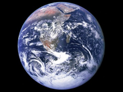

    T2 Sa géologie

    T3 Son noyau

    TP3 Son noyau interne solide (également appelé "graine") est essentiellement métallique, composé d’un alliage de fer et de nickel. La pression de 3,5 millions de bars le maintien dans un état solide malgré une température supérieure à 5000 °C.

    TP3 Son noyau interne est entouré par le noyau externe liquide qui est essentiellement composé de l’alliage fer-nickel (environ 80 % - 15 %).

    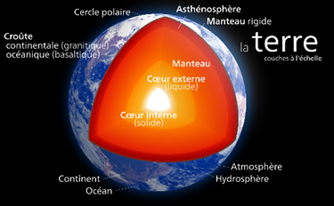

    T2 Son manteau

    P2 Il représente 84 % du volume terrestre et est divisé en deux éléments.

    T4 Son manteau inférieur

    TP4 Il recouvre le noyau.

    TP4 Il possède les propriétés d’un solide élastique.

    TP4 Il n’est pas liquide comme on pourrait le croire en regardant les coulées de lave de certaines éruptions volcaniques.

    TP4 Il est moins "rigide" que les autres couches.

    T4 Son manteau supérieur

    TP4 Le manteau supérieur est plus liquide et moins visqueux que le manteau inférieur.

    TP4 Il est formé essentiellement de roches.

    T3 Sa croûte ou écorce terrestre

    TP3 Elle représente environ 1,5% du volume terrestre.

    TP3 La croûte continentale solide est essentiellement granitique et elle est surmontée par endroits de roches sédimentaires. Elle est plus épaisse que la croûte océanique (de 30 kilomètres à 100 kilomètres sous les massifs montagneux).

    T3 Sa surface

    P3 Sa surface est divisée en plusieurs plaques tectoniques :

    T4 Les plaques principales

    TP4 La Plaque nord-américaine comprenant l’Amérique du Nord, l’Atlantique Nord-Ouest et le Groenland

    TP4 La Plaque sud-américaine comprenant l’Amérique du Sud et le sud-ouest de l’Atlantique

    TP4 La Plaque Antarctique comprenant l’Antarctique

    TP4 La Plaque Eurasienne comprenant l’Atlantique Nord-Est, l’Europe et l’Asie à l’exception de l’Inde

    TP4 La Plaque Africaine comprenant l’Afrique, le sud-est de l’Atlantique et l’ouest de l’océan Indien

    TP4 La Plaque indo-australienne comprenant l’Inde, l’Australie, la Nouvelle-Zélande et une grande partie de l’océan Indien

    TP4 La Plaque du Pacifique comprenant une grande partie de l’océan Pacifique

    T4 Les plaques secondaires

    TP4 Plaque arabique comprenant la péninsule arabique, une partie de la Mésopotamie et la mer rouge

    TP4 Plaque caraïbe comprenant la mer des Caraïbes, une partie des Antilles et une partie du nord de l’Amérique TP4 de Sud.

    TP4 Plaque de Cocos comprenant une petite partie est de l’océan Pacifique dont l’ile Cocos

    TP4 Plaque Juan de Fuca située à hauteur de la province canadienne de la Colombie-Britannique et des états américains de Washington et de l’Oregon.

    TP4 Plaque de Nazca située à l’est de l’océan Pacifique comprenant les îles Galápagos et l’île de Pâques.

    TP4 Plaque philippine comprenant la mer des Philippines, le nord de l’île de Luçon et l’est de Taïwan hormis les archipels des Ryūkyū et des Mariannes.

    TP4 Plaque Scotia comprenant le sud-ouest de l’océan Atlantique dont le sud de la Terre de Feu, mais sans la Géorgie du Sud, les îles Sandwich du Sud et les Shetlands du Sud.

    T4 Les plaques tertiaires

    TP4 plaque africaine :

    TSP4 plaque de Madagascar

    TSP4 plaque nubienne

    TSP4 plaque des Seychelles

    TSP4 plaque somalienne

    TP4 plaque antarctique :

    TSP4 plaque des Kerguelen

    TSP4 plaque des Shetlands

    TSP4 plaque des Sandwichs

    TP4 plaque indo-australienne :

    TSP4 plaque australienne

    TSP4 plaque capricorne

    TSP4 plaque de Futuna

    TSP4 plaque indienne

    TSP4 plaque des Kermadec

    TSP4 plaque Maoke

    TSP4 plaque de Niuafo'ou

    TSP4 plaque du Sri Lanka

    TSP4 plaque des Tonga

    TSP4 plaque Woodlark

    TP4 plaque caraïbe :

    TSP4 plaque de Panama

    TP4 plaque de Cocos :

    TSP4 plaque rivera

    TP4 plaque eurasienne :

    TSP4 plaque Adriatique

    TSP4 plaque de l’Amour

    TSP4 plaque anatolienne

    TSP4 plaque birmane

    TSP4 plaque ibérique

    TSP4 plaque iranienne

    TSP4 plaque de la mer de banda

    TSP4 plaque de la mer Égée

    TP4 plaque de la mer des Moluques :

    TSP4 plaque Halmahera

    TSP4 plaque Sangihe

    TP4 plaque d’Okinawa

    TP4 plaque de la Sonde

    TP4 plaque de Timor

    TP4 plaque du Yang Tsé

    TP4 plaque Juan de Fuca :

    TSP4 plaque Explorer

    TSP4 plaque Gorda

    TP4 plaque nord-américaine :

    TSP4 plaque du Groenland

    TSP4 plaque de Jan Mayen

    TSP4 plaque d’Okhotsk

    TP4 plaque pacifique :

    TSP4 plaque de Bird’s Head

    TSP4 plaque de Bismarck Nord

    TSP4 plaque de Bismarck Sud

    TSP4 plaque des Carolines

    TSP4 plaque de l’île de Pâques

    TSP4 plaque des Galápagos

    TSP4 plaque des Galápagos Nord

    TSP4 plaque Juan Fernandez

    TSP4 plaque de Kula

    TSP4 plaque de Manus

    TSP4 plaque de la mer des Salomon

    TSP4 plaque des Nouvelles-Hébrides

    TSP4 plaque du récif Balmoral

    TSP4 plaque du récif Conway

    TP4 plaque philippine :

    TSP4 plaque des Mariannes

    TP4 plaque sud-américaine :

    TSP4 plaque de l’Altiplano

    TSP4 plaque des Malouines

    TSP4 plaque des Andes du Nord

    TSP4 plaque des Andes péruviennes

    T2 Son atmosphère

    P2 L’atmosphère de la Terre s’étend sur plus de 640 kilomètres (400 miles) de haut.

    P2 Du niveau de la mer jusqu’à une altitude de 100 km, elle est composée à 78 % de nitrogène et à 21 % d’oxygène.

    P2 Le reste étant une combinaison d’argon, de gaz carbonique, de néon, d’hélium, de krypton, de xénon et d’autres gaz en faible proportion.

    T2 Ses satellites

    P2 La Lune, unique satellite de la Terre, est de grande taille comparée aux satellites naturels des autres planètes, à l’exception de Pluton.

    P2 Elle orbite à environ 300 000 km.

    P2 Les astronomes considèrent le système Terre-Lune comme une double planète.

    P2 Sa taille donne à la Lune une influence gravitationnelle non négligeable et provoque par exemple les marées de nos océans.

    P2 L’interaction entre la Terre et la Lune ralentit la rotation de la Terre de 2 millisecondes par siècle. Il y a approximativement 900 millions d’années, il y avait 481 jours de 18 heures par an.

    T1 Mars

    P1 Mars doit son nom au dieu grec de la guerre Arès puis à son équivalent romain Mars, la couleur rouge de sa surface évoquant le sang des champs de bataille. Il est le fils de Zeus et d’Héra. Arès est une divinité plus récente que Mars et fait partie des douze dieux principaux.

    T2 Ses caractéristiques

    TP2 Mars est la quatrième planète du système solaire.

    TP2 Sa distance moyenne du Soleil : 227 937 000 km.

    TP2 Sa masse est de 641,85x1021 kg. (0,107 x la Terre)

    TP2 Son volume est de 163.18x109 km3. (0.151 x la Terre)

    TP2 Sa superficie est de 144 798 500 km². (0.284 x la Terre)

    TP2 Sa rotation se déroule en 1,026 jour.

    TP2 Sa révolution dure 687 jours

    TP2 Son rayon moyen est de 3 389 kilomètres.

    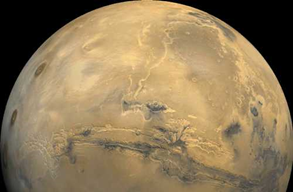

    T2 Sa géologie

    T3 Son noyau

    TP3 Le noyau est composé d’un alliage métallique liquide fait principalement de fer et de nickel.

    TP3 Il mesure de 1 500 kilomètres de rayon moyen.

    TP3 Sa température est de 1 727°C

    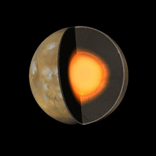

    T3 Son manteau

    P3 Il serait très semblable à celui de la Terre, constitué de phases solides où dominent les silicates riches en fer, ce dernier représentant une fraction pondérale de 11 à 15,5 % du manteau.

    T3 Sa croûte

    P3 Elle semble bien plus épaisse dans l’hémisphère sud que dans l’hémisphère nord, d’une épaisseur moyenne d’environ 50 kilomètres (soit 4,4 % du volume de la planète). Avec comme valeurs extrêmes 92 kilomètres et à peine 3 kilomètres sous le bassin d’impact d’Isidis Planitia.

    T3 Sa surface

    P3 Sa surface est variée et complexe, elle est constituée de :

    TP3 Plateaux hauts de 10 km

    TP3 Volcans de 600 kilomètres de diamètre et 25 kilomètres de haut. La plus haute montagne du système solaire se trouve sur Mars, il s’agit du mont Olympe

    TSP3 haut de 25 kilomètres et dont la base fait 600 kilomètres de diamètre.

    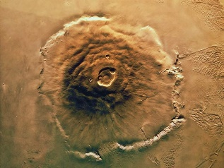

    TP3 Une énorme faille s’étend sur 2 500 km, avec une largeur de 120 kilomètres et une profondeur de 6 kilomètres nommée Valles Marineris.

    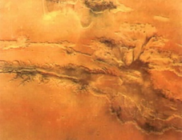

    TP3 Une découverte importante a été faite lorsque les sondes vikings ont photographié des petites vallées ressemblant à des lits de rivières avec leurs affluents et leurs îles. Ceci montre à l’évidence que l’eau coule sur Mars. Cette eau est saumâtre.

    TP3 La couleur rouge sang provient de l'oxyde de fer accumulé à la surface de la planète.

    T2 Son atmosphère

    TP2 L'orbite de Mars est considérablement elliptique, ce qui provoque des variations de la température d'approximativement 130°C.

    TP2 Cela a une influence majeure sur le climat de Mars.

    TP2 Elle se compose essentiellement de gaz carbonique.

    P2 Sa température de surface est de :

    TP2 Minimum : -133°C

    TP2 Moyenne : -63°C

    TP2 Maximale : -3°C

    T2 Ses satellites

    P2 Deux petits satellites sont en orbite autour de Mars. Ils sont de forme irrégulière dont la surface présente de nombreux cratères.

    Début_tab

    SatelliteDistance (km)Rayon (km)Masse (kg)

    Phobos9 37611,101,08x1016

    Deïmos23 4586,201,476x1015

    Fin_tab

    T1 La ceinture d'astéroïdes

    P1 Si l'on se fonde sur la distance qui sépare chacune des neuf planètes connues, il devrait exister une dixième planète entre Mars et Jupiter. De fait, à l'endroit où cette planète devrait se situer, on trouve une bande d'astéroïdes dont certaines ont un diamètre atteignant 1 000 kilomètres alors que les autres sont de minuscules cailloux.

    T1 Jupiter

    P1 Jupiter doit son nom au dieu romain qui gouverne la Terre et le ciel, ainsi que tous les êtres vivants s’y trouvant. Jupiter est le dieu romain le plus important (dieu de la foudre et du tonnerre, président du conseil des dieux). Il forme la triade avec Minerve et Junon. Il est assimilé au dieu grec Zeus (le plus grand des dieux de panthéon hellénique), le dieu de la lumière, du ciel, de la foudre, trônant au sommet du mont Olympe. Il maintient l’ordre et la justice dans le monde. Il est le fils du titan Cronos et de Rhéa. Sa nourrice fut la nymphe Amalthée, une chèvre qui lui donna son lait. Zeus obtint son pouvoir sur l’univers à la suite de sa victoire contre les titans. Il s’unit à Métis, à Dioné avec qui il eut Aphrodite, à Eurynomé, à Mnémosyne, à Léto avec qui il eut Apollon et Artémis, à Héra avec qui il eut Arès et à Déméter.

    T2 Ses caractéristiques

    TP2 Jupiter est la cinquième et plus grosse planète du système solaire.

    TP2 Sa distance moyenne du Soleil : 778 412 000 km.

    TP2 Sa masse est de 1,8986x1027 kg. (317,8 x la Terre)

    TP2 Son volume est de 1,43128x1015 km3. (1 321,3 x la Terre)

    TP2 Sa superficie est de 6,14x1010 km². (120,5 x la Terre)

    TP2 Sa rotation se déroule en 9h55.

    TP2 Sa révolution dure 11 ans, 10 mois et 15 jours

    TP2 Son rayon moyen est de 69 911 km.

    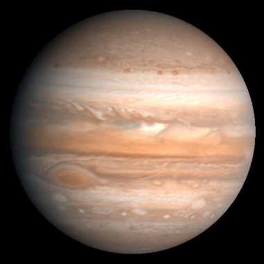

    T2 Sa géologie

    T3 Son noyau

    TP3 Il serait composé de roche et serait de la taille de la Terre.

    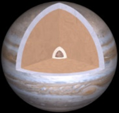

    T3 Son manteau

    TP3 Le manteau est composé d’hydrogène en phase métallique qui occuperait 78 % du rayon de la Terre. Il pourrait être liquide (à la manière du mercure) si la pression était moins importante.

    TP3 La couche d’hydrogène métallique est entourée d’une couche d’hydrogène liquide.

    TP3 La couche d’hydrogène liquide est entourée d’une couche d’hydrogène gazeux.

    T2 Son atmosphère

    P2 L’atmosphère est composée de 4 couches.

    TP2 La troposphère : Elle est d’une épaisseur de 50 kilomètres et sa température est de -163°C, elle est composée de nuages de glace d'ammoniac. En dessous, des nuages composés d'hydrosulfure d'ammonium, de sulfure d'ammonium et d'eau existent probablement. Il n'y a pas de nuages de méthane, car la température est trop élevée pour qu'il se condense. Les nuages de vapeur d'eau constituent la couche nuageuse la plus dense et ont une influence importante sur les dynamiques régissant l'atmosphère.

    TP2 La stratosphère : Elle est d’une épaisseur de 320 kilomètres et sa température est de -73°C. Elle est composée de méthane, de dihydrogène, d’hydrocarbures légers, comme l'éthane et l'acétylène.

    TP2 La thermosphère : Elle est d’une épaisseur de 1 000 kilomètres et sa température peut atteindre 726°C

    TP2 L’exosphère : Elle n'a pas de limite supérieure bien définie. La densité décroit lentement jusqu'au milieu interplanétaire approximativement 5 000 kilomètres au-dessus de la « surface ».

    P2 Depuis la Terre, Jupiter apparaît jaune-oranger dû fait du sulfure d’ammonium et au phosphore présent dans son atmosphère. Les couleurs des nuages correspondent à leur altitude, bleu pour les plus bas suivis du marron puis les blancs et enfin les rouges pour les plus élevés.

    P2 Sa température varie de -108°C à -161°C

    T2 Sa tâche

    P2 C’est une énorme perturbation atmosphérique qui parcourt Jupiter depuis des siècles. Elle mesure 26 500 kilomètres de long et 15 000 kilomètres de large.

    P2 Une seconde s’est formée au début des années 2000 par la collision et la fusion de trois petites tâches. De même couleur que la première, elle reste deux fois moins importante.

    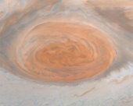

    T2 Ses satellites

    P2 Jupiter est entouré de 66 satellites découverts à différentes périodes. Les plus récemment n’ont pas tous été nommés. Ils peuvent être regroupés en fonction de leurs tailles et de leurs orbites.

    Début_tab

    GroupeSatelliteDistance du centre de JupiterDiamètre (km)

    AmalthéeAmalthée Métis Adrastée ThébéMoins de 200 000 kmMoins de 200 km

    Satellites GaliléensIo Europe Ganymède CollistoEntre 400 000 et 2 000 000 de km

    ThémistoThémisto

    HimaliaLéda Himalia Lysithéa Elara S/2000 J11Entre 11 000 000 et 13 000 000 de kmMoins de 170 km

    CarpoCarpo

    AnankéVers 21 000 000 de km

    CarméVers 23 000 000 de km

    PasiphaéEntre 17 000 000 et 30 000 000 de kmMoins de 65 km

    Fin_tab

    T2 Ses anneaux

    P2 Comme Saturne, Jupiter comprend des anneaux. Ils sont moins visibles, car constitués de grains de matières très sombres.

    P2 Du plus près au plus lointain du centre de la planète, les anneaux sont regroupés en trois grandes sections :

    TP2 Le halo : situé entre 92 000 kilomètres et 122 500 kilomètres du centre de la planète. Le halo est un anneau en forme de tore, élargi par le champ magnétique de Jupiter.

    TP2 L’anneau principal : situé entre 122 500 kilomètres et 128 940 kilomètres du centre de la planète et épais de seulement 30 km. Il est probablement composé de poussières provenant des satellites Adrastée et Métis.

    TP2 L’anneau Gossamer : entre 128 940 kilomètres et 280 000 kilomètres du centre de la planète. Avant 181 350 km, il est constitué de poussières provenant d'Amalthée et de Thébé. Cet anneau est très peu dense, mais nettement plus épais que le précédent (plusieurs milliers de kilomètres) et s'évanouit progressivement dans le milieu interplanétaire.

    T1 Saturne

    P1 Saturne doit son nom au dieu romain qui préside la période qui précède le solstice d'hiver. Saturne est un très ancien dieu latin détrôné par Jupiter. Saturne lui-même avait remplacé Janus. Il est supposé avoir inventé l'agriculture (il est représenté armé d'une faucille), mais était considéré comme un dieu infernal. Il est identifié au dieu grec Cronos, mais aussi au dieu carthaginois Baal. Cronos est un Titan, le plus jeune fils d'Ouranos (le Ciel) et de Gaia (la Terre).

    T2 Ses caractéristiques

    TP2 Saturne est la sixième et deuxième plus grosse planète du système solaire.

    TP2 Sa distance moyenne du Soleil : 1 421 180 000 km.

    TP2 Sa masse est de 568,46x1024 kg. (95,152 x la Terre)

    TP2 Son volume est de 827,13x1012 km3. (763 x la Terre)

    TP2 Sa superficie est de 43,466x109 km². (83,703 x la Terre)

    TP2 Sa rotation se déroule en 10h, 44min, 2s.

    TP2 Sa révolution dure 29 ans, 165 jours, 12h.

    TP2 Son rayon moyen est de 58 232 km.

    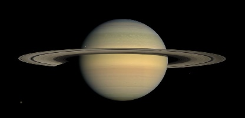

    T2 Sa géologie

    T3 Son noyau

    TP3 Le noyau est rocheux et est composé de silicates et de fer

    TP3 Sa température est de 11 727°C

    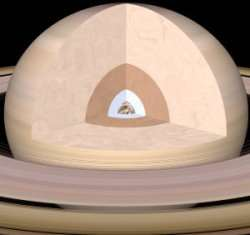

    T3 Son manteau

    TP3 Ce noyau est entouré d'une couche d'hydrogène métallique, puis d'hydrogène liquide, puis enfin d'hydrogène gazeux.

    TP3 Il mesure de 1 300 à 2 000 kilomètres de rayon.

    T2 Son atmosphère

    P2 La haute atmosphère est constituée à 93,2 % d'hydrogène et à 6,7 % d'hélium en termes de molécules de gaz. Des traces de méthane, d'éthane, d'ammoniac, d'acétylène et de phosphine ont également été détectées. Les nuages les plus en altitude sont composés de cristaux d'ammoniac, tandis que les nuages plus bas semblent être constitués soit d'hydrosulfure d'ammonium, soit d'eau.

    P2 Sa température varie de -139°C à -189°C.

    T2 Ses satellites

    P2 Saturne compte 62 satellites en rotation autour d'elle.

    P2 Après le passage des sondes Voyager en 1980, les astronomes connaissaient 10 satellites. Le premier fut Titan, découvert en 1655. Le passage des sondes Voyager 1 et Voyager 2 permit la découverte de 7 lunes supplémentaires, suivies 10 ans plus tard, par la découverte de Pan. Fin 2000, l'Union Astronomique Internationale a annoncé coup sur coup la découverte de 12 lunes. Avec l'arrivée de la sonde Cassini dans la banlieue proche de Saturne de nouvelles découvertes ont eu lieu, 34 satellites découverts entre 2004 et 2009 et d'autres sont à prévoir. Il existe également 3 satellites non confirmés : S/2004 S3, S/2004 S4 et S/2004 S6.

    P2 Ces satellites sont très variés : de Titan aussi grand que Mercure, à de petits corps irréguliers semblables à des astéroïdes.

    T2 Ses anneaux

    Début_tab

    NomRayon interne (km)Rayon externe (km)Largeur (km)Épaisseur (m)

    Anneau D66 90074 5107 610?

    Division de Guérin74 51074 658148—

    Anneau C74 65892 00017 3425

    Anneau B92 000117 58025 5805-10

    Division de Cassini117 500122 2004 700—

    Anneau A122 170136 77514 60520-40

    Division d'Encke133 589—325—

    Division de Keeler136 530—35—

    R/2004 S 1137 630—??

    R/2004 S 2138 900—??

    Anneau F140 180—30-500?

    Anneau G170 000175 0005 0001×105

    Anneau E181 000483 000302 0001×107

    Fin_tab

    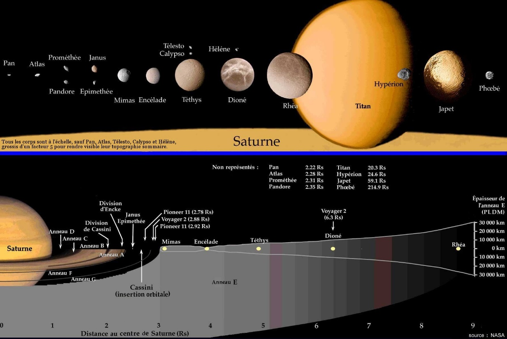

    T1 Uranus

    P1 Uranus doit son nom à la divinité grecque du ciel, le père de Cronos (Saturne) et grand-père de Zeus (Jupiter). Ouranos est le Ciel qui, en s'unissant avec Gaia, la Terre, va donner naissance aux Titans. Uranus fut tout d'abord appelé la planète Herschel du nom de son inventeur qui, lui, aurait voulu appeler cette planète "l'astre de Georges", du nom du roi Georges III. En 1781, Johann Bode la nomma Uranus.

    T2 Ses caractéristiques

    TP2 Uranus est la septième planète du système solaire.

    TP2 Sa distance moyenne du Soleil : 2 870 858 000 km.

    TP2 Sa masse est de 8,6810x1025 kg. (14,536 x la Terre)

    TP2 Son volume est de 6,83344x1013 km3. (63,085 x la Terre)

    TP2 Sa superficie est de 8,0831x109 km². (15,847 x la Terre)

    TP2 Sa rotation se déroule en -17 h.

    TP2 Sa révolution dure environ 84 ans.

    TP2 Son rayon moyen est de 25 362 km.

    TP2 Elle est pratiquement invisible à l’œil nu.

    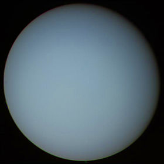

    TP2 Uranus forme un angle d'approximativement 90 degrés avec le Soleil, de telle sorte qu'un de ses pôles est toujours pointé en direction du Soleil au cours de la rotation de la planète. Bizarrement, la température est presque identique aux deux pôles de la planète

    T2 Sa géologie

    T3 Son noyau

    TP3 Le noyau composé de silicates et de fer.

    TP3 Il mesure 3 750 kilomètres de rayon.

    TP3 Sa température est de 7 000°C

    T3 Son manteau

    TP3 Il est d’une épaisseur de 10 000 km.

    TP3 Il est principalement composé de glace d’eau mélangée à de l’hélium, du méthane et d’ammoniac.

    T3 Sa surface

    P3 Bien qu'il n'y ait pas de surface clairement définie sur Uranus, la partie la plus extérieure de l'enveloppe gazeuse d'Uranus est considérée comme son atmosphère

    T2 Son atmosphère

    P2 L'atmosphère peut être divisée en trois couches :

    TP2 La troposphère, d'une altitude de −300 à 50 km

    TP2 La stratosphère, d'une altitude de 50 kilomètres à 4 000 km

    TP2 La thermosphère/couronne commençant vers 4 000 kilomètres d'altitude et allant jusqu'à près de 50 000 kilomètres de la surface

    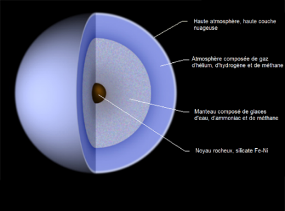

    T2 Ses satellites

    P2 Uranus possède 15 satellites, dont 5 ont été découverts entre 1787 et 1948 et 10 autres en 1986. Semblables aux satellites de Saturne, les plus gros (de diamètres supérieurs à 400 km) portent les noms des héros shakespeariens tirés des œuvres suivantes, le songe d'une nuit d'été et la tempête : Miranda, Ariel, Umbriel, Tatiana et Obéron. Ils sont constitués de glace et de débris rocheux. Les autres satellites sont des astéroïdes sombres de quelques dizaines de kilomètres de diamètre.

    Début_tab

    NomDiamètre (km)Masse (1016 kg)Rayon moyen (km)

    Cordélia474,549 800

    Ophélie435,453 800

    Bianca519,359 200

    Cressida8034,361 800

    Desdémone6417,862 700

    Juliette9455,764 400

    Portia13516866 100

    Rosalinde7225,469 900

    Cupid120,1274 800

    Belinda8135,775 300

    Perdita8040,076 416

    Puck16228986 000

    Mab160,2897 734

    Miranda4746 600129 900

    Ariel1 159135 000190 900

    Umbriel1 169117 000266 000

    Titania1 578352 000436 300

    Obéron1 523301 000583 500

    Francisco120,134 276 000

    Caliban98737 231 000

    Stephano200,608 004 000

    Trinculo100,0758 578 000

    Sycorax19054012 179 000

    Margaret110,1014 345 000

    Prospero302,116 243 000

    Setebos302,117 501 000

    Ferdinand120,1320 901 000

    Fin_tab

    T2 Les anneaux

    P2 Les anneaux d'Uranus sont découverts depuis la Terre en 1977, lors de l'observation de l'occultation d'une étoile par la planète. On en compte alors 9, qui sont les principaux anneaux de la planète. Des anneaux secondaires très fins sont découverts par la sonde Voyager 2 en 1986 (dont un de 3 500 kilomètres de largeur). En comparaison de ceux de Saturne, les 9 anneaux principaux d'Uranus sont très petits. Leur épaisseur varie de 20 à 30 mètres

    Début_tab

    NomDistance (km)Largeur (km)

    ζ (Zéta)39 6003 500

    641 8401 à 3

    542 2302 à 3

    442 5802 à 3

    α (Alpha)44 7207 à 12

    β (Béta)45 6707 à 12

    η (Eta)47 1900 à 2

    γ (Gamma)47 6301 à 4

    δ (Delta)48 2903 à 9

    λ (Lambda)50 0242 à 3

    ε (Epsilon)51 14020 à 100

    ν (Nu)67 3003 800

    μ (Mu)97 70017 80

    Fin_tab

    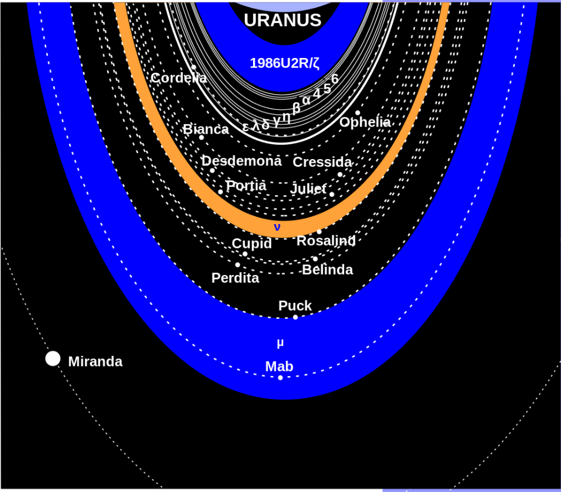

    T1 Neptune

    P1 Neptune doit son nom au dieu des océans dans la mythologie romaine. Plus connu sous le nom de Poséidon dans le panthéon de la mythologie grecque. Poséidon règne sur la mer, c’est le frère de Zeus. Il est l’un des dieux olympiens, il est le fils de Cronos et de Rhéa. Il eut de nombreux enfants, des géants malfaisants. Il fut l’époux d’Amphitrite, une néréide dont il eut un fils nommé Triton. Il est représenté armé d’un trident sur un char entouré des Néréides et de génies comme Protée.

    T2 Ses caractéristiques

    TP2 Neptune est la huitième planète du système solaire.

    TP2 Sa distance moyenne du Soleil : 4 503 443 661 km.

    TP2 Sa masse est de 102,43x1024 kg. (17,147 x la Terre)

    TP2 Son volume est de 62,526x1012 km3. (57,74 x la Terre)

    TP2 Sa superficie est de 7,64x109 km². (14,98 x la Terre)

    TP2 Sa rotation se déroule en 16 h 6,6 min.

    TP2 Sa révolution dure environ 164 ans 323 jours et 22 heures.

    TP2 Son rayon moyen est de 24 622 km.

    TP2 Elle a été découverte grâce à des calculs mathématiques.

    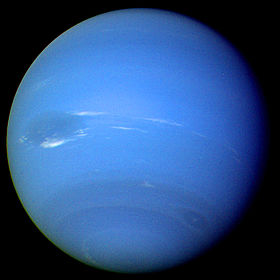

    T2 Sa géologie

    T3 Son noyau

    TP3 Le noyau de Neptune est composé essentiellement de silicates et de fer avec la présence d’agrégats de roche te de glace et d’hydrogène.

    TP3 Il mesure 7 000 kilomètres de rayon.

    T3 Son manteau

    TP3 Il est d’une épaisseur de 15 000 km.

    TP3 Il est composé de roches en fusion, de glaces, d'hydrogène et un peu d'hélium

    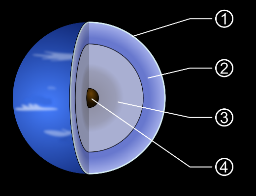

    L.1-Haute atmosphère,

    L.2-Atmosphère composée de gaz d'hélium, d'hydrogène et de méthane,

    L.3-Manteau composé de glaces d'eau, d’ammoniac et de méthane et

    L.4-Noyau rocheux

    T2 Son atmosphère

    TP2.Elle est d’une épaisseur de 8 400 km.

    TP2.Elle est composée à haute altitude de 84 % d'hydrogène et de 12 % d'hélium et 1,5 % de méthane. Des traces d'ammoniac, d'éthane et d'acétylène ont également été détectées.

    T2 Sa grande tâche sombre

    P2 Lors de survol de Neptune par la sonde Voyager 2 en 1989, les astronomes découvrirent une grande tache sombre. Les vents y soufflaient vers l'ouest à 300 m/s (1 080 km/h) allant jusqu'à 2 500 km/h. Cette tâche était un gigantesque ouragan sombre qui pouvait se déplacer à plus de 1 000 km/h. En novembre 1994, les astronomes, grâce au télescope Hubble, s’aperçurent que cette tache avait disparu.

    T2 Ses anneaux

    P2 Neptune possède des anneaux planétaires peu visibles. Ceux-ci sont sombres, leur composition et leur origine sont inconnues.

    Début_tab

    NomDistance (km)Largeur (km)

    Galle41 90015

    Le Verrier53 20015

    Lassell53 2005 800

    Arago57 000?

    Adams62 930< 50

    Fin_tab

    T2 Ses satellites

    P2 Neptune compte 14 satellites. Le premier et plus gros, Triton, a été découvert en 1846, 15 jours après la première observation de la planète.

    Début_tab

    OrdreLabelNomDiamètre

    (km)Masse

    (1016 kg)

    1Neptune IIINaïade6719

    2Neptune IVThalassa8335

    3Neptune VDespina152210

    4Neptune VIGalatée175212

    5Neptune VIILarissa195420

    6S/2004 N 1

    (provisoire)19

    7Neptune VIIIProtée4185 000

    8Neptune ITriton2 7072 140 000

    9Neptune IINéréide3403 100

    10Neptune IXHalimède609

    11Neptune XISao389

    12Neptune XIILaomédie389

    13Neptune XPsamathée281,5

    14Neptune XIIINéso609

    Fin_tab

    T1 Pluton

    P1 Pluton est nommée à la fois en référence au dieu romain des enfers et à Percival Lowell dont les initiales forment les deux premières lettres de Pluton. Le nom fut suggéré par Venetia Burney, une jeune fille âgée de onze ans habitant Oxford, en Angleterre. Pluton signifie "le riche", c’est le surnom du dieu des enfers Hadès. Hadès, le dieu des morts, est fils de Cronos et Rhéa, frère de Zeus, Poséidon, Héra, Hestia et Déméter. Après la victoire sur les Titans, Zeus prit le Ciel, Poséidon, la Mer et Hadès, le monde souterrain, les Enfers. Hadès est impitoyable, aucun de ses sujets ne peut revenir parmi les vivants. Il est assisté de divers génies et démons, tel Charon. Jusqu’en 2006, Pluton fût considéré comme planète, mais depuis elle a été déclassifié en planète naine.

    T2 Ses caractéristiques

    TP2 Pluton est la neuvième planète du système solaire.

    TP2 Sa distance moyenne du Soleil : 5 906 450 638 km.

    TP2 Sa masse est de 1,314x1022 kg.

    TP2 Son volume est de 6,97x109 km3.

    TP2 Sa rotation se déroule en -6,387 jours.

    TP2 Sa révolution dure environ 248 ans.

    TP2 Son rayon moyen est de 1 185 km.

    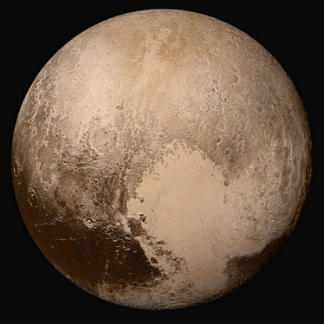

    T2 Sa géologie

    T3 Son noyau

    TP3 Même si la composition de Pluton est pour l’instant inconnue, la planète serait constituée d'un noyau rocheux de 800 à 900 kilomètres de rayon.

    T3 Son manteau

    TP3 Il est d’une épaisseur de 200 km.

    TP3 Il est principalement composé de glace.

    T3 Sa croûte

    TP3 Elle est d’une épaisseur de 5 à 10 km.

    TP3 Elle est constituée de méthane gelé.

    T2 Son atmosphère

    TP2 L'atmosphère de Pluton est principalement composée d'azote, avec un peu de méthane, de monoxyde de carbone et d'éthane

    TP2 La température est de -230°C

    T2 Ses satellites

    Début_tab

    NomDésignation SystèmeDimensions (km)Masse (1021 kg)

    Pluton2 37013,05

    CharonPluton I1 2081,52

    StyxPluton V10 - 25

    NixPluton II42 x 369<0.005

    KerbérosPluton IV< 30

    HydrePluton III55 × 409<0.005

    Fin_tab
