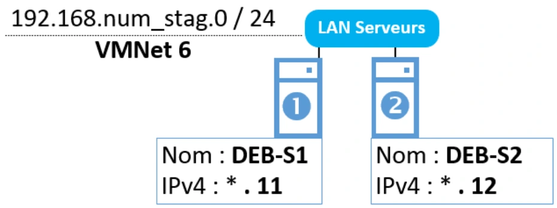

# Énoncés — Module 02 — Adressage réseau

Les consignes suivent les scénarios des sources. Les valeurs historiques et les particularités de version sont expliquées dans le cours et les corrigés.

## TP 1 — Configuration réseau de la maquette

Services réseau en environnement Linux

### Mise en œuvre et configuration réseau

Durée estimée

3 heures

### Objectifs

- Créer des machines virtuelles conformément à un cahier des charges.
- Configurer l’adressage réseau sous GNU/Linux Debian.

### Prérequis

- VMware Workstation doit être installé sur votre machine physique.

Récupérer l’image ISO du système d’exploitation indiqué dans le tableau de l’étape 1. Il est conseillé de télécharger l’ISO du DVD au départ ; les machines virtuelles n’auront pas obligatoirement accès à Internet :

https://cdimage.debian.org/debian-cd/current/amd64/iso-dvd/

### Notes

- Pour toutes les configurations réseau, remplacer num\_stag par un chiffre entre 1 et 30, par exemple 10.
- Installer une seule fois la Debian sans interface bureautique et faire des clones permettra d’accélérer les déploiements des VMs.
- Veiller à bien lire toutes les instructions pour chaque VM.

Services réseau en environnement Linux

### Etape 1 - Configuration du LAN Clients

Création de la machine virtuelle cliente :

<table><tr><th>Nom de la VM</th><th>Système d’exploitation</th><th>RAM</th><th>Réseau</th></tr><tr><td>Cli-db-10</td><td>Linux Debian 10.x 64 bits</td><td>1024 MB</td><td>Custom / VMNet4</td></tr></table>

### Nom : Cli-db-10 IPv4 : \* . 10

### LAN Clients 172.18.num\_stag.0 / 24 VMNet 4

### Installation du système d’exploitation :

- Installer le système d’exploitation. Ne pas configurer l’adressage réseau pendant l’installation (il sera configuré post installation).

### L’environnement de bureau Debian doit être installé sur Cli-db-10.  Configuration système  :

- Configurer l’adressage réseau IPv4 des postes en vous référant au précédent schéma.

Vous utiliserez le Network Manager pour configurer le réseau de Cli-db-10.

- Vérifier le nom du poste, le renommer au besoin.

### Etape 2 - Configuration du LAN Serveurs

Création des machines virtuelles serveur :

Créer les machines virtuelles suivantes

<table><tr><th>Nom de la VM</th><th>Système d’exploitation</th><th>RAM</th><th>Réseau</th></tr><tr><td>DEB-S1</td><td>Linux Debian 10.x 64 bits</td><td>1024 MB</td><td>Custom / VMNet6</td></tr><tr><td>DEB-S2</td><td>Linux Debian 10.x 64 bits</td><td>1024 MB</td><td>Custom / VMNet6</td></tr></table>

Services réseau en environnement Linux

Installation du système d’exploitation sur les machines virtuelles :

- Installer le système d’exploitation indiqué dans le tableau sur les machines virtuelles créées précédemment.
- Ne pas configurer l’adressage réseau pendant l’installation (il sera configuré post installation).

L’environnement de bureau Debian NE DOIT PAS être installé (ni aucun autre environnement graphique…) sur ces machines.

Configuration système des machines :

- Configurer au moyen de la commande ip l’adressage réseau IPv4 des postes en vous référant au précédent schéma.
- S’assurer qu’ils communiquent bien entre eux.
- Une fois le point précédent vérifié, purger la configuration précédemment établie (flush) puis reporter dans le fichier de configuration des interfaces leur configuration respective.
- Redémarrer le service networking et vérifier la bonne prise en compte de la configuration de vos interfaces.
- Vérifier le nom des postes, les renommer au besoin.
- Vérifier que les postes communiquent bien entre eux (ping).

### Etape 3 - Préparation d’un serveur supplémentaire

Créer une machine virtuelle avec les caractéristiques suivantes :

<table><tr><th>Nom de la VM</th><th>Système d’exploitation</th><th>RAM</th><th>Réseau</th></tr><tr><td>RouTux</td><td>Linux Debian 10.x 64 bits</td><td>1024 MB</td><td>Aucune carte réseau</td></tr></table>

- Installer son système d’exploitation. NE PAS INSTALLER l’environnement de bureau Debian, ne pas configurer le réseau.
- Vérifier le nom d’hôte de la machine (le modifier au besoin)

[Corrigés commentés](corrections.md) · [Cours du module](../../../modules/15-services-reseau-en-environnement-linux/module-02-adressage-reseau.md).
