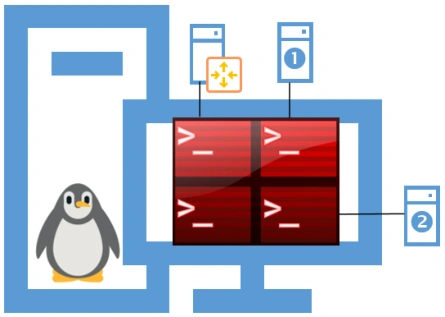

# Énoncés — Module 04 — Administration à distance

Les consignes suivent les scénarios des sources. Les valeurs historiques et les particularités de version sont expliquées dans le cours et les corrigés.

## TP 1 — Installation, accès par clé et copies SSH

### Configuration du service SSH

Durée estimée

1 heure

### Objectifs

- Installer et configurer le service SSH

### Prérequis

- Les ateliers précédents doivent être fonctionnels

### Notes

- Pour toutes les configurations réseau, vous remplacerez num\_stag par un chiffre entre 1 et 30, par exemple 10.

### Etape 1 - Installation du serveur SSH sur TOUS les serveurs Debian

- Configurer le fichier sources.list de tous vos serveurs afin qu’ils ne contiennent que les lignes suivantes :

```text
deb http://ftp.fr.debian.org/debian/ buster main
deb http://security.debian.org/debian-security buster/updates main
deb http://ftp.fr.debian.org/debian/ buster-updates main
```

- Mettre à jour le gestionnaire de dépendances
- Vérifier l’état d’installation du paquet openssh-server, l’installer au besoin.

### Etape 2 - Configuration du service SSH

- Installer Terminator sur la machine Cli-db-10 ; vous utiliserez cette machine pour centraliser l’administration de vos serveurs GNU/Linux.



- Configurer le service SSH pour permettre la connexion à vos différents serveurs sans avoir à saisir de mot de passe (échange de clés).
- Vous allez devoir vous connecter depuis la machine Cli-db-10 sur les serveurs : RouTux, Deb-S1, Deb-S2.

### Etape 3 - Utilisation des commandes de copie sécurisée

- Sur la machine Cli-db-10, utiliser la commande scp pour copier les fichiers de configuration paramétrés sur chacune des machines Debian (interfaces, resolv.conf, sources.list…).


[Corrigés commentés](corrections.md) · [Cours du module](../../../modules/15-services-reseau-en-environnement-linux/module-04-administration-a-distance.md).
