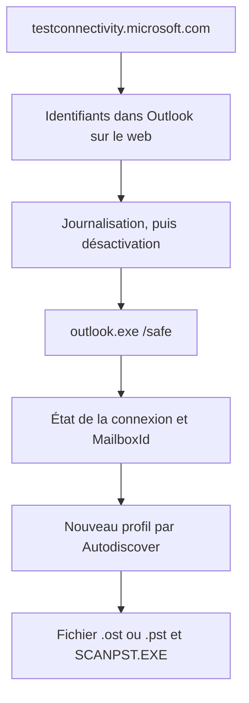

# Dépannage — Outlook ne se connecte pas

Démarche du module Outlook. Les noms de fichiers et d’adresses ci-dessous sont ceux du support de formation.

**Illustration IA / externe au cours — ordre de diagnostic.**

Le test distant sépare un problème d’accès Exchange d’un problème de profil local.

1. Ouvrir [testconnectivity.microsoft.com](https://testconnectivity.microsoft.com/) et lancer le test de connectivité Outlook. Le TP attend un test réussi.
2. Vérifier l’identifiant et le mot de passe dans Outlook sur le web.
3. Activer la journalisation : Fichier, Options, Options avancées. Redémarrer. Lire `C:\Users\micheline\AppData\Local\Temp\Journalisation d’Outlook`, puis désactiver la journalisation.
4. Lancer `outlook.exe /safe`. Le mode sans échec démarre sans les modules complémentaires. Dans le TP, les émojis ne sont plus proposés.
5. Ctrl + clic droit sur l’icône de la zone de notification : état de la connexion. Noter le MailboxId dans « Nom du serveur ».
6. Outlook fermé, supprimer le profil (Panneau de configuration, Mail) puis rouvrir pour laisser Autodiscover reconfigurer. Contrôler messages, calendrier et tâches.
7. Repérer le fichier dans Fichier, Informations, Paramètres du compte. `.ost` : données hors connexion, le serveur Exchange conserve les éléments. `.pst` : stockage local, notamment sans Exchange (POP3, IMAP4).
8. Contrôler l’intégrité avec `SCANPST.EXE`. Le support limite MaxFileSize à 50 Go et WarnFileSize à 47,5 Go.
9. Relever le nombre d’éléments : Propriétés de la boîte de réception, Taille du dossier.

Outlook Anywhere est activé par défaut : l’accès Exchange Online depuis Internet ne passe pas par un VPN. La commande citée est `Test-OutlookConnectivity`.

!!! warning "Attention"
    Ne pas supprimer un fichier `.ost` ou `.pst` sans savoir lequel est en cause et sans copie. Le support montre aussi un fichier `.bak` de sauvegarde.
