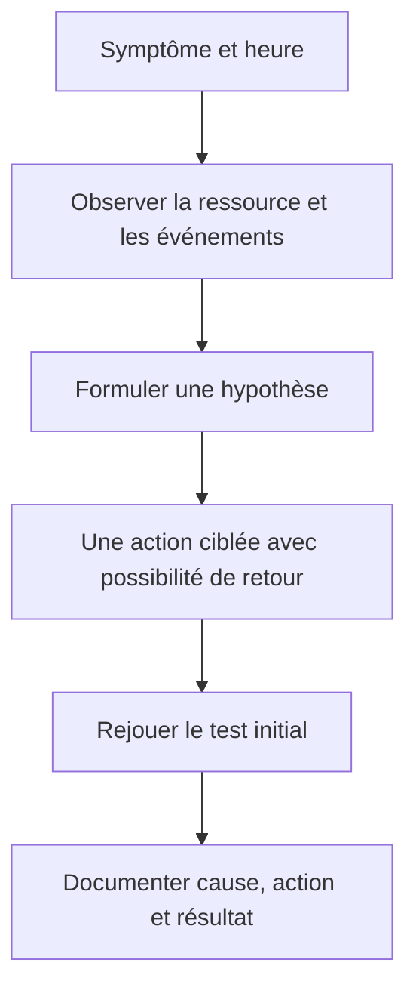

# Dépannage — Windows instable

## Partir d’un symptôme observable

Noter le symptôme, son heure, le compte concerné et le changement récent : installation, pilote, mise à jour ou réglage. Le module 10 distingue l’observation en temps réel, l’historique et les outils automatiques de diagnostic.



## Choisir l’outil qui répond à la question

| Question | Outil du cours | Preuve à conserver |
|---|---|---|
| Quel processus consomme maintenant ? | Gestionnaire des tâches, Moniteur de ressources | Processus, ressource et intervalle observés. |
| Que s’est-il passé à l’heure du défaut ? | Observateur d’événements | Journal, heure, identifiant et message utiles. |
| Le défaut se répète-t-il après un changement ? | Historique de fiabilité | Chronologie des incidents et installations. |
| Faut-il mesurer sur une durée ? | Analyseur de performances | Compteurs choisis et période de collecte. |
| Le système ne démarre plus normalement ? | WinRE et options de démarrage | Option utilisée et résultat, sans multiplier les changements. |

## Agir puis tester

1. Confronter le symptôme à la ressource et aux événements, sans attribuer la panne au premier message rencontré.
2. Identifier une action correspondant à l’hypothèse : vérifier un pilote, un service, l’espace disponible ou une modification récente.
3. Prévoir le retour à l’état précédent dans le laboratoire.
4. Effectuer une action à la fois.
5. Rejouer le test qui reproduisait le défaut et conserver les observations.

## Restauration du système

Vérifier la protection du volume et le point disponible avant de choisir la restauration. Un point de restauration concerne le système et certains programmes ; il ne constitue pas une sauvegarde des fichiers personnels. Après récupération, comparer le système, les applications et les données, comme dans le TP.

## Fichiers système — complément externe

Lorsque les observations indiquent une corruption de composants Windows, la documentation Microsoft décrit DISM et SFC. Ces commandes complètent le support et ne constituent pas une réponse automatique à toute lenteur :

```cmd
DISM /Online /Cleanup-Image /ScanHealth
DISM /Online /Cleanup-Image /RestoreHealth
sfc /scannow
```

Lire le résultat et les journaux ; une réparation peut nécessiter une source adaptée. [Référence externe Microsoft : réparer une image Windows](https://learn.microsoft.com/en-us/windows-hardware/manufacture/desktop/repair-a-windows-image).

- [Cours original et optimisé M10](../modules/02-systemes-clients-microsoft/module-10-la-maintenance-du-systeme.md)
- [TP de maintenance et correction](../tp/systemes-clients/module-10/index.md)
