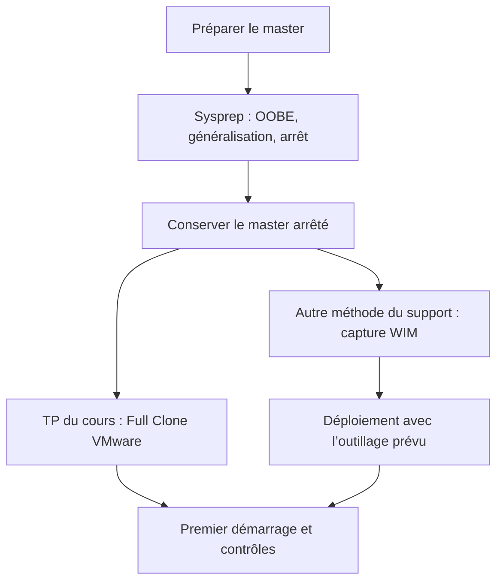

# Tutoriel — Capturer et déployer une image Windows

## Choisir la méthode présentée dans le cours

Le module 12 présente l’industrialisation d’un poste : préparer un **master**, généraliser Windows, puis reproduire cet état. Son TP met en œuvre un **Full Clone VMware**. Les images WIM, WinPE, DISM et WDS sont des notions du support, mais leur procédure détaillée n’est pas fournie dans ce TP.



## 1. Préparer le master du laboratoire

1. Revenir à l’état prévu par le scénario ; noter son nom et son instantané.
2. Ouvrir la session administrative demandée.
3. Effectuer le nettoyage des comptes et profils prévu dans l’énoncé et la correction, sans l’étendre à une autre machine.
4. Relever les disques, volumes, ressources, réseau, comptes et pilotes qui serviront à la comparaison finale.

La suppression de profils utilisée dans le TP est une préparation du master de laboratoire, pas une opération à reproduire sur un poste personnel.

## 2. Généraliser Windows et arrêter

Dans le répertoire `C:\Windows\System32\Sysprep`, lancer Sysprep avec les options du support : OOBE, Généraliser et Arrêter. L’équivalent en ligne de commande est :

```cmd
C:\Windows\System32\Sysprep\sysprep.exe /oobe /generalize /shutdown
```

Si l’opération échoue, examiner les journaux du sous-répertoire `Panther` avant une nouvelle tentative. Après réussite, **ne pas redémarrer le master avant capture ou clonage**.

## 3. Réaliser le Full Clone du TP

1. Utiliser VMware Workstation pour créer le clone demandé à partir de l’état préparé.
2. Choisir **Full Clone**, selon le déroulé exact du TP.
3. Conserver le nom `Win10-XX-Clone` et les autres repères du scénario.
4. Démarrer le clone et réaliser sa configuration initiale.

Le clone démarre pour créer son identité et ses paramètres. Ne pas confondre cette étape avec le redémarrage du master avant clonage.

## 4. Comparer puis valider

| Contrôle | Question à résoudre |
|---|---|
| Identité | Le clone possède-t-il son propre nom de machine ? |
| Ressources | Disques, volumes et mémoire correspondent-ils à l’état cloné ? |
| Réseau | Quels paramètres sont conservés ou recréés ? L’adresse est-elle fixe ou fournie par DHCP ? |
| Comptes et profils | Quels comptes et profils sont réellement présents après OOBE ? |
| Pilotes | Le pilote étudié dans le scénario est-il toujours installé ? |
| Récupération et pare-feu | Que sont devenus protection du système, points de restauration et règle ICMP ? |

Les nombres et valeurs du corrigé décrivent son laboratoire. Noter les résultats de la VM utilisée et expliquer les différences au lieu de les remplacer par les valeurs de la capture.

## 5. Situer la capture d’image

| Outil du support | Rôle |
|---|---|
| WinPE | Environnement léger de préparation et de déploiement. |
| DISM | Maintenance d’images ; capture et application d’une image selon le scénario. |
| WIM | Format d’image Windows. |
| WDS / PXE | Déploiement réseau et amorçage d’un environnement adapté. |

Ces notions ne constituent pas une procédure WIM complète. Utiliser un atelier dédié lorsqu’une capture ou un déploiement manuel est demandé.

- [Cours original et cours optimisé M12](../modules/02-systemes-clients-microsoft/module-12-introduction-a-la-capture-et-au-deploiement-d-image.md)
- [Énoncé du TP](../tp/systemes-clients/module-12/enonces.md)
- [Correction du TP](../tp/systemes-clients/module-12/corrections.md)
